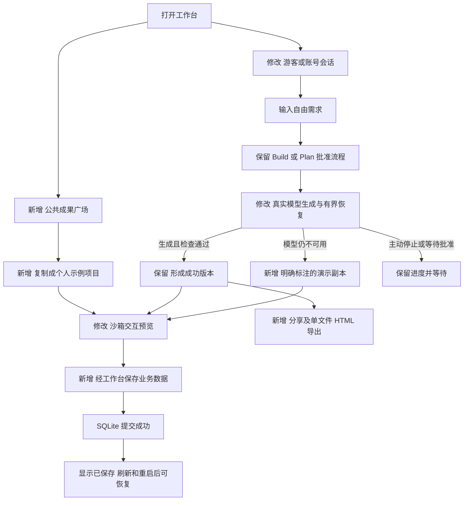
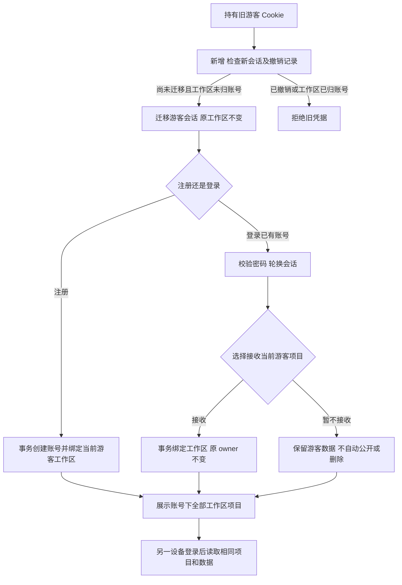
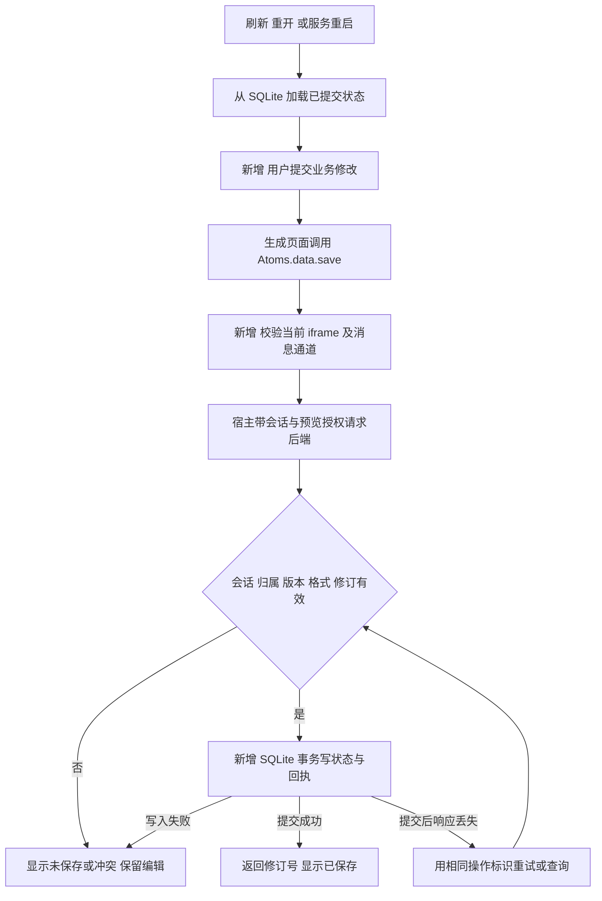
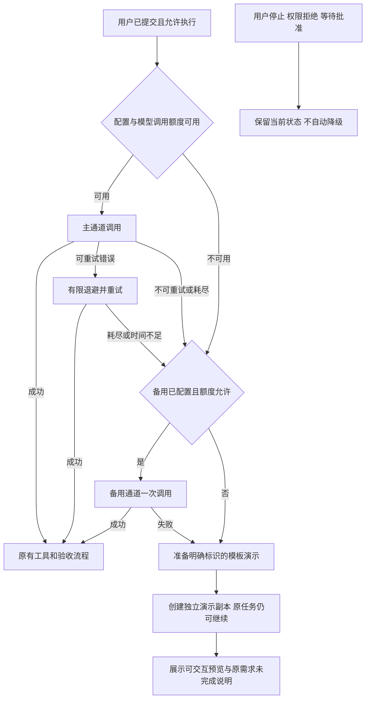
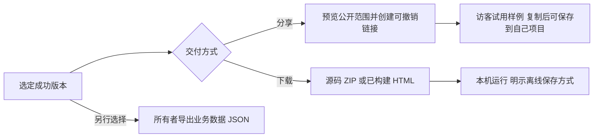

# 验收缺口补齐技术方案

日期：2026-11-13。状态：待用户确认；本文和配套图均为拟实现方案，业务代码尚未修改。

对应[已确认范围的需求](acceptance-completion-requirements.md)。建议沿用现有 Go、React、SQLite 和 gVisor 执行器，补账号、模板目录和受控的数据读写能力。先打通“无 Key 也能试用、已保存数据重启仍在”，再完成分享导出及全部验收。

## 1 当前实现与变更位置

| 位置 | 已有行为 | 本次变化 |
| --- | --- | --- |
| `internal/httpapi/server.go` | Cookie 对应一个游客工作区；预览禁止直接联网与同源权限 | 增加账号会话、示例/分享入口、应用数据接口；保留预览隔离 |
| `internal/store/store.go` | SQLite 事务保存项目、文件、检查点及配额 | 新表保存账号、业务数据和写入回执；项目原 owner 标识保持稳定 |
| `internal/agent/engine.go`、`internal/model/client.go` | 部分 TPM 重试；其他错误结束运行；提示词要求页面只用内存 | 统一故障分类与有限恢复；新增明确的演示结果；改用受控保存 API |
| `web/src/App.tsx` | 示例填入提示词，项目预览与历史切换 | 增加成果广场、账号入口、数据保存状态、预览通信和安全分享 |
| `runner/browser.cjs`、`internal/agent/tools.go` | 交互检查无刷新动作，也无应用数据宿主 | 增加测试数据宿主、刷新操作和保存断言；真实持久化另做后端重启验证 |
| `deploy/backup.py`、发布流程 | 同库一致性备份，独立发布目录 | 迁移前后核对新增实体和认证边界，回滚不能恢复旧游客鉴权漏洞 |

## 2 总体流程

图中“新增”和“修改”表示相对当前版本的变化。

交互总览图在本文配套 `.archify` 目录生成；各分支细节以下文为准。图的校验结果只证明图可读和结构有效，不代表产品功能已通过验收。

## 3 新增实体及用途

下表给出拟用名称。实现时可按职责拆文件，不预先创建空接口或通用插件框架。

| 实体 | 定义与主要信息 | 例子与用途 |
| --- | --- | --- |
| 账号 `User` | 唯一用户名、密码摘要、创建时间 | `reader_01` 在两台电脑登录同一账号 |
| 会话 `Session` | 随机凭据的摘要、游客工作区或账号、过期/撤销时间 | 手机会话注销后无权再读项目；旧游客凭据迁移留撤销记录 |
| 工作区绑定 `WorkspaceAccount` | 一个工作区只能归一个账号；一个账号可以接收多个工作区 | 原游客工作区 `w1` 绑定账号，原项目 owner 仍为 `w1` |
| 认证限流记录 `AuthAttempt` | 用户名/IP 摘要、时间窗、失败次数 | 连续错误密码触发暂缓；进程重启不清空窗口 |
| 模板包 `TemplateBundle` | 随版本发布的源码、构建 HTML、初始数据、功能说明、检查记录及哈希 | `reading-list@1` 用于首页体验和降级；不是用户数据表 |
| 结果来源 `DeliveryOrigin` | 成功版本或演示成果上的来源与范围元数据 | `model`、`preset`、`fallback`，避免混淆真实生成与模板 |
| 应用约定 `AppContract` | 受支持的数据 API 版本、数据格式版本、初始状态 | `schema_version=1` 的待办应用，供生成器、执行器及预览共同检查 |
| 应用数据 `AppState` | 项目所属工作区、项目、格式版本、递增修订号、JSON、更新时间 | `{"todos":[{"id":"t1","text":"买咖啡","done":true}]}`；数据不塞进代码版本 |
| 保存回执 `AppWriteReceipt` | 操作标识、请求内容摘要、提交修订号、时间 | 响应丢失后重发 `save-123`，返回原回执而不重复写入 |
| 预览授权 `PreviewGrant` | 绑定会话、项目、成功版本、读写模式和有效期的短期授权 | 当前已交付版本可读写本项目；历史预览无正式数据写权限 |
| 分享 `Share` | 随机令牌摘要、固定版本、创建/撤销时间 | `/s/随机值` 仅访问指定交付版本，不能读取整个项目 |

新数据库表采用显式列名和事务迁移；原有表、项目 JSON、文件哈希和调用账本不批量重写。模板包和 AppContract 是文件/元数据，不为它们另建独立服务。

## 4 账号和旧游客数据

首版选择用户名和密码注册，不依赖邮件或短信。用户名规范化后唯一，密码不裁剪；建议最少 12 个字符、最多 128 个字符，并限制请求字节数。密码使用 Argon2id 和独立随机盐，参数与摘要一起存储。初始参数采用 19 MiB 内存、2 次迭代、1 路并行，哈希计算限制同时 1 个，在现有服务内存上限内实测后调整。[OWASP 密码存储建议](https://cheatsheetseries.owasp.org/cheatsheets/Password_Storage_Cheat_Sheet.html)与 [Go Argon2 包](https://pkg.go.dev/golang.org/x/crypto/argon2)支持该选型。

会话用高强度随机不透明凭据，数据库仅存摘要，Cookie 保留 HttpOnly、Secure、SameSite 及 `__Host-` 约束。登录/注册轮换凭据，退出服务端撤销；账号会话建议闲置 7 天、最长 30 天，游客维持现有使用习惯并提示账号恢复方式。保留 Origin/CSRF 校验；登录错误统一为用户名或密码错误。新增按 IP 和用户名组合的有限窗口，哈希前限流；可信代理来源配置固定，不能信任任意客户端的转发头。[会话轮换与撤销依据](https://cheatsheetseries.owasp.org/cheatsheets/Session_Management_Cheat_Sheet.html)。

注册页面明确说明将接收哪些游客项目；登录已有账号时只有用户选择接收才绑定。原 owner 不变，避免移动 blob、任务或正在运行的作业。接收必须同时校验当前有效游客会话和已验证账号，事务确保同一工作区只能被接收一次；并发注册/接收不能重复归属。

账号会话与尚未接收的游客会话使用分别命名的 HttpOnly Cookie。选择暂不接收时保留本机游客凭据，退出账号后可返回该游客工作区；接收成功才撤销对应游客会话。登录状态优先使用账号授权，不能由请求参数切回任意游客身份。

普通项目接口先确认当前会话可访问该项目所属工作区，再调用现有 Store；不能直接信任浏览器提交的 owner。项目列表聚合账号已绑定工作区。模型配额按账号所有已绑定工作区汇总，保留原账本；登录、注册或接收工作区不赠送新额度，实际模型发送继续计入全站账本。后台运行继续用稳定工作区 ID。

同一账号的活动任务数和新建项目数也按已绑定工作区合并判断，不能靠接收多个工作区绕过限制。接收后超出现有新建上限的历史项目仍全部保留可读，只阻止继续新建，不通过删除项目解决。

旧 Cookie 仅能一次迁移尚未归属账号的工作区。撤销记录命中时不能再回退到旧 `workspaces.token_hash` 验证。账号退出或切换后关闭旧事件流与预览通信，长连接在推送前复核会话有效性；不停止已经合法启动的后台生成。

## 5 应用数据保存

### 5.1 数据边界

首版以项目为一个应用的数据边界；同一项目多个页面共享一份 JSON 状态。不同应用用不同项目。`AppState` 与项目代码/检查点分表，写业务数据不重写整个项目 JSON，也不触发 Agent 上下文或代码版本失效。初始上限建议单应用 256 KiB JSON，单账号业务数据总量 8 MiB，写入按应用限制频率，超限明确返回错误；额度是方案默认值，实施需结合实测核对。

初始状态只在数据行不存在时事务插入一次，不能在刷新或服务启动时用默认值覆盖已有行。原子提交依靠当前 SQLite WAL 和 `synchronous=FULL` 设置以及持久化数据目录，不采用进程退出时统一写盘。

采用“读出修订号，保存时检查修订号”的方式防止覆盖。例如页面 A、B 都读到修订 7，A 保存为 8 后，B 带 7 的请求返回 409；保留 B 未提交的编辑，让用户加载最新内容再处理，不自动覆盖或自动合并。

同一保存使用固定 `request_id`，在同一事务写入状态和回执。相同标识相同内容返回原结果，相同标识不同内容拒绝。回执按项目保留最近 1000 条且最多 7 天；过期重试仍受旧修订号限制，不能重新应用为新操作。回执返回的是该操作的提交结果，不冒充数据库当前最新版本。

### 5.2 沙箱通过工作台读写

提供固定小接口 `Atoms.data.load()` 和 `Atoms.data.save(value, {expectedRevision, requestId})`；应用启动先加载数据，提交动作等待 save 成功，临时 UI 状态继续留在页面内存。SDK 是项目内受保护的运行时文件，不能被模型覆盖，随源码和构建 HTML 一起交付。

预览仍不增加 `allow-same-origin`，不开放任意网络请求。iframe 经专用消息通道请求宿主工作台，宿主带自己的会话和 CSRF 向后端请求。SDK 不提供任意 URL、SQL、项目 ID 或 owner 参数。

消息握手验证 `event.source` 是当前 iframe，验证预期空来源及握手随机值，再建立仅属于当前预览的 MessageChannel。宿主向无同源权限 iframe 的握手只能定向投递给该窗口；不得通过全局广播发送业务数据或凭据。iframe 向宿主使用明确的工作台 origin。后续消息检查协议版本、操作类型、大小及请求标识。刷新、导航、卸载、切换账号/项目时销毁旧通道、取消待处理响应。`origin="null"` 不是身份凭证。[postMessage 的来源校验说明](https://developer.mozilla.org/en-US/docs/Web/API/Window/postMessage)。

宿主取得的短期 PreviewGrant 保存在宿主内存中，不写入 iframe、模型上下文、导出或 URL。每次读写在服务端重新校验会话、项目归属、授权模式和当前成功版本；最终写事务内再次检查版本绑定与数据修订。旧页面即使晚到也不能改写新版本的数据。纯 UI 忽略旧响应不能代替服务端校验。

### 5.3 正式数据、试用数据和版本

| 打开方式 | 数据来源 | 写入效果 |
| --- | --- | --- |
| 当前成功交付版本 | 本项目正式 AppState | 授权有效时持久保存 |
| 草稿或历史版本预览 | 明确标识的测试副本/初始样例 | 不改正式数据；修改仅供本次预览试用 |
| 公共示例或分享预览 | 模板初始数据 | 不改所有者；保存前复制到自己的项目 |
| 自动浏览器检查 | 每次测试独立的初始数据 | 不连接生产业务表；报告标明测试范围 |

工作台默认展示最后可用的交付版本，保留“查看草稿”入口。恢复历史代码时不回滚 AppState；恢复后的版本必须声明兼容当前 `schema_version` 才能重新获得写权限。不同格式版本明确提示不兼容，保留数据及 JSON 导出入口。本期不让模型自动迁移或清空正式数据；普通增加可选字段需保持兼容和已有内容。

旧应用适配要保留原版本，再加入 SDK、加载/保存及错误处理，重新做交互测试。不自动导入已经丢失的浏览器内存状态；仍在旧页面中的内容，用户应先手动导出或保存再刷新。

## 6 示例和故障兜底

### 6.1 共用模板包

随发布内置 3 个完整模板，预留扩展到 5 个：任务看板、阅读清单、带方案保存的计算器。每个模板均有自包含源码、构建 HTML、初始 JSON、功能清单、AppContract 和桌面/手机检查记录。资源不依赖外部 CDN。模板生成新副本时使用唯一请求标识，同一次点击重试不能复制多个项目。

公共广场只读取公共模板目录。点击试用后复制到访客或账号工作区，事务写入文件、模板来源和初始数据。模板升级只影响以后创建的副本，不覆盖用户已有项目。

模板的预览构建可以直接使用发布前验证的固定产物，因此无 Key、额度耗尽或模型网关断开时仍能显示。复制记录标明“复用模板发布验证”和原构建哈希，不能伪造本次模型生成、实时执行器测试或原用户需求验收通过。

### 6.2 模型恢复顺序

1. 调用前识别空配置和额度不足，直接进入可用的后续路径。主 Key 无效可切已配置备用；全站/账号额度耗尽不得借备用绕过，直接模板。
2. 对普通 429、连接错误和选定的 502/503/504 做最多 3 次退避重试，建议间隔 1、2、4 秒加少量抖动；Retry-After 在剩余时间内优先遵守。401/403、确定的参数错误及预算耗尽不原样重试。保留现有 TPM 等待信息，但归入同一恢复预算，不能嵌套放大重试次数。
3. 保留当前长模型调用的超时配置，不统一压缩成短请求。调用、等待和备用共享本轮剩余时间，并给模板落盘留出余量，不能每次重试重新获得整轮时间；等待期间展示实际阶段和停止入口。演练用独立实例设置短超时，不能据此改生产配置或声称取消即停止计费。
4. 备用通道仅允许一份显式配置，同一逻辑模型动作最多切换一次。主备必须支持兼容工具协议；记录实际路由与配置修订。格式错误仍使用既有格式反馈预算，确定的工具执行失败走原修复流程，不统统当成网关故障。
5. 每次实际发送分别预留额度和记录用量；备用也消耗同一账号/全站额度。超时或取消没有回执的调用保持用量未知，不能记成免费。晚到回复仍受当前运行 epoch 和指令版本限制。
6. 原任务仍保留真实失败状态；增加关联演示成果的 `demo_ready` 展示结果，与原需求 `completed` 分开。模板始终创建独立项目，包括原项目尚无文件的情况；关联原运行标识以去重。UI 显示“演示应用已就绪，原需求尚未完成”，提供重试原任务和使用演示入口。Plan 未批准时只显示已有公共示例链接，不创建被禁止的实现产物。

模板选择只覆盖公开声明的类别；自由描述无法可靠匹配时使用通用任务工具并明确说明，不伪装定制。真实模型恢复后仍可继续原需求。新一次重试保持绑定旧演示副本或显式新建，避免无限堆积项目。

## 7 分享和导出

分享只绑定固定成功版本和示例初始状态。所有者创建前看到将公开的页面；不自动分享对话、草稿、私有业务数据或全部文件接口。令牌高强度随机、服务端存摘要，可撤销；公共接口限流并只允许取白名单资源。撤销意味着后续读取失效，不能撤回访客已经下载的内容。

单文件 HTML 导出使用已通过构建的 HTML，把脚本、样式和支持资源内联，带同版 SDK。在线模式经宿主保存到服务器；独立打开时 SDK 使用明确标识的本机模式，始终提供 JSON 导入/导出。浏览器允许时可缓存到本机，但禁止把 `file://` 下的 localStorage 当作可靠跨浏览器保证，其行为未被统一规定。[MDN 说明](https://developer.mozilla.org/en-US/docs/Web/API/Window/localStorage)。无法自动保存时必须提示并保留手动导出入口，不能显示服务端“已保存”。

源码 ZIP 增加运行说明、API 约定和已构建 HTML。默认只附初始样例数据；所有者另外点击导出业务数据才读取 AppState。导入 JSON 要验证格式版本、大小和修订，并展示替换提示、保留导入前数据备份；生成代码没有任意批量清空其他应用的能力。

## 8 接口与代码职责

| 位置 | 拟增加职责 |
| --- | --- |
| `internal/auth`、`internal/httpapi/auth.go` | 密码、会话、账号工作区归属、限流；与 Agent 调度分开 |
| `internal/store/auth.go`、`app_state.go`、`migrations.go` | 原子迁移、归属绑定、状态写入和去重；事务内不发模型请求 |
| `internal/httpapi/app_data.go`、`share.go`、`catalog.go` | 数据授权、只读公共展示和模板复制；统一复用权限与错误处理 |
| `internal/templates`、受保护的前端运行时资源 | 3～5 个模板和共用 SDK，避免模型生成各自的存储协议 |
| `internal/model`、`internal/agent` | 结构化错误、一次有界恢复策略、真实来源及演示结果；不新增并行调度框架 |
| `web/src` 拆出的账号、广场和预览组件 | 显示状态、消息通道、冲突处理；不继续把全部新增逻辑塞进 App.tsx |
| `runner/browser.cjs` 及共享契约 | 测试用宿主、刷新/保存等待动作、隔离状态；同一 SDK 在测试和正式预览运行 |

主要路由拟为 `/api/auth/register|login|logout|me`、`/api/catalog`、`/api/catalog/{id}/copy`、`/api/projects/{id}/preview-grants`、`/api/projects/{id}/app-state`、`/api/projects/{id}/shares` 和 `/s/{token}`。保存使用 revision、request_id、schema_version；具体 JSON 类型随实现定义，生成应用只面对 SDK。

## 9 验证与发布

| 层次 | 验证内容 | 不能据此声称 |
| --- | --- | --- |
| Go 存储/接口测试 | 会话轮换撤销、迁移归属、跨账号拒绝、事务提交、去重、修订冲突、过期预览、格式不兼容 | 真实手机和真实模型已通过 |
| 执行器浏览器测试 | 每个模板及生成样例的新增、修改、刷新；1440/390 视口；固定 SDK 与数据宿主一致 | 生产数据库重启不丢数据 |
| 真后端浏览器测试 | 对独立 SQLite 保存后，关闭浏览器、kill/restart 后端、重新登录恢复；覆盖提交后丢响应及跨设备会话 | 磁盘损坏和整机丢失恢复已覆盖 |
| 故障矩阵 | 空 Key、401、429、TPM、503、断网、预算耗尽、主备都失败、晚到回复与停止 | 超时上游没有计费 |
| 真实模型样例 | 从零生成一个持久化应用并做局部迭代，断言符合用户需求；已有应用适配一例 | 广泛模型成功率或容量已评测 |
| 交付与发布 | HTML 离线打开、分享撤销、README 新环境复现、国内手机流量；一致性备份和回滚演练 | 未实际执行的验收项通过 |

普通 `test_preview` 增加刷新和等待保存动作，复用与线上相同 SDK，在独立浏览器宿主内运行；报告写明数据模式、SDK 版本、输入/构建哈希和所覆盖条件。需要服务重启或跨设备的条件必须有独立真实后端证据，验收汇总不得把模拟宿主的成功当成这些条件的通过。

迁移先在生产一致性备份的隔离副本上验证。正式切换前确认活动任务状态、备份、核对模型账本和所有既有项目引用，再按现有独立发布流程实施。SQLite 备份继续用在线备份接口，覆盖新增账号和业务表；不是直接复制正在使用的 `.db` 文件。[SQLite 备份说明](https://www.sqlite.org/backup.html)。

账号上线后不能直接切回只认旧游客 Cookie 的老程序：它可能忽略撤销记录。上线前准备保留新鉴权边界的兼容回滚版本；仅关闭新 UI 或模板功能仍保留账号鉴权和数据表。若没有安全兼容版本，进入维护模式保留数据，不对公网恢复旧认证代码。恢复旧数据库只能在明确核对增量数据后执行，不能丢弃发布后的用户写入。

## 10 实施顺序与本轮交付

1. 账号、会话和旧工作区绑定，验证旧数据与额度保留。
2. AppState、回执和预览通信，先用确定性待办样例证明重启恢复与隔离。
3. 3 个持久化模板及首页体验，形成不依赖模型的可用入口。
4. 统一模型故障恢复和演示来源，保护原项目及已有数据。
5. 分享、HTML/数据导出和既有应用适配，再补 README、AI 使用与验收手册。
6. 完成全部匹配测试和真实样例后交人工验收，再按已确认发布范围执行部署。

每项独立代码改动验证后分别提交 commit。清理本次替代的旧逻辑：只用旧 Cookie 的鉴权回退、重复恢复循环、强制所有业务状态进内存的提示，以及没有用途的兼容分支；只有确认新旧数据与调用场景已覆盖后才删除。

本轮只交付需求、方案及流程图。关键拟定取舍是：用户名密码账号、复用 SQLite、每项目一份受限 JSON、正式数据与试用数据隔离、模板明确标识未完成原需求、离线 HTML 不承诺服务端同步。技术方案需按用户提供的 AGENTS.md 第 2 步确认后开始编码。
