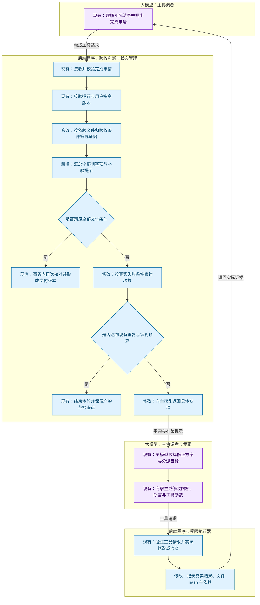
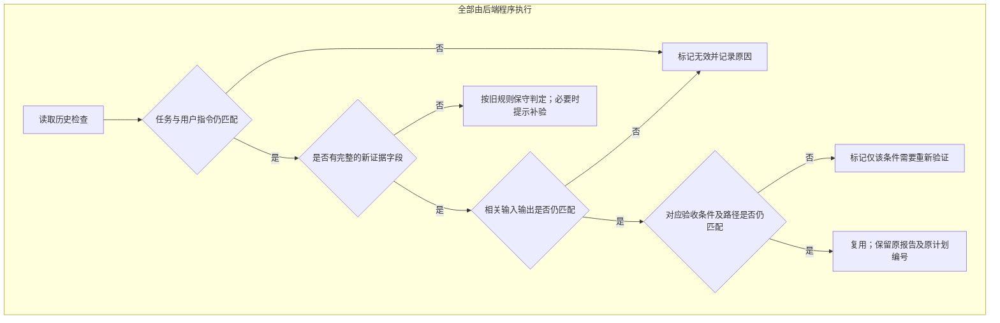

# 产物验收循环修复技术方案

日期：2026-11-13。状态：需求与技术方案已于 2026-11-13 经用户确认；实现、验证和生产发布已完成，见[验证记录](acceptance-loop-repair-validation.md)。

对应需求：[产物验收循环修复需求](acceptance-loop-repair-requirements.md)。

[查看交互流程图](../.archify/workflow-acceptance-repair-20261113-130821/acceptance-repair.html) · [流程图自动检查回执](../.archify/workflow-acceptance-repair-20261113-130821/ownership-review/acceptance-repair.finalize-summary.json)。图中的源码链接标注现有职责或拟改造入口，新增行为以本方案为准。

## 1. 实现方向与依据

本次把“缺什么证据”“证据是否仍有效”“是否在重复失败”统一建立在同一份验收结果上。主循环仍然负责调度，具体判断放在验收与工具适配层。

源码核对基线：`08121ebcce78601a00b6388ea3d53dc2e00ae932`，分支 `codex/task-progress-repair`。方案编写时业务源码工作区干净，新增的是本轮需求和方案文档。诊断使用此前保存的生产只读快照，没有再次执行线上任务。

| 当前实现 | 本次修改 |
| --- | --- |
| `completionCheck` 遇到第一个问题立即返回，网页运行与浏览器测试共用错误文案 | 一次收集全部可确定的缺项，分别说明检查类型、目标、失效原因和补验方式 |
| `reportCurrent` 整份报告匹配任务、指令、计划编号及输入输出 | 保留任务和指令边界；新证据按相关文件与验收条件判断，计划编号仅用于追溯 |
| 执行器报告的输入固定为 `p.Files` 全量快照 | 保留执行快照用于安全提交；另外记录经过可靠识别的验收依赖 |
| `failureFingerprint` 包含全部参数和错误文本 | 工具适配层提供影响执行结果的参数及状态，说明文案不参与验收失败计数 |

改造入口：`internal/agent/artifacts.go`、`acceptance.go`、`runner.go`、`tool_protocol.go`、`policy.go`、`feedback.go`；执行器的依赖采集位于 `runner/job.cjs`。`engine.go` 只接收统一事实和反馈，不增加按网页、PPTX 或具体文件名分支的逻辑。

## 2. 数据定义

继续使用现有 `Task`、`Report`、`Check`、`ActionFact` 和 `ExecutionObservation`，不新增数据库表。以下类型或字段名称为方案命名，编码时可按现有结构调整。

| 实体 | 定义与保存方式 | 例子与用途 |
| --- | --- | --- |
| 验收诊断 `AcceptanceAssessment` | 对当前任务和文件计算出的结果，包含是否可交付、有效证据和阻塞项；工具反馈随现有步骤记录保存 | `ready=false`，缺网页运行和 PRD 静态检查。统一供完成判定、模型提示和重复失败判断使用 |
| 阻塞项 `AcceptanceIssue` | 一项具体未满足的要求；包含稳定错误类别、目标路径、验收条件、现状、原因和补验提示 | `runtime_missing`，入口 `index.html`，类型 `web`；浏览器测试已通过，建议补 `run_project kind=web`。避免让模型猜缺项 |
| 检查证据单元 `CheckEvidence` | 一组可以独立判断有效性的检查；关联原报告，记录检查种类、目标、输入输出 hash、依赖精度、对应条件和实际结果 | 一次网页交互检查依赖 `index.html/app.js/style.css`；PPTX 内容检查依赖该 PPTX。使无关文件变化不影响这组检查 |
| 验收条件标识 `CriterionKey` | 服务端根据验收条件原文、排序去重后的目标路径及相关的必用输入约定计算出的标识，附在相关证据上；不由模型任意填写 | “网页可翻页”及三份网页文件对应一个标识。计划编号和说明变化不改变它，新增必用数据源、目标路径或修改条件会改变它 |
| 重试依据 `RetryBasis` | 工具适配层生成的稳定执行条件，写入现有动作事实，增加规则版本以区分旧数据 | 普通交付模式、相关文件版本、排序后的缺项及实际检查状态。两次只换总结文字的提交得到相同依据 |

“依赖精度”有两种：`exact` 表示程序能证明依赖清单完整；`snapshot` 表示无法证明完整，使用全输入快照并附原因。执行快照和验收依赖分别保存，不能用较小的验收依赖替换执行安全校验。

## 3. 调整后的流程

图中按执行主体划分区域，并用“新增”“修改”标出变化；图及源码链接保留已确认的设计版本，当前实现和生产发布情况见验证记录。交互图的每个节点也标注了执行主体。

| 执行主体 | 负责什么 | 不由它决定的事项 |
| --- | --- | --- |
| 大模型：主协调者与专家 | 理解需求和反馈，选择修正方案，提出分派；生成文件修改、测试步骤、断言期望值和工具参数；提出完成申请 | 不能仅凭自己的总结把检查或任务登记为通过 |
| 后端程序 | 校验权限和运行版本；计算 hash，核对依赖和验收证据，生成缺项反馈，累计重复失败；调度工具，保存状态并执行交付门槛 | 不替模型凭空生成用户要求，也不因模型声称成功而写入成功记录 |
| 受限执行器，属于程序侧 | 实际构建和执行脚本、操作浏览器、收集输出及执行事实；静态内容断言由 Go 后端执行 | 不自行规划任务，也不自行决定整个任务是否完成 |

“大模型调用工具”在这里指模型输出调用名称和参数。后端验证并执行这些请求，真实检查结果再返回给模型。验收条件及测试步骤可由模型根据需求提出，程序负责执行和核对已声明的条件；这仍不能替代未实际覆盖的语义或人工验收。



以下证据有效性判定全部由后端程序完成，不需要大模型决定 hash 是否匹配或报告是否过期。判定需要补验后，才由大模型选择并提出后续工具请求。该判定与“外部作业能否提交结果”分别处理：



## 4. 一次说明全部阻塞项

把当前返回单个 `error` 的完成检查改为无外部副作用的诊断函数：只读取任务、文件和报告，不触发模型或执行器。原 `completionCheck` 可作为调用入口，最终通过同一份诊断决定是否交付。

诊断覆盖：文件缺失、静态检查覆盖、实际运行、浏览器交互、计划验收条件与路径对应关系。发现一个问题后继续检查其他独立项；例如文件缺失使进一步判断无法成立时，记录根因，不重复生成一串相同原因的错误。

证据按具体入口或目标匹配，不能再只维护全项目的 `passed[kind]`。两个网页或两个脚本必须各自有对应证据；同类的另一个文件通过，不能覆盖当前文件的失败。同一组检查以对应版本下最新的完整结果为准，不从历史结果中任意挑选通过项。

每个阻塞项区分：从未执行、实际失败、依赖文件变化、要求变化、任务或指令不匹配、旧证据信息不足。使用原报告 ID 作为追溯链接，但不把 ID 纳入失败次数判定。

示例反馈：

```json
{
  "code": "acceptance_incomplete",
  "ready": false,
  "issues": [
    {
      "code": "runtime_missing",
      "execution": "web",
      "paths": ["index.html"],
      "observed": "对应网页的浏览器交互检查有效；缺少网页运行记录",
      "next": "分派具备执行权限的角色补 run_project(kind=web, entry=index.html)"
    }
  ]
}
```

示例只展示一项，实际返回全部可确定的阻塞项。保留现有 `ok/error` 字段供界面兼容，新增结构化内容供模型处理；界面显示简明原因，完整记录留在原步骤中。当前检查提示、最终交付、重复失败判断使用同一套诊断，避免三处各自判断。

本次继续明确区分网页运行与浏览器交互两类证据。以后若要让一次浏览器测试同时满足两类要求，应另行明确覆盖标准；本次不隐式降低现有验收要求。

## 5. 按实际依赖记录证据

### 5.1 网页运行与浏览器验收

由可信执行器在实际构建路径中收集入口 HTML、引用的 CSS、JS、图片、字体以及脚本构建涉及的项目文件。脚本依赖优先使用构建器的依赖输出，并核对路径属于该次输入快照。模型声明的 `paths` 表示要证明的目标，不代表已经完整列出了执行依赖。

对于本地资源的缺失、新增和解析规则同样记录约束。只记录已读取文件，可能漏掉“新增文件改变模块解析结果”的情况；因此扩展名推断、目录扫描、通配导入等场景，必须包含相应的文件集合条件，无法可靠覆盖时退回 `snapshot`。

新报告保存依赖采集版本。服务端核对入口存在于依赖中，检查清单和执行类别一致，再从原始输入快照取各文件 hash。执行器未返回完整依赖、返回异常路径或当前版本不支持该采集方式时，保守使用全快照并说明原因。

### 5.2 静态检查与产物断言

将静态结果按可独立验证的文件或验收条件分组，记录组内检查实际使用的文件。HTML 引用检查也要包含引用目标或“目标不存在”的条件，不能只依赖 HTML 本身。

同一验收条件下的一组断言必须整体通过，不能从含失败项的同组检查里只取成功项。后续只检查 PPTX 时，只能更新 PPTX 对应的证据，不能顺带把旧报告中的网页或 PRD 标记为通过。

报告的总体失败状态保留。不同组只有在依赖和前置条件确实独立时才能单独复用。例如执行失败、输出回收失败会阻断相关输出证据；不能拿未保存的新输出去证明项目中的旧文件。

### 5.3 Python、JavaScript/TypeScript 脚本与 Go

这些程序可能运行时读取任意项目文件。首版仍使用其可访问的完整输入快照，报告明确标记为 `snapshot`。不能仅根据入口文件或静态 import 推断全部依赖。

全快照比较包含路径集合，新增或删除文件也会被发现；对成功回收的输出使用回收后的实际 hash，避免输出替换自身后让刚完成的报告立即失效。将来若引入严格的输入访问范围，可再缩小这一类依赖，本次不额外实现通用文件访问追踪系统。

### 5.4 保留提交时的安全校验

`RunnerAction.Inputs`、原作业 ID、运行 epoch、用户指令版本、输入快照一致性和输出 `old_hash` 校验继续保留。先证明外部作业结果属于当前有效运行并原子保存，再讨论以后能否复用其验收证据。

## 6. 计划变化与证据复用

`Plan.Revision` 继续保存，用来回答“这份报告产生于哪次计划”。新证据的有效性改为核对正式验收条件，不再单凭计划编号变化否定全部报告。

正式验收约定来自 `Plan.Acceptance` 与 `Delivery` 的目标、输入、保留文件和条件对应关系。新增约束必须写入验收条件；计划正文只作实施说明。条件原文只做换行和首尾空白等确定性规范化，不用模型猜测两句不同要求是否同义。

新增必用输入也是约定变化。若现有结构无法把一个输入准确归属到某条条件，先将它作为交付范围的共同依赖保守处理，不能因条件文字没变就跳过新数据源。

- 仅改计划说明、重新保存、调整路径排列：保留仍匹配的证据。
- 增加一个验收条件：已有相同条件的证据可保留，新增条件必须有对应证据。
- 修改条件内容或其路径集合：该条件的旧证据不能直接复用。
- 添加新交付目标：新增目标必须补齐检查；原目标按自身依赖判断。
- 收到新的用户指令或切换任务：维持现有版本边界，不能借计划复用跨越这些边界。

运行成功等通用事实与“满足某条业务要求”分别判断。曾经运行成功，不会自动证明新增的内容要求。

## 7. 修复重复失败判定

工具注册层提供用于重复判断的参数投影，也就是从参数中选出真正影响执行的部分。普通工具保留现有完整参数规则；完成申请排除 `summary`，保留 `answer_only` 等会改变行为的参数。不能把所有工具的文本字段一律删除，例如文件正文和断言期望值必须保留。

完成申请的失败依据使用：

1. 当前任务与用户指令版本、相关交付约定。
2. 当前相关输入输出版本及依赖精度。
3. 排序、去重后的阻塞项、稳定原因类别和对应检查状态。

原始报告 ID、调用 ID、时间戳、总结文字、错误展示顺序和仅供展示的 `detail` 不计入依据。重复登记相同的检查不会改变状态；无关文件变化也不会改变 `exact` 检查对应的状态。`snapshot` 的全量输入是其真实保守依赖，变化时仍可能需要重新判断。

用同一诊断计算调用前的准入依据和提交时的失败依据。每个当前仍存在的阻塞条件保留自己的计数；补齐一项只解决该项，不清空其他未变化问题的历史。新增无关报告、改变无关检查或重新排列缺项，不能使已有计数归零。

保留现有阈值：相同确定性失败默认 3 次，恢复预算默认 2 次。次数保存在任务观察记录中，普通继续、改派角色和服务重启不清零。达到限制时给出受阻目标、原因和已有证据，结束本轮并保存进度。相关缺项实际补齐后，重新评估新状态，允许必要的完成申请；已经停止的运行仍需通过原有继续流程启动。

旧失败事实和计数保留，不将不同历史条件下的 17 次失败强行合成一项。新判定带规则版本，能根据原记录可靠还原时再归一化；信息不足时保持旧记录，新规则从后续调用开始计数，并继续受全局调用和时间预算限制。

## 8. 兼容与当前任务恢复

- 旧报告没有可靠的依赖范围和条件标识时，保留原判定，不擅自删除输入或改写计划编号来使其通过；必要时做一次有针对性的补验。
- 新应用遇到旧执行器回执时回退到全快照。应用与执行器的新协议采用可选字段，避免升级期间误认依赖完整。
- 原报告、任务、文件和检查点保持可追溯；新增的是证据解释和新检查，不补造历史成功。
- 针对当前任务，先固定已批准的交付范围和已有文件，输出全部实际缺项，再依次补充网页运行、浏览器对应条件和相关静态检查。只有诊断为空才允许形成交付版本。
- 原先“全部检查通过”的模型文字不作验证依据；当前 PPTX 是否能被 PowerPoint 原生正确打开仍需实际验证，不能由本修复顺带宣称通过。

## 9. 实施顺序与验证

| 阶段 | 实现范围 | 必须通过的验证 |
| --- | --- | --- |
| 一 | 验收诊断与细化反馈 | 网页运行和浏览器检查分别缺失；同时缺多项全部返回；失败、过期、未知分别解释；结果顺序确定 |
| 二 | 证据单元、依赖采集、计划条件复用 | 改无关文件不失效；改相关 JS/CSS 失效；缺失文件补入、删除、依赖解析变化可识别；动态脚本保守回退；计划仅改说明保留证据，实际改要求不误通过 |
| 三 | 稳定失败条件与持久计数 | 换总结不重置；换报告 ID 不重置；解决一个缺项不清空其他问题次数；真实补齐后允许交付；普通继续和改派仍保留计数 |
| 四 | 整体回归与交付 | 停止、新指令、未知作业恢复、二进制回收及迟到结果保护继续有效；当前快照诊断可解释所有阻塞；受控补验能收敛到完成或有界停止 |

代码验证包括 Go 全量测试和执行器相关测试。先使用固定工具响应验证调度与重复判定，再使用实际构建器和浏览器验证依赖采集；不能用模拟报告代替真实运行测试。浏览器工具响应的断言目标必须与实际网页及正式验收条件对应。

只读快照用于回归，不直接改写生产库。真实模型与线上完整交付须分别记录实际调用、用量、结果和未覆盖项；没有执行就不能标成通过。已独立验证的代码改动提交对应 commit，最终提供改动摘要、验证记录和已知限制。

用户已确认本方案并继续发布。已按第 9 节完成实施、验证和生产发布；详见[实现与验证记录](acceptance-loop-repair-validation.md)。

方案阶段验证：已核对现有代码入口、报告格式与停止保护；流程图通过结构校验、产物检查和真实浏览器检查。已核看 1440 × 900 浅色截图，分工泳道、节点、缺项分支和结果返回路径均可见；另有 2048 × 1320 与深色截图生成记录，未逐张核看。方案编写时未执行产品修复测试或重跑生产任务；实现后的验证结果见上述记录。
