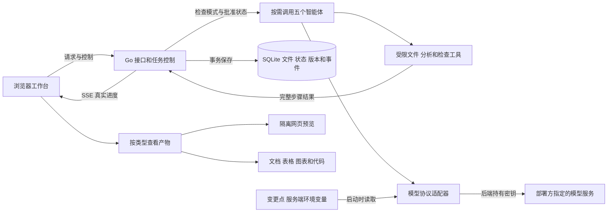
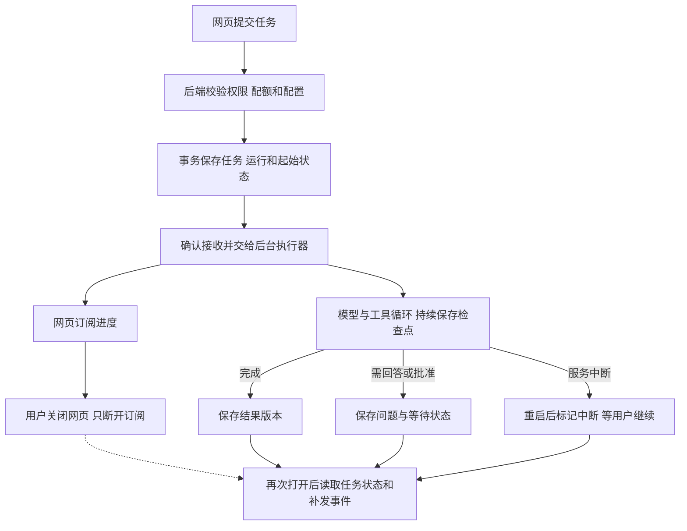
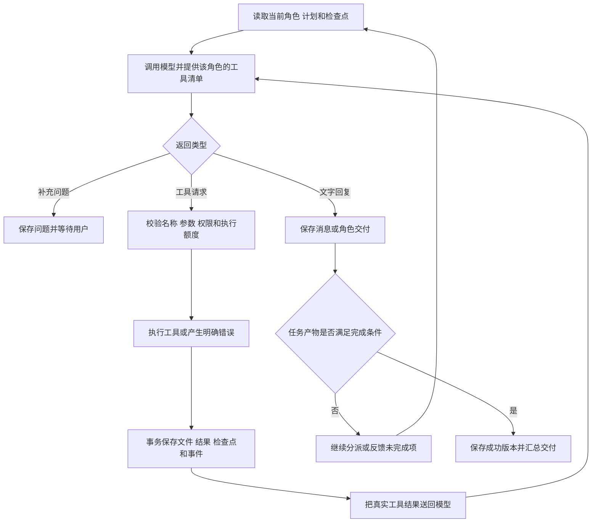
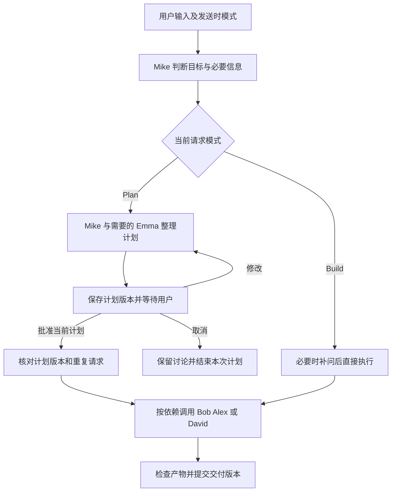
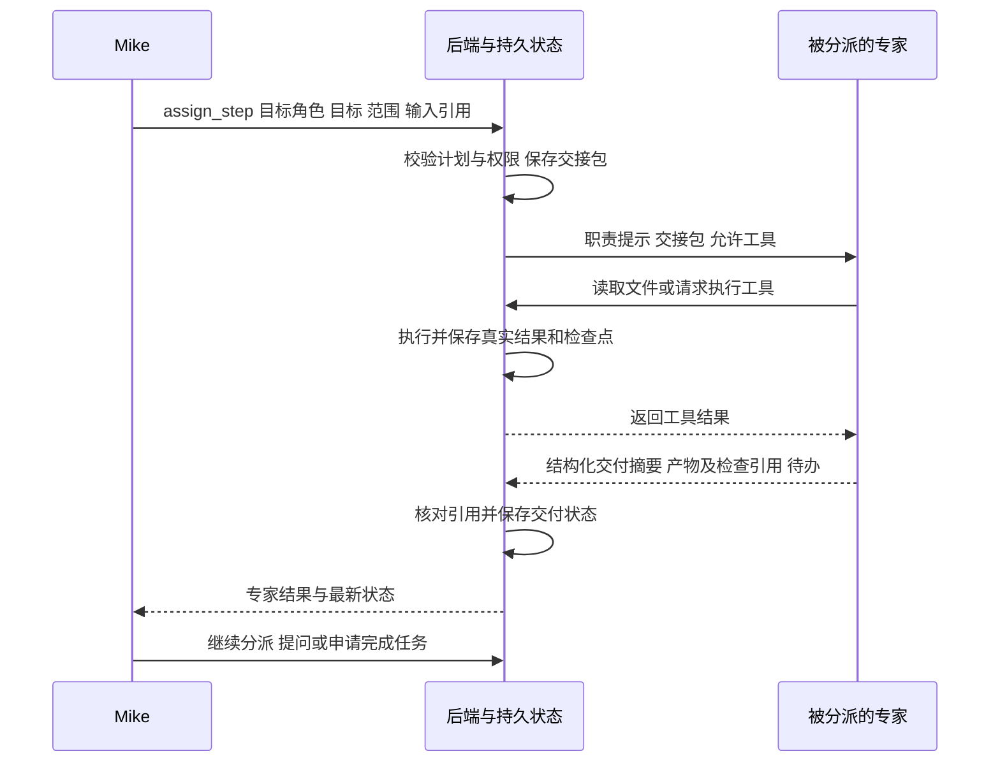
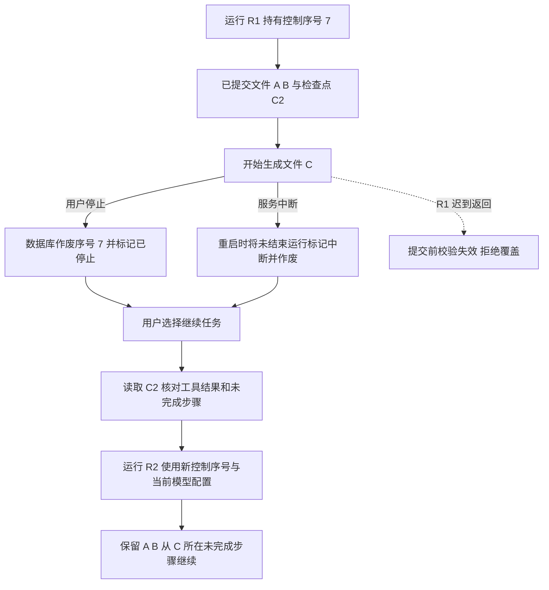
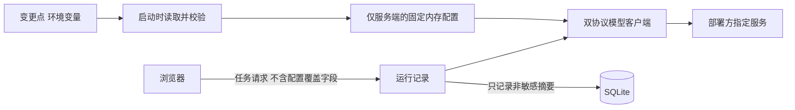
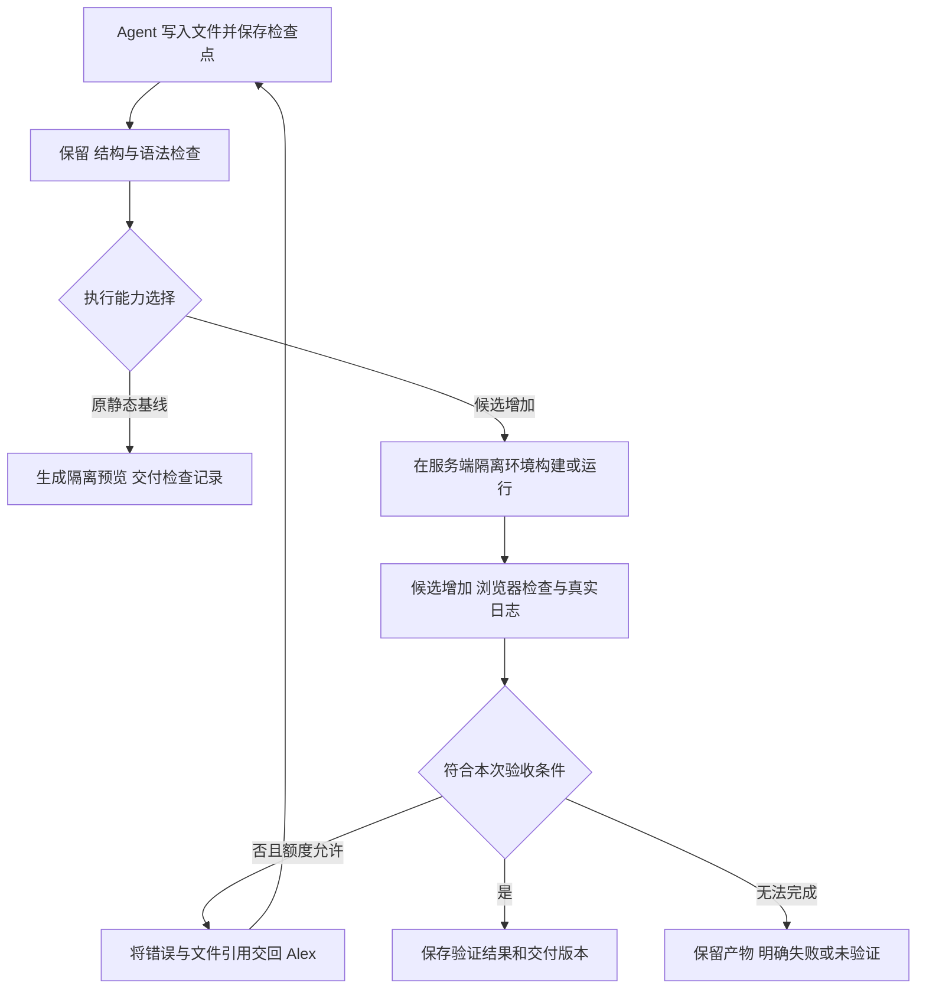

# Atoms Demo 技术方案 v0.3（选型复核稿）

日期：2026-11-11。状态：**待技术方案确认，尚未编码**。

需求基线：[requirements.md v0.4](requirements.md)。v0.2 已改为服务端环境变量接入，并展开后台执行、角色交接和工具清单。本版按用户要求重新比较技术选型：第 1–11 节保留此前可评审的基线，第 12–13 节明确替代方案、条件与调整建议。新增的沙箱执行等选项尚未纳入已确认范围；基线中的具体组件不是最终决定。本方案尚未批准，也未实施。

## 1. 基线方案与关键取舍（待选型复核）

此前基线为 **Go 后端 + React/TypeScript 工作台 + SQLite**。一个 Go 服务同时提供网页、接口和后台任务执行。任务状态保存在数据库中，浏览器断开不影响执行；进程中断后由用户点击继续，从已保存状态恢复。以下实现选择的适用条件与替代项见第 13 节。

五个智能体各有职责和工具权限，由同一个执行框架按需调用。模型负责判断下一步和生成内容；后端负责批准检查、实际工具执行、保存产物、限制执行次数和记录真实结果。

首版明确以下边界：

| 事项 | 实现选择 | 取舍 |
| --- | --- | --- |
| 智能体调度 | 单进程、按依赖顺序执行；每项目一个活动运行 | 能展示真实交接；暂不建设分布式任务系统或并行改同一项目 |
| 保存 | 小型文件内容和元数据一起存 SQLite | 文件、步骤结果和检查点可一次提交，减少文件与数据库不一致 |
| 网页产物 | HTML/CSS/JavaScript 和 JSON，支持项目内文件引用 | 可自由生成交互；暂不动态安装 npm 依赖或启动生成的服务器 |
| 文档产物 | Markdown、纯文本；平台安全渲染 | 支持文档原件下载；原生 DOCX/PPTX/PDF 排版不在本轮 |
| 脚本产物 | 源文件及运行说明 | JavaScript 可做语法检查；其他语言可查看下载，未执行明确标注 |
| 数据产物 | CSV、JSON、分析 Markdown、图表配置 | 由固定计算工具执行统计；不运行模型随意生成的 Python/SQL |
| 模型接入 | Chat Completions 与 Responses 两个适配器 | 支持两种明确协议；不把“OpenAI 兼容”解释为任意供应商、模型都可用 |
| 模型配置 | Go 服务启动时读取环境变量，所有角色与访客共用 | 移除访客设置、密钥入库和配置热更新；调用消耗部署方账户额度 |
| 部署 | 单个容器或 Go 可执行文件，数据放持久目录 | 适合演示规模；不承诺多实例、高可用或跨设备匿名账户恢复 |

“数据分析使用固定计算工具”仍然由智能体自主选择字段、筛选条件和聚合方式，结果来自真实运算。任务不匹配已有工具能力时明确说明限制，不编造计算结果。

## 2. 技术组成和代码边界

| 部分 | 选择 | 职责 |
| --- | --- | --- |
| 前端 | React、TypeScript、Vite；CSS 变量；轻量图表组件 | 首页、对话卡片、文件查看、版本差异、移动布局 |
| 接口 | Go 标准库 `net/http` | 访客会话、输入校验、任务控制、流式进度、下载 |
| 智能体 | Go 中统一的角色执行循环 | 组装上下文、调用模型、处理工具请求、角色交接 |
| 模型通信 | 专用 HTTP 客户端，两种协议适配器 | 指定服务地址、超时、工具调用、用量记录、错误归类 |
| 持久化 | `database/sql` + 纯 Go SQLite 驱动 | 工作区隔离、事务、版本、检查点、事件记录；不保存模型密钥 |
| 网页检查 | esbuild Go API 和 HTML/资源校验 | 在内存中检查 JS/CSS、组合项目文件，不执行生成代码 |
| 浏览器预览 | 带限制的 iframe 内嵌区域 | 执行生成的前端交互；不授予平台 Cookie、密钥或后端权限 |
| 服务配置 | Go 从环境变量读取并校验 | 仅后端模型客户端使用密钥；配置不传给前端或智能体 |

建议目录：

```text
cmd/server/              启动及依赖组装
internal/httpapi/        路由、会话、输入与返回格式
internal/task/           状态转移、批准、停止、继续、执行上限
internal/agent/          五个角色定义与工具调用循环
internal/model/          Chat Completions / Responses 适配器
internal/tools/          文件、分析、检查和图表工具
internal/store/          SQLite 数据访问与事务
internal/artifact/       文件快照、版本、差异和导出
internal/config/         环境变量读取、格式校验、非敏感配置摘要
internal/security/       会话校验、路径检查、日志脱敏
web/src/                React 工作台
migrations/             数据库迁移
docs/                   需求、方案、启动与验收说明
```

按实际替换边界定义少量接口，如模型客户端、工具调用和事务保存；角色定义使用配置与工具权限集合。避免给每个业务对象建立多层通用抽象。前后端依赖版本在编码时锁定并保留锁文件。

当前环境已发现 Go 1.27.1、Node 24.21.0、npm 11.19.0 和 Git；Docker 命令存在，但未验证守护进程或目标服务器。当前仓库无应用代码、提交、远程地址及 Git 提交身份配置。

## 3. 整体架构与用户界面

可浏览的[架构图](../../.archify/architecture-atoms-demo-20261111-173155/atoms-demo.html)支持缩放和查看说明卡。图表示本方案，尚非已实现的系统。环境变量版本的自动检查记录见[检查记录](../../.archify/architecture-atoms-demo-20261111-173155/atoms-demo.review-3/atoms-demo.finalize-summary.json)；图的检查不替代应用功能测试或人工验收。



SSE 是服务端持续向浏览器发送事件的连接，用来显示角色接手、文件保存、检查结果和最终状态。数据库保存事件序号，断线后从上次序号补读；内存通知只是加速，不能作为唯一事件来源。

首页使用浅色画布、侧边项目列表、中央需求输入和 Build/Plan 选择。项目页左侧显示对话和折叠执行步骤，右侧展示产物；顶部显示当前草稿/版本及历史入口。移除原方案的模型设置面板；服务配置不可用时仅展示可理解的状态。窄屏改为“对话 / 产物”切换，避免把双栏硬缩到手机上。

界面必须直接表达：待补充信息、待批准、运行中、已保存草稿、已完成检查、失败/中断、可继续。只有真实步骤写入成功后才显示“已保存”；不展示假百分比或内部推理链。

### 3.1 任务在哪里运行，关闭网页会怎样

线上部署时，任务调度、模型调用、文件写入、数据计算与静态检查均在云服务器的 Go 进程中执行。模型推理由配置的模型服务完成。网页负责提交请求、订阅进度与显示产物；生成网页的 JavaScript 交互运行于浏览器中的隔离预览。

本地开发时同一后端可以在开发电脑上运行，此时关闭后端进程、关机或休眠会影响执行。线上部署后，用户电脑的关闭不影响云端任务。



实现上，HTTP 请求上下文只负责接收请求，不作为后台运行的取消信号。后台运行使用服务级生命周期和自己的超时/停止信号；SSE 连接的建立与断开不启动或取消运行。先保存再确认接收；浏览器未收到确认时，可用提交标识查询是否接收，重发同一标识不能重复运行。

关闭网页后任务可以运行至完成、达到额度/超时、用户显式停止、需要用户输入或服务中断。服务重启不会自动重新发起收费调用。方案采用单进程后台执行器，首版无需引入独立消息队列；这不代表具有机器故障时无缝执行能力。

## 4. 智能体如何实际协作

### 4.1 角色、工具和交付

| 角色 | 实际职责 | 可用专属动作 | 交付示例 |
| --- | --- | --- | --- |
| Mike | 判断任务类型、分派、汇总检查与交付 | `ask_user`、`propose_plan`、`assign_step`、`finish_task` | 澄清卡、计划卡、角色交接、交付摘要 |
| Emma | 产品需求、范围、验收整理 | `ask_user`、`write_document` | `docs/requirements.md`、验收清单 |
| Bob | 模块、接口和数据设计 | `write_document` | `docs/design.md`、接口约定 |
| Alex | 生成和修改程序，针对错误修复 | `write_file`、`replace_text`、`delete_file`；共用检查工具 | 网页、脚本、代码检查结果 |
| David | 明确计算口径、调用分析工具、解释结果 | `analyze_table`、`create_chart`、`write_document` | 汇总 CSV、图表 JSON、分析报告 |

所有角色可读取已授权的项目文件和当前计划。输出路径和大小由服务端检查；`delete_file` 仅在当前草稿移除文件，历史内容保留。分析工具输出带来源文件摘要和计算参数，模型不能伪造工具返回值。文档写入权限不能借文件扩展名绕过代码修改门槛。

协调者请求分派时，后端验证角色、步骤依赖和范围；子角色不能无限委派其他角色。首版限制为 Mike 向专家分派一层，依次执行并回收结果。Build 可跳过不需要的 Emma/Bob；数据分析可直接由 David 实施。普通问答允许直接回答而不生成版本。

### 4.2 工具调用循环

工具调用指模型提出一个有结构的操作请求，例如“把此内容写入 `app.js`”；真正写入由后端校验和执行。[官方工具调用说明](https://developers.openai.com/api/docs/guides/function-calling)



工具参数即使来自支持严格格式的模型也必须由本服务校验。禁止将模型文字中的“已完成”“检查通过”直接映射成成功状态。模型返回不完整参数、超限内容或未知工具时，不执行；允许有限修正，失败则展示原因并保留进度。

### 4.3 Build / Plan 门槛



批准必须关联具体计划版本及内容摘要；用户修改计划使旧批准失效。批准请求有去重标识，同一批准只启动一次执行。Plan 阶段允许生成规划文档，但不能写入目标应用、执行数据计算或通过换路径绕开实施门槛。

### 4.4 角色之间传递什么

交接包是后端为一次角色分派保存的结构化记录，放在 `assign_step` 对应的步骤中，不新增聊天平台或独立数据库表。它的用途是让下一位角色知道目标、已有工作、授权范围和完成标准。各角色有独立的职责提示与消息上下文，共享已授权的项目产物；首版没有任意两位角色自由互发消息的通道，由 Mike 组织交接。

| 交接内容 | 例子 | 用途 |
| --- | --- | --- |
| 身份与起点 | 项目 P1、任务 T1、运行 R2、计划 p3、检查点 C8、目标角色 Alex | 找到正确工作区与当前状态，防止用旧草稿覆盖新进度 |
| 本次目标与完成标准 | 增加菜单分类筛选；“全部”仍显示所有商品 | 约束本次子任务，支持检查是否交付 |
| 已确认范围与限制 | 保留价格与样式；只修改菜单功能；计划 p3 已批准 | 防止角色重新解释或扩大已经确认的范围 |
| 相关用户信息与决策 | 用户最后一次要求“按热饮/冷饮分类”及对应消息引用 | 提供必要背景；摘要同时保留原始来源供核对 |
| 输入产物引用 | `requirements.md`、`design.md`、`menu.js` 的路径和内容摘要 | 按需读取准确版本；大文件不在角色之间反复全文复制 |
| 已完成工作、检查与待办 | 已写分类字段；语法检查通过；交互尚待验收 | 复用进度，定位失败位置；检查记录使用真实工具返回 |
| 期望输出及执行限制 | 修改文件清单、检查结果；可用工具、剩余调用次数 | 限制工具能力与资源使用，由后端执行约束 |

专家完成后返回：`completed / blocked / failed` 状态、工作摘要、文件路径及内容摘要、真实检查记录引用、未完成项和需要用户回答的问题。后端核对这些引用和当前文件状态，再写入步骤结果；角色自报完成不等于任务成功。API Key、宿主环境变量及模型内部推理不放入交接包。单个角色继续工具调用所需的协议项另行保存，不作为其他角色的推理上下文。

例如：Emma 产出“菜单分类、营业时间、验收清单” → Mike 把需求文件和批准范围交给 Bob → Bob 产出文件结构与交互设计 → Mike 将需求、设计、现有文件和验收项交给 Alex → Alex 实际改文件、调用检查并返回结果。只有存在数据分析任务时才分派 David，不固定要求五个角色全部出场。



### 4.5 首版工具清单

以下 **14 个工具**是暴露给模型的操作接口。工具由后端实现，不等于模型能执行任意系统命令。项目、工作区、运行和权限由执行器绑定，模型不能通过自填 ID 访问其他项目。

| 工具 | 功能与输入输出示例 | 可用角色/约束 |
| --- | --- | --- |
| `list_files` | 列出当前检查点或指定授权版本的文件路径、类型、大小、摘要 | 所有角色；仅当前项目 |
| `read_file` | 读取 `src/menu.js` 的全文或指定行，返回内容及摘要 | 所有角色；大小和范围限制，输入原件只读 |
| `search_files` | 在项目文本中按路径和字面文本搜索，返回匹配片段与行号 | 所有角色；有结果上限，不搜索宿主文件系统 |
| `write_file` | 创建/完整替换代码文件，返回路径、新内容摘要和检查点 | Alex；覆盖需提供读到的旧摘要，创建需声明路径不存在 |
| `replace_text` | 在指定文件中精确替换文本，返回变更摘要与检查点 | Alex；核对旧内容摘要和预期匹配次数，不模糊猜测位置 |
| `delete_file` | 从当前草稿清单删除指定文件 | Alex；核对旧摘要，历史版本及原始输入保留 |
| `write_document` | 写入需求、设计或报告等 Markdown/文本文件 | Emma、Bob、David；文档类型、覆盖摘要与阶段权限检查 |
| `ask_user` | 保存一个问题及可选选项，返回问题卡标识并暂停等待 | Mike、Emma；回答到达后继续，不循环等待模型 |
| `propose_plan` | 保存任务步骤、产物和验收条件，返回计划修订标识 | Mike；Plan 下等待用户批准，不能由模型自行批准 |
| `assign_step` | 指定专家、子目标、输入引用与期望输出，由执行器保存交接包并调度 | Mike；一层委派、顺序执行，不能绕过批准和权限 |
| `analyze_table` | 读取 CSV/JSON，按明确字段完成筛选、选列、分组、计数、求和、均值、极值、排序；保存计算结果及来源 | David；确定性计算，不接受任意 Python/SQL/表达式 |
| `create_chart` | 引用真实计算结果生成柱状/折线图配置，返回图表文件及数据引用 | David；不接受 JavaScript 回调，点数有上限 |
| `check_artifacts` | 检查指定产物的入口、引用、语法、文本结构、表格/图表格式，返回逐项通过/失败/未执行 | 所有角色；仅受支持检查，Plan 阶段只检查规划产物；不声称自动验证业务交互 |
| `finish_task` | 提交交付文件、验收结果引用与摘要，申请结束任务 | Mike；后端校验完成条件，满足后才创建版本；普通问答只结束消息 |

新增文件后、关键修改后和结束前，执行器按产物类型触发必需检查，不能依赖模型是否记得调用 `check_artifacts`。输入原件在用户提交时由平台直接保存；工具分析读取原件，不能把模型重写的数字当作用户数据。

检查点持久化、SSE 事件、版本比较/恢复、预览和 ZIP 导出由平台服务提供，不需要模型主动调用“保存记忆”或“导出”才能生效。首版不提供终端/任意代码执行、依赖安装、通用 HTTP 请求、联网搜索、浏览器自动操作或外部部署工具。交付前开发团队会用浏览器验收应用，但这与产品内置 Agent 可调用的工具是两件事。

## 5. 数据实体、定义与示例

以下每项都是本方案需要保存的实体。初期使用 JSON 字段保存小型结构，不为每一种工具参数建独立表。

| 实体/建议表 | 定义与关键内容 | 例子 | 用途 |
| --- | --- | --- | --- |
| 工作区 `workspaces` | 匿名访问主体及会话令牌摘要 | 浏览器访客 W1 | 隔离项目、消息和产物 |
| 项目 `projects` | 标题、归属、当前成功版本、活动运行与控制序号 | P1：咖啡馆项目，当前 v2 | 聚合工作并控制并发 |
| 任务 `tasks` | 一个目标及其计划、当前检查点 | T1：增加菜单筛选 | 多次继续仍属于同一任务 |
| 消息 `messages` | 用户/角色消息、问题卡、卡片状态 | 用户把价格改成 30 元 | 展示对话及必要上下文 |
| 计划 `plans` | 内容、修订号、摘要、批准状态 | plan-3：只改价格，不改布局 | 实施前的范围约束 |
| 运行 `runs` | 一次执行尝试、起始检查点、非敏感模型配置摘要、控制序号、额度、状态 | R2 从 C7 继续 T1，使用部署配置 env-2 | 区分目标与执行次数，追溯使用的协议和模型 |
| 步骤 `steps` | 角色、模型调用/工具动作、输入摘要、交接包、状态、返回与用量 | S8：Alex 按计划 p3 修改 `menu.js` 成功 | 保持真实执行证据、交接、重放与去重 |
| 文件内容 `artifact_blobs` | 不变的文件字节及内容摘要 | SHA256=abc… 的 `menu.js` 内容 | 让草稿与历史复用相同内容 |
| 检查点 `checkpoints` | 文件清单、已完成步骤、待办、角色位置和必要协议上下文 | C8：A/B 已存，C 待完成 | 中断后恢复到完整提交的位置 |
| 交付版本 `versions` | 不变的文件清单、校验摘要、来源任务/运行及版本号 | v3：更新价格 | 预览、差异、恢复和导出 |
| 事件 `events` | 递增序号、项目/运行、事件类型、脱敏内容 | 123：文件已保存 | 流式显示及重连补发 |

文件清单是“相对路径 → 内容摘要、产物类型”的集合，保存在检查点/交付版本中，不额外建立文件系统副本作为真相源。读取和下载必须先验证清单归属，再访问文件内容，不能凭内容摘要跨工作区读取。

协议上下文是继续工具调用所需的消息和调用标识，不含 API Key。Responses 若返回需继续传回的协议项，原样按权限保存和回传，不把这些内容当作可展示的推理。跨角色交接使用范围、产物引用和结果摘要，避免无关长对话进入所有角色。

## 6. 中间产物保存与恢复

### 6.1 一次完整修改如何提交

模型完成一个 `write_file` 请求后，在短事务内：检查运行仍有效 → 保存内容 → 更新草稿清单 → 保存步骤返回 → 创建检查点 → 记录事件 → 提交。提交后再向用户显示“已保存”。网络调用、复杂计算或代码解析都在事务之外完成。

SQLite 使用 WAL（预写日志）模式、外键检查和合理等待超时；持久确认选用 `synchronous=FULL`。写事务短且串行。WAL 不适合网络共享文件系统，首版只部署单机本地数据卷。[SQLite 说明](https://sqlite.org/wal.html)

### 6.2 停止、崩溃和继续



控制序号是每次运行取得的写入资格。停止、恢复版本或创建后继运行后，旧资格失效。所有文件提交和交付版本创建都检查该序号，因此停止与文件写入发生竞争时，以数据库提交先后为准：停止前已提交的内容保留，停止后迟到结果不能写入。

步骤去重使用运行号、工具调用号和输入摘要；如果文件与步骤结果已在同一事务提交，恢复时重用已存返回，不再次修改。尚未返回的模型调用只能重新发起；原调用可能已经产生费用，状态和用量未知时明确记为未知。

恢复时可继续尚未完成的角色步骤；若模型协议状态无法沿用，则以计划、文件清单和待办重新开始该角色的下一次模型调用，不能清空已有文件。服务重启只恢复记录，不自动重新发起收费调用。

“从头重做”保留原尝试和检查点，以任务开始时的基线创建新尝试；界面说明起点。“恢复历史版本”只切换项目工作基线，保留全部历史，且与中断续做分开。存在未结束草稿时需明确选择保留草稿继续还是另起任务，不能混用两个起点。

## 7. 产物执行、展示和检查

| 类型 | 生成与检查 | 查看与下载 | 完成口径 |
| --- | --- | --- | --- |
| 网页 | `index.html` 与相对路径资源；检查入口、引用、HTML 结构及 JS/CSS 语法 | 组装进隔离预览；下载原始文件和运行说明 | 能构建预览；交付记录列出已做检查，不能把语法通过写成所有交互正确 |
| Markdown/文本 | 检查文件存在、正文非空及要求的结构 | 转义/安全渲染，不执行内嵌 HTML；下载原格式 | 结构检查通过，事实准确性范围单独说明 |
| 数据 | CSV/JSON 解析、字段与运算校验、真实统计 | 表格、CSV/JSON 和结果说明 | 与输入数据及计算参数一致，可复算 |
| 图表 | 只接受规定的柱状/折线图 JSON 配置，数据引用实际结果 | 平台组件绘制，下载 JSON/数据；必要时生成 SVG | 图表引用正确数据列，不执行任意表达式 |
| 非网页脚本 | 查看内容；JS 支持语法检查，其他语言说明未执行 | 源码、README、ZIP 下载 | “已生成源文件”，不能声称运行通过 |

网页检查使用 esbuild 的内存转换能力。虚拟文件解析只能访问当前项目清单；禁止回落到宿主文件系统、网络包下载或任意模块目录。首版不用生成项目的 npm 生命周期脚本。[esbuild API](https://esbuild.github.io/api/)

预览通过 `iframe sandbox="allow-scripts"` 加内容安全策略，且不添加 `allow-same-origin`、顶层导航、弹窗或真实表单提交权限。资源在项目内解析后内联/打包；默认禁止外部连接、外部脚本和远程图片请求。文件原件通过鉴权下载接口以附件形式发送，不将未限制的 HTML 直接当平台页面提供。[浏览器沙箱说明](https://developer.mozilla.org/en-US/docs/Web/HTML/Reference/Elements/iframe)

这意味着首版生成网页以本地交互为主，外部接口、登录、第三方支付和浏览器持久存储不作为可用能力。网页可以有输入框、筛选和在页面内处理的表单，但不能因此宣称已接入真实业务后台。运行错误提示只能作为诊断线索，不能信任生成页面自报“所有测试通过”。

数据工具首先支持筛选、选列、分组、计数、求和、均值、最小/最大值和排序。字段不存在或数值解析失败时给出行列信息，不静默把错误值当零。运算保留输入文件摘要、参数、输出文件和行数；数字格式和舍入规则在报告中固定说明。

首版数据入口为对话输入中粘贴 CSV/JSON；提交时可将选定文本保存为只读的输入文件，并展示解析预览。运算引用该输入的内容摘要，不能让模型转抄数字后再作为原始数据。文件上传仍按需求规格暂缓；输入超过行列或体积上限时明确拒绝，不静默截断。

## 8. 环境变量、模型协议与访客权限

### 8.1 服务端配置（替换原访客设置与密钥入库）

| 环境变量 | 例子 | 用途 |
| --- | --- | --- |
| `ATOMS_LLM_PROTOCOL` | `chat_completions` 或 `responses` | 明确使用的请求与工具调用协议 |
| `ATOMS_LLM_BASE_URL` | `https://gateway.example/v1` | 部署方指定的服务前缀；仅追加对应协议路径 |
| `ATOMS_LLM_MODEL` | 部署方已开通的模型名称 | 首版五个角色共用的模型，不写死默认型号 |
| `ATOMS_LLM_API_KEY` | 部署环境注入，不在示例写真实值 | 仅模型 HTTP 客户端读取并构造鉴权头 |
| `ATOMS_LLM_CONFIG_REVISION`（可选） | `env-2` | 由部署方填写的非敏感配置标识；缺省用本次启动标识区分 |

服务启动时读取为固定内存配置，只做存在性和格式校验。缺项或格式错误时模型能力标记不可用，保留项目读取和输入草稿，拒绝创建会调用模型的运行；不自动访问上游或发送探测请求。客户端不接收密钥、完整服务配置或环境变量列表。

移除原方案的模型设置页面、配置读写/测试接口、`model_configs` 表、密钥加密和应用加密主密钥。运行只保存协议、受校验的无凭证地址、模型、部署配置标识；不保存密钥及其散列。

首版不热加载环境变量。部署方变更配置时，先结束或停止活动运行，再重启服务；异常重启按中断处理。用户继续原任务时使用新进程当前配置，记录非敏感变化并保留原检查点。移除环境变量或上游撤销密钥不会删除项目；已发出的上游请求仍可能完成或产生用量。



### 8.2 协议验证与密钥边界

- Chat Completions：发送消息与 `tools`，处理 `tool_calls` 并匹配返回。
- Responses：发送输入项与函数工具，处理函数调用和后续工具结果，保留协议要求的返回项。
- 不自动跨协议、跨域或换模型重试。接口兼容情况以实际测试为准；普通文本能回复不足以证明工具调用可用。[官方工具调用说明](https://developers.openai.com/api/docs/guides/function-calling)

部署验收提供显式执行的最小工具调用测试：模型请求无副作用的 `probe` → 后端返回固定值 → 模型结束。使用固定测试内容，不带项目数据，记录鉴权及工具调用是否成功。`probe` 只用于接入验证，不列入产品角色的 14 个工具。测试由开发/部署人员在明确调用额度后运行，启动和健康检查不自动发起收费测试。

API Key 只存在于部署环境和后端进程内存，不写入数据库；避免打印环境变量、鉴权头或模型客户端配置。日志与错误入库前脱敏，模型提示、交接包、工具参数、检查点和产物不含密钥。环境文件如用于本地启动必须忽略提交并限制访问；不能使用 `VITE_` 等会打包到浏览器的变量名。数据库备份不包含模型密钥；恢复后由部署环境重新注入。

服务地址只由部署方配置。禁止浏览器请求、对话内容或工具参数覆盖模型客户端目标；客户端不提供任意 URL 请求工具。URL 禁止携带用户信息或查询凭证，生产使用 HTTPS，不跟随重定向、不隐式继承代理配置。受控内网网关只允许通过部署环境明确指定，开发用本地测试服务也必须显式配置，访客不能开放新目标。因此移除原访客任意地址输入的动态校验与配置管理流程。

所有访客使用同一服务配置，费用由该密钥对应账户承担；项目隔离、全局并发、工作区运行上限、请求频率限制及调用次数上限仍由后端统一执行。共享密钥不等于共享对话、文件或模型上下文。

### 8.3 匿名工作区

生成高强度随机会话令牌，通过 `HttpOnly`、线上 `Secure`、`SameSite` Cookie 保存，数据库只保存摘要。所有项目、文件、事件、导出均校验归属。写请求验证来源并使用防跨站请求标识，不允许任意跨域调用。

无需注册意味着匿名浏览器会话是访问凭证：清除 Cookie 后不承诺找回原工作区，首版不做跨设备同步。页面对此提供简短说明，不能用可猜测的工作区 ID 代替认证。

## 9. 请求接口与状态

| 接口组 | 主要动作 | 核心约束 |
| --- | --- | --- |
| 工作区与服务状态 | 初始化会话、读取模型能力是否可用 | 无访客模型配置接口；不返回环境变量与密钥 |
| 项目 | 创建、列表、重命名、读取 | 不返回其他工作区信息 |
| 任务/消息 | 提交请求、回答问题、修改/批准计划 | 保存发送时模式；批准绑定计划修订 |
| 运行 | 状态、停止、继续、从头重做 | 同项目单活动运行；提交去重；控制序号 |
| 事件 | SSE 订阅及按序号补读 | 只读授权项目；断线不重复触发执行 |
| 产物 | 草稿文件列表、内容查看、版本下载 | 路径校验、大小限制、草稿与成功版本明确区分 |
| 版本 | 列表、差异、历史预览、恢复 | 预览只读；恢复保留历史；活动运行时拒绝恢复 |

任务状态：等待输入、等待计划批准、待执行、执行中、已完成、失败、已停止、已中断。运行状态不替代任务状态；同一任务可有已停止的 R1 和成功的 R2。

建议默认上限：单文件 256 KiB，单项目当前快照 2 MiB、最多 100 文件；输入数据 2,000 行/32 列；图表最多 200 数据点；单运行 24 次模型调用、64 个工具动作、10 分钟，总自动修复最多 2 次。全服务同时执行 2 个项目，每工作区 1 个活动运行。上限由服务配置，可按实际验收调整，界面显示停止原因。

对非幂等的模型调用默认不做隐藏网络重试，错误交给用户或有限修正流程。只显示供应商返回的用量，未返回即未知；不同服务的价格未经配置不换算金额。单次超时、停止或错误都不能解释为零费用。

## 10. 验证计划

需求 A01–A22 全部映射到以下检查，真实模型与确定性测试分别记录。

| 检查层 | 核心用例 | 对应需求 |
| --- | --- | --- |
| 后端业务测试 | Build/Plan 分支、计划修订与重复批准、14 个工具权限、交接包与产物引用校验、普通问答不改文件 | A01–A04、A15 |
| 恢复故障注入 | 写 A/B 后中断；保存事务前/后崩溃；迟到写入；停止与提交竞争；继续和重做不同起点；网页断开后继续执行 | A07–A09、A16–A17、A22 |
| 产物测试 | 无关文件保留、版本差异、恢复历史、ZIP 内容及路径、CSV 手算结果、图表数据一致 | A05–A06、A10–A11、A14 |
| 隔离测试 | 双访客越权、未授权事件读取、生成页访问宿主失败、恶意路径和外部资源、模型目标覆盖及重定向拒绝 | A12、A20 |
| 环境/协议测试 | 配置缺失、两种协议工具往返、缺少能力、401/429/超时、修改环境后重启与继续、密钥不入库及错误脱敏 | A18–A21 |
| 前端构建与交互 | 类型检查和构建；计划批准、服务不可用提示、文件查看、版本切换、断线补事件 | A01–A03、A10–A11、A18、A22 |
| 真实模型端到端 | 网页首次生成及修改、文档、非网页脚本、已知样本分析、停止后继续 | A01–A09、A14–A15 |
| 线上验收 | 外部浏览器打开；匿名双会话；使用服务环境配置完成任务；关闭所有页面后完成；正常服务重启后继续 | A07、A12–A13、A18、A22 |

网页实际检查至少采用 1440px 和 390px 两种宽度；记录截图和关键交互结果，不把代码检查当作真机体验。协议测试可用本地可控响应服务验证错误分支，但交付前必须另做真实模型测试，不能用假模型冒充在线可用。

自动检查失败由明确结果驱动修复，超出两次则保留草稿停止。项目验证结果包含 `passed / failed / not_run`，不靠智能体文字决定。

## 11. 实施顺序、提交与部署

每个阶段完成对应测试后提交一个范围一致的 commit。具体耗时受模型、依赖与部署条件影响，功能扩展后不把原 6–8 小时建议当作完成保证。

1. 基础骨架：会话、SQLite 迁移、项目接口、前端布局、可控模型测试服务。
2. 模型接入：环境变量读取、目标固定、双协议工具握手、错误脱敏和部署配置变更验证。
3. 持久执行循环：任务/运行、实际工具调用、逐步检查点、事件、停止续做及故障测试。
4. 五个角色与双模式：角色权限、澄清/计划卡、批准修订、依赖交接、真实调用验收。
5. 多产物与版本：网页、文档、脚本、数据图表、源码/文件下载、比较与恢复。
6. 完整验收与部署：桌面/移动界面、双访客、真实模型、故障回归、交付说明。

前端构建后由 Go 嵌入或提供静态资源。提供单服务 Dockerfile/Compose 和本地 PowerShell 启动方式，数据卷只存 SQLite 及运行数据，模型配置通过服务端环境变量注入。在线使用 HTTPS 反向代理，SSE 关闭响应缓冲并配置适当超时。应用与数据备份采用一致性数据库备份方式，不在活跃写入时只复制主数据库文件；恢复演练验证版本、检查点和重新注入模型配置后的续做。

现有 Sites 托管工作流以 Worker 或静态产物为交付入口，与本方案 Go 常驻服务和本地 SQLite 数据卷不匹配，因此建议普通 Linux 主机/容器部署；不为采用托管工具而改变已确认的恢复和存储要求。

进入对应实施节点前仍需确定：首个代码提交前的 Git 身份、真实模型验收前的服务环境配置与调用额度、正式部署前的目标主机/域名及 GitHub 仓库。这些信息不阻碍方案确认；密钥只在服务环境中配置，不要求发到对话里，不读取其他项目密钥或占用既有线上服务来代替用户选择。

## 12. 本次需要确认的技术决策

不再要求一次性批准整套技术栈。先区分产品保证与实现选项，再按影响大小收敛。

**需保留的产品保证**：Build/Plan 批准边界、五个角色的实际职责、多类型文件产物、关闭网页后任务继续、已保存工作可续做、真实工具证据、访客数据隔离，以及只从环境变量读取模型配置。采用什么框架、数据库或进程结构都不能取消这些保证。

**优先决定**：是否将真实构建/运行/浏览器检查纳入本期；这是产品能力与验收范围的变化。随后再选智能体编排实现，并依据部署规模决定单进程/独立执行服务及数据库。React/Vue、HTTP 框架、实时传输方式等影响相对较小，可以采用合理默认值。

当前建议：Go 与 React 保留；编排将 Eino 列为优先验证候选；单机 Demo 的 SQLite 与 SSE 保留；单独评审受限云端沙箱和浏览器检查；模型协议优先接通实际服务所需的一种，另一种按兼容需求决定。以上是复核建议，尚未替换第 1–11 节基线或新增验收承诺。

按用户提供的 AGENTS.md，确认本技术方案后开始编码；完成验证与 commit 后进行人工验收。

## 13. 替代方案与取舍评审

日期：2026-11-11。依据当前需求、开发者 Go 背景和下列官方资料进行定性比较。本轮没有编写应用、跑框架原型、测试部署目标或测量性能/费用；“更适合”是针对本项目的判断，不是实测排名。

### 13.1 语言与智能体框架应分开选择

Go 熟悉度有利于维护后端，但不意味着必须自研整个智能体执行循环。

| 选项 | 相比当前基线的收益 | 代价或限制 | 本项目判断 |
| --- | --- | --- | --- |
| Go + 少量自研执行循环（当前） | 工具、消息、持久状态完全可控；单一语言；针对本项目定制 | 工具消息配对、取消、角色切换、上下文裁剪、模型异常与恢复都要自行维护；代码少不代表恢复正确性容易 | 保留为可靠退路，不应在未比较框架前直接定案 |
| Go + Eino ADK | 保留 Go；复用 Agent、工具循环、角色组合、中断/恢复等组件 | 要适配框架消息/事件/状态结构；持久存储、业务权限、文件提交与迟到写入仍由项目负责；模型协议适配需验证 | **优先验证候选**；是否采用由关键路径与接入兼容性决定 |
| Python + LangGraph，作为主体或独立执行服务 | 显式图流程、检查点、人工介入；适合复杂分析与 Python 工具一起维护 | 若保留 Go 接口，会增加一套运行时、服务边界和事件映射；全后端改 Python 则偏离主要维护语言 | 如果 Python 执行/分析成为核心再提高优先级；不因“多 Agent”就默认引入 |
| TypeScript 全栈 + Agent SDK | 前后端共用类型，Node 构建和浏览器工具集成自然 | 主要后端语言变化；SDK 仍不能代替业务数据一致性和工具权限 | 可行，但当前没有足够收益驱动整体迁移 |

Eino 官方列出 Agent、顺序/并行组合及人工介入能力；Runner 的恢复需要配置 `CheckPointStore`，不能把框架支持直接等同于应用已经耐故障。[Eino 概览](https://www.cloudwego.io/docs/eino/overview/)、[Runner 与持久状态](https://www.cloudwego.io/docs/eino/core_modules/eino_adk/agent_extension/)

LangGraph 提供检查点与人工中断；持久化须选真正的持久存储，内存实现不能跨进程重启保存。无论采用哪种框架，都需将“工具已写入”和“框架准备重试”的关系明确处理；检查点不自动赋予外部动作只执行一次的保证。[LangGraph 持久化](https://docs.langchain.com/oss/python/langgraph/persistence)、[失败恢复与动作去重](https://docs.langchain.com/oss/python/langgraph/fault-tolerance)

候选框架采用前应验证：实际模型服务的工具往返；Plan 等待批准后跨重启继续；工具写入成功、框架尚未推进时中断；旧运行迟到返回；角色工具权限与上下文隔离；相同批准不重复执行。验证不通过就调整集成边界或回退自研循环，不能降低恢复要求。应用文件清单与检查点仍是业务状态依据，避免框架和应用各自维护一套互相矛盾的任务真相。

### 13.2 多 Agent 的组织方式也可替换

| 选项 | 收益 | 代价 | 建议 |
| --- | --- | --- | --- |
| Mike 每一步都调用模型决定下一位角色 | 灵活，能应对开放任务 | 额外调用和延迟；容易重复规划或遗漏必要检查 | 不用于每次机械推进 |
| 完全固定的五角色流水线 | 执行顺序清晰、容易测试 | 简单任务也经过全部角色；容易产生无价值文档与调用 | 不推荐作为所有任务的统一流程 |
| 固定批准/保存/检查规则 + 按需模型分派 | 关键约束由代码保证，开放部分仍由 Mike 和专家完成 | 需要清晰区分业务规则与模型自由度 | **推荐**；简单修改直接 Alex，分析任务直接 David，复杂需求才进入多角色链路 |
| 依赖明确的步骤并行执行 | 独立分析/检查可以同时进行，可能减少等待 | 上下文和文件写入可能冲突，需合并结果与取消分支；不保证总调用费用降低 | 首版同一项目写入串行；未来只先开放只读或产物不重叠的并行 |

上下文同样有取舍：共享全部聊天实现简单但容易带入无关内容；只给模型摘要可能丢失约束；当前“结构化交接包 + 文件/消息原始引用 + 按需读取”更适合保留。五个角色可以共用同一模型，角色数量不决定模型数量；按角色配置不同模型应由实测质量和用量驱动，首版不急于增加。

### 13.3 代码执行是最影响产品形态的选项

当前静态方案降低了部署复杂度，但会限制“实际运行 → 发现错误 → 自动修复”的循环。它适合轻量产物生成 Demo，不等价于完整开发环境。

| 执行方案 | 相比当前方案的收益 | 代价/能力边界 | 本项目判断 |
| --- | --- | --- | --- |
| 静态检查 + 用户浏览器 iframe（当前） | 部署少、实现集中；能生成并预览简单前端 | 不能真实运行后端/非网页脚本，不能验证安装与构建；交互错误发现有限 | 如明确优先最小 Demo，可保留，但要接受这些能力限制 |
| 浏览器运行环境，例如 WebContainers | 可在浏览器运行 Node 工具链，减轻服务器执行负担 | 执行依赖浏览器页面；浏览器兼容/隔离头及商业使用条件需要核对 | 可作为客户端体验增强，不能独自承担“关闭网页后完整任务继续” |
| 自建云端受限沙箱 | 真实构建、脚本运行、浏览器检查；关闭客户端不影响执行 | 维护镜像、依赖、资源限制、网络出口、清理与隔离；执行文件须可靠回收 | **若要接近实际开发产品，优先评审此能力**，先限定一种运行环境 |
| 托管云沙箱 | 减少自行维护执行基础设施，可接入命令/文件/进程能力 | 新增服务依赖、费用和数据流向；账号、区域、网络与 SDK 接入都要验证 | 是自建的替代，不默认更便宜，也不默认符合当前部署条件 |

WebContainers 官方明确其执行发生在浏览器标签页内，据此不能将其作为浏览器关闭后的唯一执行环境。[运行位置](https://webcontainers.io/guides/introduction)

自建隔离可评估 gVisor 等执行边界；它与普通容器隔离机制不同，且需要验证目标 Linux 主机的支持与兼容性。仅加一个 Docker 容器并不足以证明适合公开执行不可信代码。托管方案如 E2B 已提供隔离运行、文件及命令能力，但此处只作为候选，未验证账号、网络、成本或接入。[gVisor 隔离模型](https://gvisor.dev/docs/architecture_guide/intro/)、[E2B 文档](https://docs.e2b.dev/)

建议的适中扩展是：先支持**固定 Node.js 工具链与预装依赖**，按固定执行配置进行构建/测试，配合受限浏览器检查。暂不同时承诺任意语言、任意依赖、任意终端操作和任意长期后端服务。Python 分析沙箱可在确有复杂分析需求时追加。

### 13.4 检查能力可独立于运行环境分层增加

静态检查与浏览器检查互相补充，不是二选一。对简单静态网页，也可以不引入通用终端工具，而在隔离的浏览器执行服务中提供基本冒烟检查（页面能打开、无未捕获错误、关键控件可操作）。

更进一步，可由 Agent 提交受限的“点击、输入、读取、断言”步骤，让 Playwright 执行并返回结果。验收条件应来自用户要求/批准计划；模型生成的测试可能遗漏问题，截图也不能单独证明业务正确。Playwright 的断言能力可复用，但运行生成页面仍要隔离并限制网络与资源。[Playwright 断言](https://playwright.dev/docs/test-assertions)

下面标记的是**候选新增流程**，不是本期已经批准的实现：



若采用这条扩展流程，新增实体只需：

| 概念 | 定义 | 例子与用途 |
| --- | --- | --- |
| 执行配置 | 平台定义的运行环境、命令集合、资源与网络限制 | `node-web-v1`：预装 Node 与构建工具，允许指定构建/测试步骤，限制执行范围 |
| 沙箱会话 | 某次运行专属的临时执行环境 | R2 的临时工作目录与执行进程，用于隔离项目、运行检查并在结束后清理 |
| 执行报告 | 输入文件摘要、执行配置、退出状态、日志、检查结果与回收产物引用 | 构建失败指出 `app.js` 第 20 行，提供真实错误供 Alex 修复 |

沙箱只接收所需项目文件，不能继承控制服务的模型密钥。可恢复文件须回收到应用的持久存储，不能只放临时沙箱里。执行记录和产物必须能与检查点关联；调用超时而结果未知时先查询实际执行结果，不直接再次启动。候选工具可命名 `run_project` 与 `test_preview`；只有扩展被确认后，才调整当前 14 个工具和相应验收范围。

### 13.5 后台任务：单进程、独立执行服务、工作流引擎

| 选项 | 收益 | 代价 | 选择条件 |
| --- | --- | --- | --- |
| API 与执行器同一 Go 进程（当前） | 部署和调试简单；已能满足关闭网页后继续 | 服务重启影响活动任务；调度、超时、恢复由项目维护 | 单机低并发 Demo 仍适用 |
| API + 独立 Worker（后台执行进程） | 网页接口发布可与执行服务解耦；执行资源可独立调整 | 需任务领取、有效期、心跳、去重、旧执行者失效控制；同机仍共享机器故障 | 长任务较多、执行资源重或需要独立发布时采用 |
| Temporal 等持久工作流引擎 | 复用任务调度、历史、等待、重试与工作流管理 | 增加服务与使用约束；工作流代码需遵守重放要求，外部调用及文件动作仍要去重 | 跨服务长流程、较复杂等待和恢复成为主要需求时再考虑 |

独立 Worker 不一定同时需要 Redis、Kafka。若已经选择 PostgreSQL，可以评估用任务表原子领取工作；`SKIP LOCKED` 是可支持队列式消费者的数据库机制，但完整调度可靠性仍需应用设计。若采用外部队列，任务落库与入队也要解决一致性，不能增加队列后反而丢任务。[PostgreSQL 锁与队列式消费](https://www.postgresql.org/docs/current/sql-select.html)

Temporal 的 Activity 是可执行外部动作的工作单元，可能按策略重试，因此必须处理重复动作；Go 工作流还存在确定性要求。不能将其解释为模型永不重复收费，也不能让默认重试改变本项目“服务中断后由用户继续”的约定。[Activity 行为](https://docs.temporal.io/activities)、[Go 工作流约束](https://github.com/temporalio/documentation/blob/main/docs/develop/go/workflows/basics.mdx)

**建议**：不为了关闭网页继续执行就引入分布式系统。保持后台运行与 HTTP 连接分离；执行不可信代码的沙箱独立隔离，是另一件需要单独保证的事。

### 13.6 数据库、文件存储、版本管理不是同一个选型

| 部分 | 当前 | 可替代方案及取舍 | 建议 |
| --- | --- | --- | --- |
| 业务状态数据库 | SQLite | PostgreSQL/MySQL 支持独立数据库服务、多执行实例共享；增加部署、凭证、备份和运维工作 | 单机低写并发保留 SQLite；明确多机执行、并发写或已有数据库基础设施时优先 PostgreSQL |
| 文件内容 | 小文件存数据库 | 本地内容目录/对象存储适合更大文件，数据库只放清单；但文件存储与业务事务不能自然一次提交，需先写不可变内容再提交引用，处理遗留对象与备份一致性 | 当前小文本上限可继续入库；引入大量依赖、截图或二进制后重新评估；不能把 node_modules、缓存全部放入版本 |
| 版本快照 | 内容摘要与文件清单 | Git 便于源码差异、分支和导出；增加仓库隔离、锁与恢复处理，对表格/二进制也不自动提供业务语义差异 | 当前保留清单快照；需要真实仓库工作流时再加 Git；Git 不能替代任务/批准/运行数据库 |

SQLite 同一时刻只允许一个写入者，短事务可排队；是否适用取决于写负载与部署方式，不能仅凭“有多用户”判定不能使用。多台机器直接共享数据库文件不是本方案的扩展路线。[SQLite 适用条件](https://sqlite.org/whentouse.html)

从 SQLite 换成 PostgreSQL 并非只换驱动；事务、锁、迁移和并发领取均需重新验证。将文件移至对象存储也不等于换数据库，两者应独立决策。

### 13.7 数据分析、模型接入与界面

| 选型点 | 当前及替代 | 优劣与建议 |
| --- | --- | --- |
| 数据计算 | 固定 Go 运算工具；可替换/补充为受限查询引擎、沙箱内 Python | 固定工具结果易复算，但每增加一类分析要补功能；查询引擎适合关系运算，Python 适合更开放分析，但需要运行隔离与依赖。首版小样本统计可保留当前工具，不把它宣称为通用数据科学能力 |
| 协议数量 | 首版同时实现两种；可先实现实际配置服务所需的一种 | 双协议覆盖面大，但有两套消息/错误/工具回传测试；优先实际服务的一种，通过边界接口保留扩展，不必一次实现未使用协议。此项如采用需同步接入验收范围 |
| 模型客户端 | 手写 HTTP；可使用官方/框架适配器 | 复用 SDK 可减少类型与流解析代码，但“兼容服务”差异仍需验证；手写更可控但需自行维护协议细节。先验证所选模型与工具调用，再选客户端，不按 SDK 品牌决定供应商 |
| 前端 | React + Vite；可替代 Vue + Vite 或其他组件框架 | 当前交互需求两者均可实现；换框架不会改善任务恢复或 Agent 能力。用户没有指定前端偏好，可保留 React；本期不因可能需要公开介绍页而额外引入服务端渲染框架 |
| HTTP 框架 | Go 标准库；可替代 Gin/Chi 等 | 框架提供路由/中间件组织便利，增加依赖；当前接口规模不是主要决策风险，选熟悉方案即可 |
| 进度传输 | SSE + 普通 HTTP 操作；可替代 WebSocket 或定时查询 | SSE 适合服务端进度推送；WebSocket 适合频繁双向终端/协作交互，但重连、鉴权与状态补发仍要做；定时查询简单但实时性与请求量有取舍。当前保留 SSE，未来终端能力再单独考虑 WebSocket |

SSE 的连接是服务器到客户端的单向事件流，因此提交/停止/批准继续用 HTTP 请求。是否恢复漏掉的业务事件取决于服务端事件存储，而非仅靠传输协议。[SSE 官方说明](https://developer.mozilla.org/en-US/docs/Web/API/Server-sent_events/Using_server-sent_events)

### 13.8 建议的决策顺序与依赖关系

1. **先定执行深度**：接受轻量静态 Demo，还是增加固定环境的构建、运行与浏览器检查。后者更接近开发产品，但会增加真实部署与隔离验证工作。
2. **再定编排实现**：Go 优先；对 Eino 进行关键路径验证，再决定复用哪些组件，不能同时维护两套任务状态。
3. **按执行规模选部署与存储**：固定环境沙箱可与单机控制服务并存；只有需要独立执行实例/多机共享时才联动评估 Worker 与 PostgreSQL。引入框架本身不要求分布式部署。
4. **保留低风险默认值**：React、SSE、结构化交接、文本文件快照可暂定。只为当前实际模型服务实现必要协议与客户端，额外兼容按需求追加。
5. **更新完整方案后再编码**：若采用候选执行能力，同步第 4、7、9–11 节及需求验收，不在实现过程中悄悄扩展范围或弱化保存保证。

我的倾向是保留 Go、项目持久化与现有用户流程，将主要增量投入**可验证的实际执行能力**，并优先评估 Eino 复用，而不是一开始同时堆上多语言服务、消息队列和大型工作流系统。具体沙箱来源与框架兼容性仍待环境和关键路径验证。
