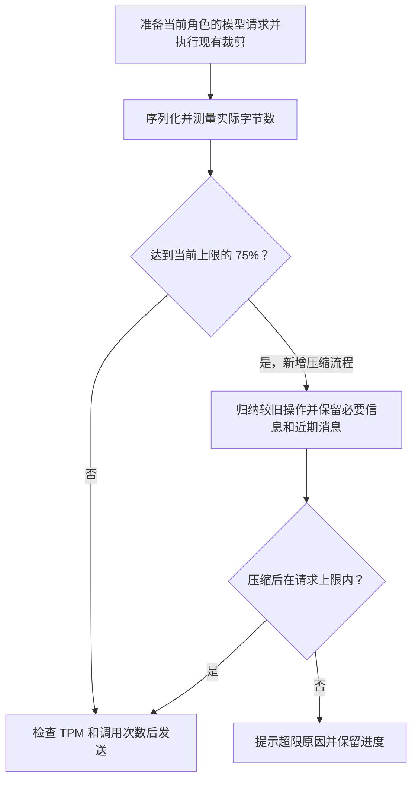
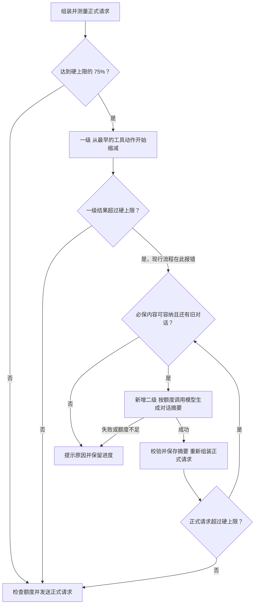

# Atoms 自动上下文压缩技术方案

日期：2026-11-12。两级压缩方案已确认并通过本地验证。前半部分记录原有规则压缩方案。

## 触发和预算

`ATOMS_MAX_REQUEST_BYTES` 是 Atoms 服务端对单次模型 HTTP 请求体的字节上限，默认 512,000 字节（500 KiB）。它与模型以 Token 计量的上下文窗口及 TPM 分别检查。现有网关接收最多 1 MiB 请求体，部署配置应在所用网关允许的范围内。

每次准备模型请求时，先执行已有的历史裁剪，再计算实际 JSON 字节数。达到当前上限的 75% 开始压缩，目标压到 60% 以内。默认配置下分别为 375 KiB、300 KiB。若配置为 400 KiB，分别变为 300 KiB、240 KiB。压缩后重新序列化，预留和发送使用同一份请求。

## 压缩内容

新增每角色的压缩摘要。它是从已落库的任务状态生成的只读材料，记录覆盖到的历史位置及保留的进展引用。例如，Alex 已保存 `app.js`，曾有一条浏览器检查失败，最新版本还待重验；摘要引用对应步骤和报告，供模型选择下一步。

保留当前目标、用户的确认和更正、批准状态与验收条件、当前文件清单和匹配当前文件的检查结果，以及继续执行所需的近期消息和完整工具请求与结果。较早的操作按步骤归纳为做过什么、可重新读取哪些文件、哪些检查仍待做。摘要由已有记录生成，不额外调用模型；审批和执行依旧由已有状态与检查点决定。

按当前角色的执行顺序，默认原样保留最近 4 个完整动作。工具调用和对应结果成对保留。若仍超压缩目标，从这 4 个里最旧的开始归纳，至少保留最后一个完整动作。当前待处理的格式错误反馈保留。

复用摘要和覆盖位置，只在新增历史使请求再次到达比例时扩大压缩范围。若必要信息无法压到目标，但请求未超硬上限，发送最紧凑的版本。若必要信息超过硬上限，提示哪部分仍然过大并保留进度。原消息、文件、检查点和版本照常保存。

## 验证

在至少两个不同的上限下验证比例边界。用可控模型验证连续两次压缩后，旧动作不重放、当前文件和审批正确、近期工具结果完整。测试必要输入仍然过大时不发请求。发布验收用原长任务检查能否从原检查点继续，并记录实际请求大小和真实推进的步骤。

## 两级压缩技术方案

覆盖线上 JSON 工具模式的首次执行和检查点续做。以序列化后的请求体字节数判定，默认硬上限为 500 KiB。

### 触发与执行

1. **一级压缩旧工具记录。** `prepareFrameContext` 沿用 75% 触发、60% 目标。从最早的已完成工具动作开始，用路径、状态和报告引用替代大段参数与结果。调用与结果成对处理，优先保留最近四个完整动作，至少保留最后一个。复用已保存的对话摘要，尚未摘要的对话保留原文。若一级结果不超过硬上限，直接发送正式请求。即使高于 60% 目标，也无需生成新摘要。
2. **二级压缩旧对话。** 现有流程在一级后仍超限时直接报错。改为先检查必须保留的内容是否已占满上限，以及是否还有可压缩的旧对话。符合条件时，`runFrame` 调用现有模型，把较早的用户消息和模型回复提炼成摘要。保留当前角色最近四条对话原文，以及任务目标、最新用户输入和更正、当前审批与验收条件、当前文件和检查状态。摘要区分用户已确认的要求、模型的建议和待办，并附上来源消息。正式请求从应用状态读取审批和检查结果。
3. **逐批校验和续做。** 摘要请求只带待处理的对话与已有摘要，使用独立的输出格式。单批输出上限为 1,024 Token，若服务端上限更低则按服务端配置。先序列化测量，单次放不下时按对话顺序分批，超长单条消息按文本边界分段。校验响应格式和来源范围，用有效摘要重建正式请求。能发送即停止压缩。若无可压缩内容、摘要失败或已到额度上限，保留已提交的进度并提示具体原因。

### 数据与接入

- **新增对话摘要 `DialogueSummary`。** 按任务和角色保存，记录已覆盖的角色消息范围、任务内用户消息来源和摘要正文。单条消息分段时记录已处理到的文本位置。比如覆盖 Alex 的第 1 至 36 条历史消息，记录「用户最终要求 JSON 导出。CSV 兼容是模型建议，尚待确认」。它用于替换下次请求中对应的旧对话。复用已有摘要时，只追加尚未覆盖的历史。一级工具摘要继续使用现有 `ContextSummary`，两者独立推进。历史项目缺少对话摘要字段时按未生成处理。
- **按原有额度记账。** 模型客户端复用现有服务端配置、HTTP 请求和用量解析，增加独立的摘要请求与响应解析。摘要请求不携带可执行工具，返回内容只作为历史资料。摘要与正式请求都按实际发送的请求体检查大小，计入单轮、工作区及全站每日调用数和 TPM。记录请求类型、压缩前后字节数与结果，便于核对调用成本。
- **按运行标识保存。** 摘要与覆盖范围一并写入现有项目状态。停止后拒绝旧运行写回。失败或截断的摘要不推进覆盖范围，已提交的摘要可在重启后复用。原始消息、文件、检查点和版本照常保存，工具执行去重继续以已提交步骤为准。

### 验证

| 场景 | 预期结果 |
| --- | --- |
| 一级后低于或恰好等于硬上限 | 只发正式请求。尚未摘要的对话保留原文，新增摘要调用为 0。 |
| 一级后比硬上限多 1 字节 | 有可压缩旧对话时进入二级。用不同的上限验证，每个实际发送的请求都在上限内。 |
| 旧对话一次装不下 | 分批按序摘要，正式请求能发送后停止。核对每次发送与用量账本一致。 |
| 用户先要求 CSV，后改为 JSON | 多次摘要及重启后仍按 JSON 交付。模型提议、用户决定与系统批准状态区分清楚，旧工具动作不重放。 |
| 必保内容过大、摘要失败或中途停止 | 给出具体原因，保留已提交进度，旧运行的迟到结果无法覆盖新状态。 |

本地通过回环 HTTP 和可控模型验证了 0／1 字节边界、分批、停止后重开 SQLite 续做，以及摘要调用计入工作区额度。`go test -count=1 ./...`、两级压缩测试连续运行 10 次、`go vet ./...` 和 Linux amd64 构建均通过。云端真实模型续做验收受 ECS SSH 公钥认证失败阻断。
