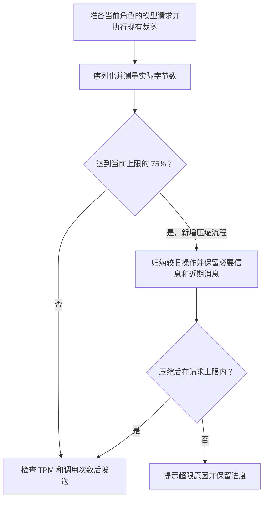

# Atoms 自动上下文压缩技术方案

日期：2026-11-12。状态：方案已确认。

## 触发和预算

`ATOMS_MAX_REQUEST_BYTES` 是 Atoms 服务端对单次模型 HTTP 请求体的字节上限，默认 512,000 字节（500 KiB）。它与模型以 Token 计量的上下文窗口及 TPM 分别检查。现有网关接收最多 1 MiB 请求体，部署配置应在所用网关允许的范围内。

每次准备模型请求时，先执行已有的历史裁剪，再计算实际 JSON 字节数。达到当前上限的 75% 开始压缩，目标压到 60% 以内。默认配置下分别为 375 KiB、300 KiB。若配置为 400 KiB，分别变为 300 KiB、240 KiB。压缩后重新序列化，预留和发送使用同一份请求。

## 压缩内容

新增每角色的压缩摘要。它是从已落库的任务状态生成的只读材料，记录覆盖到的历史位置及保留的进展引用。例如，Alex 已保存 `app.js`，曾有一条浏览器检查失败，最新版本还待重验；摘要引用对应步骤和报告，供模型选择下一步。

保留当前目标、用户的确认和更正、批准状态与验收条件、当前文件清单和匹配当前文件的检查结果，以及继续执行所需的近期消息和完整工具请求与结果。较早的操作按步骤归纳为做过什么、可重新读取哪些文件、哪些检查仍待做。摘要由已有记录生成，不额外调用模型；审批和执行依旧由已有状态与检查点决定。

按当前角色的执行顺序，默认原样保留最近 4 个完整动作。工具调用和对应结果成对保留。若仍超压缩目标，从这 4 个里最旧的开始归纳，至少保留最后一个完整动作。当前待处理的格式错误反馈保留。

复用摘要和覆盖位置，只在新增历史使请求再次到达比例时扩大压缩范围。若必要信息无法压到目标，但请求未超硬上限，发送最紧凑的版本。若必要信息超过硬上限，提示哪部分仍然过大并保留进度。原消息、文件、检查点和版本照常保存。

## 验证

在至少两个不同的上限下验证比例边界。用可控模型验证连续两次压缩后，旧动作不重放、当前文件和审批正确、近期工具结果完整。测试必要输入仍然过大时不发请求。发布验收用原长任务检查能否从原检查点继续，并记录实际请求大小和真实推进的步骤。
