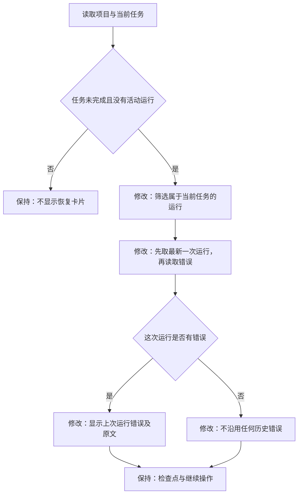

# 当前任务错误提示修复

日期：2026-11-14（北京时间）。范围：已确认的模型兜底与任务恢复功能中的错误展示缺陷。

## 问题与需求

线上 API Key 已恢复，内网和公网 `bootstrap` 均返回 `model_ready=true`。受影响任务于 03:14 因未配置 Key 失败；03:17 继续后发生 25 次模型调用，03:34 被停止，这次运行没有错误。页面仍显示第一次运行的“模型服务尚未配置”，因为它先过滤整个项目的错误，再取最后一项。

- 恢复卡片只展示当前任务最新一次运行的错误。
- 最新运行没有错误时，不能沿用更早运行或其他任务的错误。
- 有错误时标明“上次运行错误”，区分历史执行结果与当前服务配置。
- 历史执行记录、当前任务状态、检查点、继续操作和模型配置不变。

## 技术方案

使用现有接口返回的 `run.task_id` 匹配当前任务；接口已经按开始时间排列运行，取匹配结果的最后一次，再读取其错误。没有新增实体、接口或存储，也不修改旧运行记录。

## 验证方案

生产前端构建；使用本地独立浏览器及明确模拟的 API 快照，覆盖旧配置失败后停止、不同任务隔离、最新真实错误、无当前运行、完成和运行中状态、配置恢复前后错误说明、点击继续后的状态切换。先确认旧版本可复现，再验证修复版本。线上只检查现有任务页面与服务状态，不触发付费模型任务。

## 验证结果

- 修改前用真实构建产物复现：旧配置失败之后的新运行已停止，恢复卡片仍有旧错误，定向断言失败。
- 修复后 TypeScript 检查及生产构建通过。
- 定向浏览器检查 9 项通过，覆盖上述错误归属、历史信息和继续操作；使用模拟 API 快照，未调用模型。
- 既有自动演示跳转 19 项浏览器检查通过；使用独立本地 Go 服务及测试数据，未调用模型。
- 本地证据：`artifacts/task-error-display-2026-11-13T19-39-03-735Z/`、`artifacts/fallback-navigation-2026-11-13T19-39-11-725Z/`。
- 03:43（北京时间）发布 `20261113T194309Z`，静态文件切换完成。此包从独立工作树构建，修复提交为 `3c8ca06`，对应 PR 分支的 `813f3da`；后端仍为 `cff1612`。
- 公网健康检查与模型配置检查通过，`model_ready=true`，10 个静态资源的摘要与发布清单一致。应用与执行器没有重启，环境配置保持一致，11 个现存项目及业务表保持一致。
- 在用户当前 Chrome 任务页面刷新验证：旧“模型服务尚未配置”错误已消失，侧栏显示“模型服务已配置”；仍为已停止状态、14 个检查点、累计 25 次模型调用。验证没有继续或重跑任务。
- 发布证据及页面截图位于独立工作树 `atoms_demo-model-status/artifacts/task-error-release-20261113T194309Z/`。最初发布包因 Windows 换行格式改变服务文件而在切换前被校验拦截；最终包复用已验证的原运行文件字节，只更新前端。
