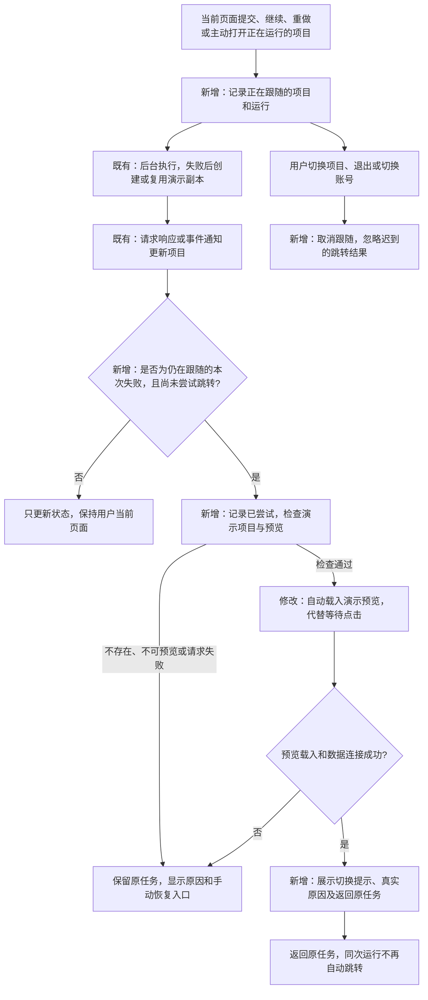

# 模型失败后自动进入演示预览技术方案

日期：2026-11-14（北京时间）。状态：**用户已确认方案并要求继续；实现和本地验证完成，等待人工体验验收。**

依据：[已确认需求](fallback-auto-preview-requirements.md)。本方案以现有演示副本与任务失败记录为依据，调整前端跳转和提示，不改变后台兜底范围。

## 1 实现思路

将“演示副本准备好后等待用户点击”改为“当前页面确认副本可打开后，自动展示其预览”。原任务与演示仍是两个项目，原任务继续保留失败状态。

改动集中在前端：记录当前页面跟随的运行，识别对应的演示结果，检查预览，完成一次页面切换。演示地址附带原项目 ID，刷新后重新向服务端核实两者关系，再恢复提示和返回入口。不新增数据库表或后端接口，也不把地址参数当作项目访问授权。

### 已核实的现有能力

| 位置 | 可复用的能力 | 本次调整 |
| --- | --- | --- |
| `internal/core/app.go`、`internal/store/catalog.go` | 原项目已有 `recovery.project_id/run_id/reason/unavailable`，副本已有 `source.kind=fallback` | 直接使用现有数据，不修改副本创建逻辑 |
| `web/src/App.tsx` | 请求返回和事件通知都会更新当前项目；已有人工打开演示、查看成功版本的入口 | 接入运行跟随及自动跳转；人工入口复用同一打开方法 |
| `web/src/api.ts` | 账号变化时取消请求、拒绝旧会话响应，限制登录返回地址 | 预览探测沿用同一请求保护；严格支持新增的来源项目参数 |
| `web/src/components/AppPreview.tsx` | 获取预览授权，加载隔离页面，通过专用消息通道读写应用数据 | 增加载入完成/失败通知；只用于本次跳转反馈 |
| `web/src/main.tsx` | 账号或会话变化会重新创建工作台组件 | 借助卸载清理当前跟随及待处理跳转 |

## 2 流程变化

图中“既有”部分沿用现状，“新增/修改”部分为本次范围。查看历史失败任务不会建立新的自动跳转跟随。

## 3 前端状态与来源信息

只增加少量页面状态，不建立独立任务系统。

| 名称 | 定义与具体例子 | 用途与保存位置 |
| --- | --- | --- |
| 当前跟随 `FollowedRun` | 当前页面关心的一次运行，例如“账号 U 的原项目 P，运行 R，当前导航序号 7” | 内存中保存；判断到来的失败结果是不是本页面仍在等待的运行 |
| 已尝试记录 `HandledFallback` | 已经处理过的“账号 U、原项目 P、运行 R”组合 | 当前标签页记忆，同账号刷新后可恢复；避免重复通知、断线重连与返回后再次跳走 |
| 演示来源 `FallbackLocation` | 页面地址中的原项目 ID，例如演示项目 D 的地址为 `/?project=D&fallbackFrom=P`；D、P 实际均为合法的 32 位项目 ID | 刷新后找回原项目；必须通过服务端项目记录核实，不保存密钥、错误原文或预览授权 |

预览准备过程只有“检查中、载入中、就绪、失败”几种页面状态，复用原项目快照和上述来源信息。每次主动导航增加一个序号；异步结果必须同时匹配账号、项目、运行及导航序号才可改变页面。

### 3.1 何时建立跟随

- 当前页面成功提交 `submit/continue/restart` 等实际启动运行的操作后，从响应取得本次运行 ID。
- 用户主动打开一个仍在运行的项目时，跟随打开时那一次运行。
- 刷新时只恢复同账号、同项目且尚未结束的已跟随运行；打开已经失败的历史任务不自动跟随。
- 仅收到事件更新不能建立新的跟随，避免其他账号在共享项目发起运行后把本页面自动带走。
- 处理“空 Key 下任务很快失败”的顺序问题：操作响应与事件更新可能先后交错。先确定响应所属运行，再检查已经收到的最新项目状态，不能用较旧响应覆盖较新结果。
- 从空白页创建项目和发送任务也要检查导航序号，避免用户已离开后，迟到的创建响应重新选回原项目。

### 3.2 何时允许尝试跳转

同时检查：当前仍选中原项目、运行与任务已失败、没有新的活动运行、`recovery.run_id` 等于当前跟随运行、演示未标记不可用、此次运行尚未尝试自动跳转。

先写入已尝试记录，再发起副本检查，防止重复状态更新并行触发多次。自动打开失败后不循环重试，保留手动“打开演示应用”；再次运行产生新的运行 ID 时允许新的自动尝试。

记录使用按账号区分的 `sessionStorage`，仅存项目/运行 ID，设置固定条数上限，不存业务内容。存储被浏览器禁用时，当前页面用内存去重；刷新后的历史失败项目本来就不建立跟随，因此不会因存储不可用而反复跳转。退出和切换账号时清理当前跟随与待处理检查。

## 4 预览检查、打开与失败反馈

1. 保持原页面，显示“正在打开演示应用…”，读取演示项目，检查 `source.kind=fallback`、有效交付版本及 `preview_ready`。
2. 再检查该版本的预览地址能够正常返回页面。HTML 检查通过统一 API 请求层执行，保留账号变化、请求取消及错误处理；不能将 HTML 当作 JSON 解析，也不执行 HTML 内脚本。
3. 请求完成后再次核对当前导航和运行；条件仍有效才开始载入演示视图，并自动选中“产物工作区 / 预览”。载入中显示明确的加载状态，暂不显示“已切换”。
4. `AppPreview` 在有效实例完成预览授权、页面加载及首次应用数据读取后通知载入成功，再展示正式切换提示。单纯 iframe 的 `load` 事件不能代表应用成功，错误页也可能触发该事件。
5. 载入出错或超过有限等待时间时恢复原任务视图，显示具体原因并保留手动入口；如果用户已主动离开，则忽略旧结果。准备与载入期间不接受对尚未就绪副本的操作，也不覆盖未提交输入。

页面切换共用一个明确的成功结果，只有成功时才同步当前项目、地址栏、最近打开项目和预览面板；不沿用“打开方法吞掉异常，调用方仍切换面板”的处理方式。演示载入失败不会显示成功提示，也不会修改原任务或应用业务数据。

## 5 提示、刷新与返回

### 提示内容

演示预览上方显示：

> 大模型服务不可用，已切换至演示应用兜底。
>
> 此为预置演示，原需求尚未完成。

提供“查看原因”和“返回原任务”。具体原因来自服务端已经脱敏的失败记录，继续让用户区分缺少 Key、额度不足和超时；主提示不代替真实错误详情。

### 刷新与来源核实

- 成功进入演示后，地址中保留 `project` 和 `fallbackFrom`，刷新后直接打开演示预览。
- 读取两个项目，核对演示类型及 `original.recovery.project_id === demo.id`，通过后才显示来自原任务的失败原因与返回入口。
- `safeReturnTo` 仅额外接受这两个合法且不重复的项目 ID 参数，不允许任意 URL、外站来源或任意额外参数。登录返回仍只恢复页面，不重发任务或重新创建副本。
- 来源关系不匹配时忽略来源参数，按普通项目打开；不采信地址中的错误描述。
- 原任务已删除时，保留可访问的演示并说明原任务不可用，取消返回入口。演示被删除或访问失效则按现有项目不存在/登录失效流程处理。
- 从原项目点击已有的“打开演示应用”同样携带来源信息。旧演示通过仅包含自身 ID 的历史链接打开时，保持现有演示标识；不猜测或伪造原任务来源。

### 返回原任务

返回前保持本次运行的已尝试记录，打开原项目的对话与任务页。恢复原有失败详情、继续/重做操作以及上一成功版本入口；不自动开始新的模型调用。新一次继续或重做才建立新的跟随。

## 6 代码职责与改动范围

| 文件/模块 | 职责 |
| --- | --- |
| `web/src/fallbackNavigation.ts`（新增，最终文件名可随代码组织调整） | 定义跟随与来源数据，解析严格的页面地址，读写有限的已尝试记录 |
| `web/src/hooks/useFallbackNavigation.ts`（新增） | 串联状态检查、异步预检、一次性自动跳转和清理；不创建后台任务或演示项目 |
| `web/src/components/FallbackNotice.tsx`（新增） | 展示已切换提示、预置性质、原因及返回入口 |
| `web/src/App.tsx` | 接入跟随和导航结果，复用原有项目/预览选择能力；移除被新组件替代的重复提示逻辑 |
| `web/src/components/AppPreview.tsx` | 通知本实例的首次载入完成或失败，保留原有数据授权和保存流程 |
| `web/src/api.ts` | 支持预览页面探测与严格来源地址，保持统一账号保护 |
| `web/src/style.css` | 提示、加载反馈和窄屏布局的必要样式 |
| `scripts/fallback_navigation_acceptance.cjs`（新增） | 通过真实本地后端和浏览器验证跳转与数据保留；可控延迟/失败仅用于复现竞争情况 |

保留工作区已有的 `App.tsx` 预览版本刷新修复。实施前记录该现有差异，避免将其误删或无说明混入本次修改。

## 7 验证方式

本地使用独立数据库、空模型配置，按需求 A01–A09 做浏览器验证；不通过修改生产数据制造故障。

| 验证 | 重点 |
| --- | --- |
| 新增浏览器验收 | 空 Key 自动跳转、实际预览交互、保存后刷新、返回不重跳、再次失败复用副本 |
| 异步与异常验收 | 失败与副本就绪之间的延迟、事件先于操作响应、检查中切换项目、迟到失败不覆盖新页面、副本删除/404、预览授权错误和加载超时 |
| 共享项目与账号 | 别的账号发起运行不触发当前页面跳转；退出/换号取消旧动作；登录后恢复合法来源地址而不发起 AI 请求 |
| 数据与成功路径 | 失败迭代保留原成功版本和数据；正常完成、停止、未批准 Plan 均不误跳 |
| 布局 | 桌面及 390px 模拟窄屏均能看到预览、提示和返回入口，并检查截图 |
| 现有回归 | 原有 `acceptance_completion.cjs`、`login_shared_deletion_acceptance.cjs`，以及 TypeScript 检查和生产构建 |

测试要通过界面发起真实任务验证自动跳转；仅用 API 创建失败任务再断言数据库有副本，不能算本次交互验收通过。对正常成功或特定迟到顺序，可使用本地模拟响应构造明确场景，报告中区分模拟分支与真实空 Key 路径。

## 8 实施与交付

1. 技术方案确认后实现并完成上述验证，提交范围清晰的代码 commit。
2. 提供本地验收结果、截图和已知限制，按项目约定进入人工验收。
3. 发布时沿用已有独立发布目录和校验流程；前端发布须保留旧资源。线上模型 API Key 继续保持清空，恢复操作另按用户指令执行。

实现结果与证据见[验证记录](fallback-auto-preview-validation.md)。
