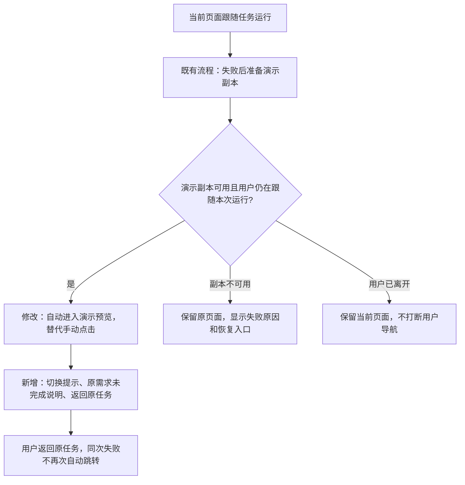

# 模型失败后自动进入演示预览需求

日期：2026-11-14（北京时间）。状态：**用户已分别确认需求与技术方案；实现和本地验证完成，等待人工体验验收。**

用户要求：直接跳转至演示应用，然后提示“大模型服务不可用，已切换至演示应用兜底”。

## 1 当前行为与目标

现有服务会在符合条件的失败后创建或复用独立演示副本，原任务保留失败状态。页面显示“打开演示应用”按钮，用户点击后才能进入预览。

本次将这一步改为自动进入已准备好的演示预览，同时明确说明切换原因、预置演示性质及原需求尚未完成。

## 2 需求范围

### R01 自动进入可用的演示预览

- 用户在当前页面提交、继续或重做任务后，该次运行失败且关联演示副本可用时，自动进入该演示项目，选中“产物工作区”的预览页。
- 同样适用于已有成功版本的项目本次修改失败；原项目、成功版本、业务数据及运行记录继续保留。
- 在演示副本实际可访问且具备可用预览后才切换，不能先跳入空白页面或提前显示“已切换”。
- 桌面和窄屏均直接展示预览。

### R02 提示与返回入口

- 切换后的演示页显著显示：**大模型服务不可用，已切换至演示应用兜底。**
- 同时显示：**此为预置演示，原需求尚未完成。** 提供查看本次具体失败原因的方式，额度耗尽、超时等原因仍可辨认。
- 提供“返回原任务”入口，方便查看失败详情、已有成果和继续任务。
- 重新加载此次演示页面后，仍能识别其演示性质与对应原任务。

### R03 跳转只发生一次，不干扰用户导航

- 同一次运行的失败只自动跳转一次；重复状态更新、断线重连及刷新不能造成反复跳转。
- 用户返回原任务、主动打开历史失败项目时不再次被强制跳走。
- 用户在结果返回前已切换到其他项目、退出或切换账号时，不执行旧任务的自动跳转。
- 只跟随当前页面发起或正在跟随的运行，不因其他账号在共享项目中的操作强制切换当前页面。

### R04 异常与既有边界

- 演示副本创建失败、已删除或无法打开时，留在原任务页面显示原因，保留现有恢复入口。
- 用户主动停止、等待回答、Plan 尚未批准等现有不创建演示副本的情况继续沿用原规则。
- 本次只调整演示副本就绪后的交互；不扩大或收紧现有兜底错误判定，不更改模板选择、模型重试、模型额度或业务数据规则。
- 当前线上 API Key 保持用户要求的清空状态，是否恢复另按用户指令执行。

## 3 用户流程变化

## 4 验收标准

| 编号 | 场景 | 预期结果 |
| --- | --- | --- |
| A01 | 空 Key 下提交 Build 需求 | 无需点击按钮，自动进入可交互演示预览；显示切换提示、演示性质及原任务入口 |
| A02 | 演示中新增记录并刷新 | 记录恢复，演示身份及返回原任务入口保持可用 |
| A03 | 返回原任务，重复收到状态或刷新 | 原任务仍失败且详情可见，不重复自动跳转 |
| A04 | 原任务再次运行并失败 | 本次运行允许一次新的自动跳转，复用已有演示及其数据 |
| A05 | 结果返回前切换项目或退出账号 | 迟到结果不改变当前选择或登录状态 |
| A06 | 副本删除、创建失败或打开失败 | 保留原页面和明确错误，不显示虚假的切换成功 |
| A07 | 已交付项目修改失败 | 自动展示演示；返回后原成功版本和业务数据仍可使用 |
| A08 | 停止任务、未批准 Plan、正常成功 | 保持各自正常结果，不误跳演示 |
| A09 | 桌面与 390px 窄屏 | 都直接看到预览、提示和返回入口 |

对应方案见[自动进入演示预览技术方案](fallback-auto-preview-design.md)，实测结果见[验证记录](fallback-auto-preview-validation.md)。
