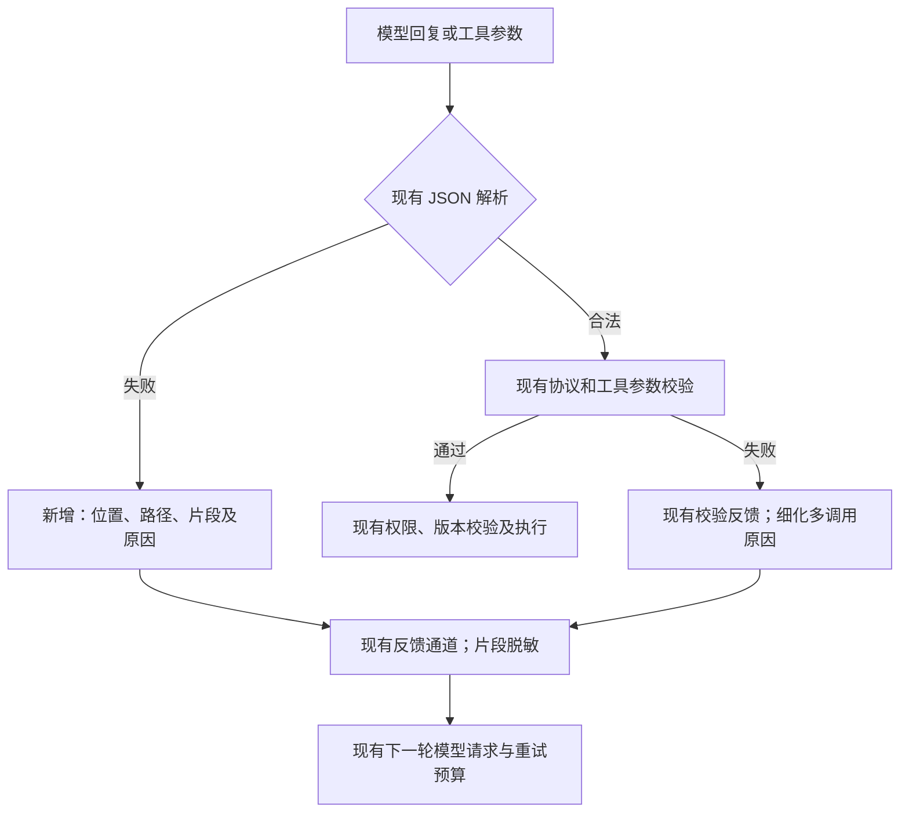

# JSON 错误诊断细化

## 已确认范围

2026-11-14，用户将方案收敛为“细化报错，使模型能够诊断修复”，随后确认继续实施。

- 给语法错误提供准确位置、附近片段、实际原因和修正提示，并确认下一次模型请求能收到这些信息。
- 不自动修改或执行错误 JSON，不新增修复状态机、不调整次数或时间预算，不在主提示词中添加具体工具逻辑。
- 现有工具权限、参数校验、停止和版本检查继续负责执行边界。

## 实现方式

标准库 `encoding/json` 继续决定输入是否合法。失败后只回读已合法解析的 token（字符串、数字和括号等语法单元），定位当前对象、数组或字段；无法可靠定位时回退到入口路径。诊断逻辑不接受或修复原始输入。

扩展现有 `validation.Issue`，不新增存储实体：`reason` 表示原因；`offset` 是从 1 开始的 UTF-8 字节位置，EOF 使用字节数加 1；`line`、`column` 是从 1 开始的行、Unicode 字符列；`excerpt` 最多保留错误前后各 80 个字符，以 `⟦…⟧` 标出错误字符或 EOF。

例如：调用对象尚未关闭时遇到 `]`，报告当前调用路径、期望 `,` 或 `}`，提示检查嵌套结束顺序。字符串后的非法文字只提示“可能有未转义的双引号”，不猜测唯一修法。

错误片段沿现有 `failureFeedback` 结构返回；输入含服务端敏感配置时隐藏片段，避免截断后暴露凭据片段。原始回复仍按现有规则保存，普通提示词、历史投影和重试机制不变。

## 验收

1. 原始六条计算器失败回复全部拒绝，并有可定位、有限长度的诊断。
2. 覆盖缺括号、引号/转义、冒号、逗号、未完成的值、额外内容、多调用、中文位置和过深输入。
3. 模拟上游检查下一轮实际 HTTP 请求中的诊断；无效调用不执行，后续合法调用沿现有流程执行。
4. JSON 文本模式、原生 Chat Completions 和 Responses 参数错误均保留反馈。
5. 反馈中的凭据及被截断的凭据片段不泄露；大整数原始参数和调用数量限制不变。

## 验证结果

2026-11-14，本地 Windows / Go 1.27.1 验证通过：

| 检查 | 结果 |
| --- | --- |
| `go test ./... -count=1 -timeout 120s` | 全部包通过 |
| `go vet ./...` | 通过 |
| `git diff --check` | 通过 |
| 六条原始失败回复的诊断回归 | 路径、原始报错字节位置、原因与片段均符合预期 |
| 六条回复的实际请求链路测试 | 模拟上游收到下一轮 HTTP 请求中的完整诊断；错误动作未执行，后续合法调用正常执行 |
| 修正语法后的原始回复 | 四条计划可解析；两条包含三个调用的回复仍被协议拒绝，无部分执行 |
| 原生工具参数反馈 | Chat Completions、Responses 均保留位置、原因与错误片段 |
| 凭据与长度边界 | 完整凭据、超出片段窗口的长凭据、含 JSON 转义的凭据均未出现在反馈中 |
| `go test ./internal/validation -run=^$ -fuzz=FuzzDecodeDiagnostics -fuzztime=3s -parallel=2` | 212,262 次输入探索通过，无 panic、越界位置或超长片段 |

上述为本地实现和模拟上游链路验证。后续已于 2026-11-14 04:35（北京时间）部署，并通过上传后 Linux 程序的六条历史回复回归及公网检查，详见[发布记录](json-diagnostics-deployment-20261114.md)。没有为验证发起真实模型调用，真实模型的修复成功率和重试次数改善尚未测量。
