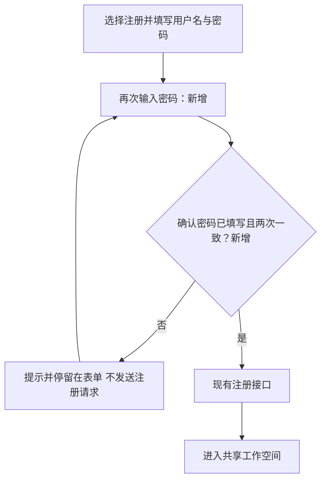
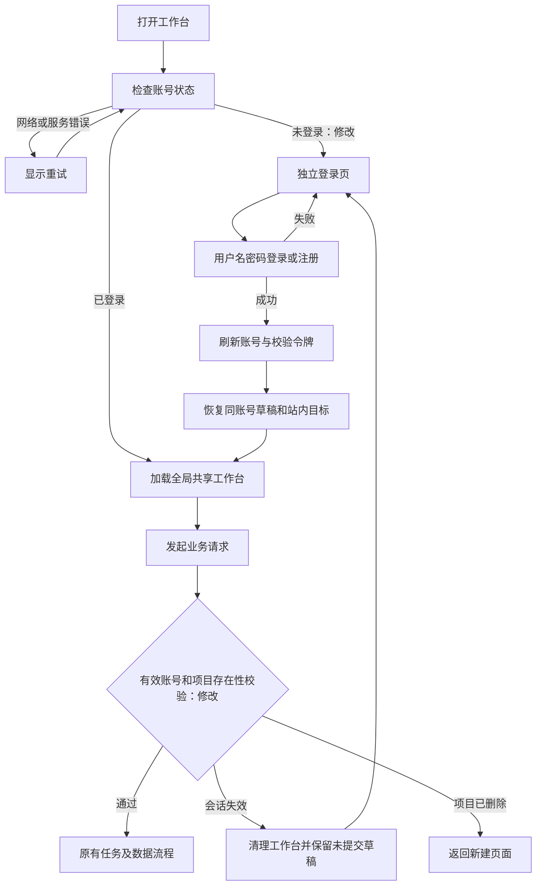
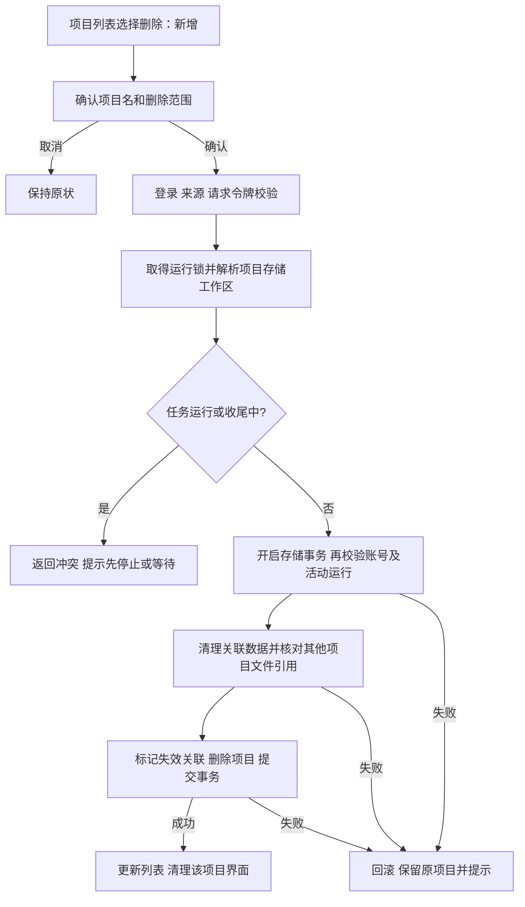

# 登录后全局共享与历史项目删除技术方案

日期：2026-11-13。状态：**用户已确认技术方案，实现、隔离验证和生产发布已完成。**

对应[需求规格](login-required-project-deletion-requirements.md)，包含用户追加确认的“所有账号均可查看、修改、发 AI 指令和删除”。本方案沿用 Go 服务、React 页面、SQLite 数据库、现有账号及执行器，不引入新的登录提供方或服务。

## 1 实现结论与代码依据

登录限制放在前端工作台入口和服务端业务入口。游客会话仅用于登录前请求校验及既有注册衔接，不能使用项目功能。账号登录后进入全局共享工作空间，所有项目均可查看和操作。历史删除采用数据库事务，即所有关联修改一起成功或一起撤销；文件先核对其他项目的引用，再清理无人使用的内容。

| 当前代码 | 已核实的行为 | 本次改动 |
| --- | --- | --- |
| `internal/httpapi/auth.go` | 初始化创建游客会话；任何有效会话都能通过业务入口 | 明确公开接口、登录接口与账号业务接口；业务接口要求账号身份 |
| `web/src/App.tsx`、`components/AccountMenu.tsx` | 初始化后直接读取项目；登录表单为可选弹窗 | 登录状态决定是否加载工作台；独立登录页替换游客弹窗 |
| `internal/store/auth.go` | 游客工作区可关联账号；项目按归属校验 | 账号校验保留，项目归属不再作为权限限制；旧项目加入共享列表 |
| `internal/store/store.go` | 项目状态是一份 JSON；文件字节按工作区和内容摘要共用 | 增加完整项目删除，保护其他项目仍引用的字节 |
| `internal/store/migrations.go` | 项目另有关联业务数据、备份、预览授权、分享和复制回执 | 明确每张表的删除或保留方式，无需新增业务数据表 |
| `internal/agent/engine.go` | 启动先保存活动运行，结束后才释放进程内运行名额；停止与实际收尾之间有短暂间隔 | 删除同时检查数据库活动运行及进程内收尾，避免收尾期间删除 |
| `internal/store/catalog.go` | 原任务可引用独立演示副本；失败续做复用该副本 | 处理演示副本被删除的情况，避免保留失效入口或自动复活 |

## 2 登录校验与接口行为

### 2.1 服务端访问规则（修改）

按请求方法和明确路径分类，不能以宽泛的 `/api/auth/`、`/api/shares/` 前缀放行所有方法。新业务接口默认要求账号登录。

| 类别 | 路径与方法 | 校验方式 |
| --- | --- | --- |
| 公开资源 | 页面、静态资源、`GET /healthz`、`GET /api/catalog` | 保持可访问；公开接口保留原限流 |
| 公开分享 | `GET /api/shares/{token}` 与 `/preview` | 校验分享有效性，只提供公开版本和试用数据 |
| 登录初始化 | `GET /api/bootstrap`、`GET /api/auth/me` | 返回账号或未登录状态，必要时发放登录前会话 |
| 登录操作 | `POST /api/auth/register`、`/login` | 登录前会话、来源检查、请求校验令牌及账号/IP 限流 |
| 退出 | `POST /api/auth/logout` | 要求当前有效账号，撤销当前设备会话 |
| 项目业务 | 所有项目、任务、文件、导出、预览、事件、数据、分享管理，以及示例/分享复制接口 | 有效账号；项目必须存在；任何登录账号均能操作；写操作继续校验来源和请求令牌 |

`HEAD` 只按相应 `GET` 的权限规则处理；不能因此绕过项目资源的登录校验。未知或不匹配方法不产生业务副作用。

- 有效会话不等于已登录：账号身份必须有有效 `UserID`，且会话未过期、未撤销。有效游客凭据访问业务接口同样返回 `401`。
- 拒绝发生在创建项目、读取需登录的数据、进入 Agent 或执行器之前。缺少模型配置时也不能通过演示兜底绕过登录要求。
- 对需要在事务中重新确认身份的入口，将 `authProject` 调整为 `sharedProject`；示例复制和分享复制同样检查账号。底层供后台执行使用的工作区读写继续按已接受任务运行，不因用户退出而取消。
- 账号 Cookie 过期时，业务请求返回登录失效；初始化接口清除失效 Cookie，再返回未登录状态。数据库不可用返回服务错误，不当作游客或登录成功。
- 初始化返回账号状态和“所有登录账号共享项目”的提示，不在登录页返回项目名称、对话或文件内容。
- 登录仍使用现有用户名/密码规则和密码摘要；Cookie 的 HttpOnly、SameSite、HTTPS Secure 属性以及现有限流保持有效。

### 2.2 全局共享与资源归属（修改）

- 增加面向工作台的全局项目查询，按更新时间返回所有项目，包括历史游客项目。保留底层按工作区定位字节的能力，避免搬迁原数据或重新计算文件摘要。
- `ProjectOwner` 调整为“已登录后解析项目实际存储工作区”；`authProject` 在事务中检查账号有效与项目存在，不再限制创建者。名称和注释同步改为共享语义，避免未来误用。
- 项目原有 `owner` 只表示文件存储与历史资源统计归属，不表示访问权限。账号 A 打开 B 创建的项目时，读取和写入仍定位到该项目原来的工作区，不能用 A 的工作区导致读不到文件或写错数据。
- 全局列表可能超过 30 项，不能继续用列表长度判断当前账号能否创建。创建数量与应用容量继续按既有存储归属统计；原有每账号 30 项、8 MiB 及每项目 256 KiB 上限不因共享而清空或合并。
- 新的 AI 运行记录保存发起账号及其计费工作区。模型请求（含重试、摘要和委派）以及每账号运行并发按发起账号累计，全局限流保持原值。继续任务是新运行，计入本次发起账号；正在运行时其他账号追加指令不更换该运行的计费账号。历史运行缺少新字段时沿用旧归属解释，原账本不重写。
- 同一项目仍只允许一个活动运行；多个账号提交同一修订的应用数据仍只有一个成功，其他收到冲突提示。所有登录账号可以停止运行，但不能绕过停止后收尾与删除限制。
- 移除前端“你的私有项目”及游客认领提示，改为“共享工作空间”。账号密码、会话、模型配置和服务端凭据不进入共享项目响应。

### 2.3 错误约定（补充）

保留现有可读 `error`，为需要统一处理的情况增加稳定的 `code`。例如 `{"code":"login_required","error":"请登录后继续使用"}`。页面按错误类型处理，不根据中文文案猜测。

| 状态 | 含义 | 页面处理 |
| --- | --- | --- |
| `401 login_required` | 没有有效账号，或账号会话已失效 | 收起共享工作台，保留所属账号的未提交指令，显示登录页 |
| `401 invalid_credentials` | 用户名或密码错误 | 留在登录表单提示，不触发全局跳转 |
| `403` | 来源、请求令牌或预览授权不符合要求 | 提示或刷新相应授权；不自动重发 AI、复制或删除请求 |
| `404 project_not_found` | 项目已删除或不存在 | 当前项目退出到新建页面，刷新共享列表 |
| `409 project_running` | 项目有活动运行或正在收尾 | 保留删除确认框，提示先停止或等待收尾 |
| `410 copy_deleted` | 旧复制请求对应的副本已删除 | 提示原副本已删除；用户重新点击时使用新请求标识 |
| `5xx` / 网络失败 | 无法确认业务结果 | 显示可重试状态，不假定退出或删除成功 |

## 3 前端结构和登录交互

### 3.1 组件职责（新增与调整）

- `AuthProvider` 管理初始化、账号变化、退出和失效处理。它不管理项目内容；工作台只在账号确认有效时挂载。
- `LoginPage` 展示用户名/密码表单及注册切换。桌面左侧表单、右侧本项目介绍；390px 窄屏以表单为主。显示加载、校验、错误及提交中反馈，不复制原站的第三方登录入口、机构背书或无实际用途的按钮。
- 用户追加的注册确认密码在 `LoginPage` 内比较；空值由必填校验阻止，不一致时显示错误并聚焦确认输入框。修改任一密码会清除旧的不一致提示，切换模式清空两次密码。确认值只保存在表单内存中，不进入注册请求或数据库；复用原注册接口，无新增业务实体。

注册流程追加如下，新增部分位于调用现有注册接口之前：

- `api.ts` 统一处理 JSON、文件下载和错误类型，供 `App`、`Catalog`、`SharePanel`、`AppPreview` 和 `SharedView` 复用。公开分享请求不会因为没有账号而跳走。
- `AccountMenu` 简化为登录后的账号信息和退出入口，删除旧游客登录弹窗及失效样式。
- `ProjectDeleteDialog` 只负责显示目标、影响和提交状态，实际删除由项目操作函数发起；不把删除伪装成 Agent 的任务动作。

### 3.2 页面进入、返回与草稿

1. 打开 `/` 或 `/login` 后先请求初始化。加载失败展示重试，未登录显示独立登录页，已登录加载项目列表。
2. 登录成功后刷新账号及请求校验令牌，再进入共享工作台。旧游客项目直接可见；不再展示接收选项。注册保留既有工作区关联以延续历史账本；已有账号登录只建立账号会话，不以接收旧项目作为查看条件。
3. 从分享页点击“保存为我的副本”但未登录时，进入 `/login?returnTo=/share/<token>`。登录后回到原分享页，由用户再次点击复制，不自动执行写入。
4. 工作台项目可用 `/?project=<id>` 表示返回目标；服务端确认登录及项目存在。`returnTo` 只接受根路径或符合格式的站内分享/项目目标，拒绝外部地址、双斜线、反斜线及嵌套登录跳转。
5. 会话过期时，仅把未提交的文字、模式和原项目 ID 暂存于当前标签页的 `sessionStorage`，并绑定原账号 ID。同账号重新登录才恢复；换账号或主动退出时清理。密码、Cookie 和整个项目响应不进入该暂存。
6. 最近打开记录按账号区分。旧的 `atoms:last` 在登录并确认项目存在后迁移，项目已删除则清理；未发送的输入仍按原账号恢复，防止换账号时自动带出未提交草稿。

### 3.3 退出、迟到响应与连接

- 账号状态每次变化都递增一个页面内部序号。发起请求时记录该序号，返回时不一致则丢弃；旧请求的成功或 `401` 都不能覆盖新账号状态。
- 退出或确认会话失效时卸载工作台，终止请求并关闭事件订阅、预览 iframe 和消息通道。取消网络请求只是减少旧结果，服务端校验仍是权限依据。
- 同浏览器其他标签页收到仅含变更类型与随机标识、不含凭据的账号变更通知后重新检查身份；页面重新获得焦点时也检查。不同设备保持原有独立会话。
- 事件流出错时先确认账号与项目是否仍有效：过期转登录、项目消失退出工作台、临时断网保留重连提示，不无限重连已删除项目。
- 下载按钮走统一请求检查再保存文件，避免会话失效后直接导航到一页错误 JSON。
- 公共分享已加载到浏览器的试用页面不具备原项目写权限。撤销/删除后新的读取和复制会失败；已提前返回的页面字节和离线文件无法远程收回。

### 3.4 登录流程图

## 4 删除历史项目

### 4.1 接口与执行边界（新增）

新增 `DELETE /api/projects/{id}`，成功返回 `200 {"deleted":true,"id":"..."}`。任何有效登录账号都能删除，请求必须携带现有请求校验令牌；删除结果对所有账号生效。

HTTP 层交给 `Engine.DeleteProject(sessionHash, id)` 协调删除与运行状态，再由 `Store.DeleteProject` 执行数据库事务。前者短暂持有现有 `Engine.mu`，后者按既有顺序获取 `Store.mu`；不在数据库锁内调用 Engine，避免互相等待。

- 与 `Start`、`Stop` 使用同一个运行锁。进程内 `active[id]` 仍存在时拒绝删除，即使数据库 `ActiveRun` 已清空也需等结束/取消收尾。
- 存储事务中重新验证当前账号有效、项目存在，并再次检查 `ActiveRun`。实际清理范围从项目保存的存储工作区确定，不能信任客户端传入的 owner 或页面上的运行状态。
- 启动先获得锁时，删除得到“运行中”；删除先完成时，后续启动读不到项目，不能发起模型调用。
- `Mutate` 已有“读不到项目即失败”的行为，删除后的迟到写入不能新增项目；事件流下一次读取不到项目即结束。
- 重复删除同一 ID 返回 `404`，不新增删除记录。前端把“当前目标已不存在”处理为列表同步完成，并明确显示该状态；其他失败不冒充成功。

### 4.2 同一事务中的数据处理

| 数据 | 处理 | 原因 |
| --- | --- | --- |
| `projects` 目标行 | 删除 | 包含所有对话、任务、执行记录、草稿、检查点和历史版本 |
| `app_states`、`app_receipts`、`app_backups` | 删除目标项目关联行 | 清理业务数据、数据写入回执与项目内备份；先于项目主行处理外键 |
| `preview_grants` | 删除目标项目授权 | 已打开的旧预览不能继续读写 |
| `share_links` | 删除目标项目分享 | 原地址读取和新复制失效 |
| `blobs` | 仅清理目标工作区内不再被任何剩余项目引用的字节 | 同一文件摘要可能被多个项目、历史版本或检查点使用 |
| `project_copies` | 保留最小复制去重回执；改为先查回执，再查对应项目 | 避免旧请求重放把已删除副本再次创建；回执不含对话、文件或业务数据 |
| 其他项目的 `Recovery` 关联 | 目标为被删演示副本时标记不可用 | 保留原任务记录，移除失效的“打开演示应用”动作 |
| 账号、会话、工作区关联及配额账本 | 保留 | 不退出账号、不影响其他项目、不重新发放已消耗额度 |

文件清理先扫描所有剩余项目的完整持久化状态（仅清理目标工作区的字节），覆盖当前文件、历史版本、任务起点、检查点、执行器输入、委派资料、校验报告和旧格式记录中的内容摘要。只清理没有剩余引用的字节；遇到损坏或无法确认的状态，整个删除失败并保留数据。摘要仍出现在其他项目记录中的字节保守保留，不承诺删除后立即释放相同数量的磁盘空间。

清理、关联更新和主行删除全部提交后才返回成功。中途数据库错误则全部回滚；删除数量上限直接由剩余项目数计算，无须额外修正计数。

### 4.3 演示副本和复制请求

- 原任务与演示副本是两个独立项目。删除任一个都不连带删除另一个。
- 在现有 `DemoRecovery` 增加 `unavailable` 标记。例如原任务关联的演示项目被删后，显示“演示副本已删除”，保留原任务的失败原因和继续入口。
- 后续任务失败时，`InstallFallback` 检查副本是否存在；缺失时更新不可用状态，不把旧项目复活，也不反复生成副本。用户可从预置示例显式创建新的项目。
- 旧复制回执仍指向已删除项目时返回 `410 copy_deleted`；用户新点击产生新请求标识，允许正常创建。事务内仍执行原有来源一致性检查。

### 4.4 删除页面流程

- 项目列表行调整为“打开项目按钮 + 独立操作按钮”，避免在按钮里再放按钮；操作入口始终可被触屏和键盘访问。
- 确认框显示项目名、“此操作会对所有账号生效”“删除后无法在产品中恢复”和影响范围；提供取消、确认删除。提交期间禁用重复点击，失败留在原界面。
- 删除当前项目后重置其文件、版本、输入框、待确认操作和最近打开记录；卸载预览与事件订阅。删除其他项目只刷新列表。
- 使用当前选择与请求序号检查，避免删除响应返回时清掉用户刚打开的另一个项目；其他标签页重新获取项目发现 `404` 后同步退出。

## 5 新增实体和状态的定义

这里的实体包括页面状态、操作参数及辅助记录；除现有结构增加字段外，不新增业务数据库表。

| 实体或字段 | 定义与例子 | 用途与生命周期 |
| --- | --- | --- |
| `AuthState` | `loading / guest / authenticated / error`；如已登录状态含 `{id:"u1",username:"alice"}` | 页面是否可挂载工作台的唯一依据，保存在内存 |
| `authGeneration` | 当前页面身份序号；退出时从 `4` 变为 `5` | 拒绝序号为 `4` 的迟到响应，保存在内存 |
| `PendingIntent` | `{userId:"u1",projectId:"p1",mode:"plan",text:"增加筛选",returnTo:"/?project=p1"}` | 登录失效后恢复同账号未提交草稿；当前标签页暂存，恢复/退出/换账号后清理 |
| `RunActor` | 新运行的发起账号与计费工作区，例如 B 在 A 的项目发起运行，保存 `{user_id:"B",workspace:"B的工作区"}` | 模型额度和每账号并发计入 B，文件仍保存在项目原工作区；运行开始后固定并随运行保存 |
| `DeleteProject` 操作 | 当前会话摘要和目标 ID，例如 `sessionHash + p1` | 只由登录者确认后发起；协调整个项目删除，不持久化为 Agent 任务 |
| 待保留文件摘要集合 | 例如其他项目还引用内容摘要 `h1`，则本次不能清理 `h1` | 只在删除事务内用于判断共享文件是否仍有用途 |
| `DemoRecovery.unavailable` | 原任务指向的演示副本已不可用，例如 `{project_id:"p2",unavailable:true}` | 保留历史关联并禁用失效入口，随原项目保存 |
| API `code` | 例如 `login_required`、`project_running` | 页面稳定识别登录和删除结果，`error` 仍供用户阅读 |

现有 `project_copies` 的定义不变：记录一次复制请求对应哪个项目。例如请求 `copy-123` 已创建 `p2`，即使 `p2` 后来删除，旧请求也不能再次执行创建。该记录只用于防重复，不是回收站。

## 6 改动文件与实现顺序

1. **登录限制与全局共享**：修改 `internal/httpapi/auth.go`、`server.go`、`app.go` 及 Store 的账号、全局列表和项目解析入口；补 Agent 的运行发起账号与额度归属；新增 `web/src/Auth.tsx`、统一请求模块和独立登录页，调整 `main.tsx`、`App.tsx`、账号/分享/示例/预览组件及样式。通过验证后独立提交。
2. **历史项目删除**：新增 `internal/store/deletion.go` 与匹配测试，补 Engine 删除协调入口和 HTTP 路由；修改复制回执、演示关联及前端项目操作。通过验证后独立提交。
3. **交付与回归**：更新 README、已有验收脚本中的游客前提及新验证记录。新增能力的验证采用隔离数据库，不以删除现有用户项目验收。

公开请求与需登录请求共用必要的请求解析，不引入通用权限框架。复用当前事务、互斥锁、会话和项目模型；删掉不再使用的游客业务权限、项目所有者权限分支、可选登录弹窗、游客接收选项和重复请求处理，保留原数据、注册工作区关联及历史账本。

## 7 验证计划

| 层次 | 验证内容与证据 |
| --- | --- |
| HTTP 登录边界 | 无 Cookie、游客、过期/撤销账号分别覆盖所有业务方法；验证 `401`、数据库不变、模拟模型和执行器调用次数为零；不同登录账号都能完整操作项目 |
| 账号回归 | 注册、登录、退出、来源/请求令牌、登录限流、原游客项目全局可见和跨设备恢复；旧游客夹具从存储构造，不能为测试重新开放游客 API |
| 全局共享 | A/B 账号看到同一列表；B 能读写 A 的文件和业务数据、发起/停止任务及管理分享；额度计入对应运行发起者；超过 30 条的全局列表不误阻止有名额账号创建 |
| 删除事务 | 每张关联表及文件摘要引用；同工作区其他项目历史/检查点保留；B 删除 A 项目后双方都不可见；未登录拒绝；数据失败回滚；重启后仍不可见；额度和剩余名额正确 |
| 并发 | 用可控阻塞的模拟模型/执行器验证启动与删除、停止后的收尾、迟到写入、事件流结束；不依赖真实付费调用或偶然计时 |
| 关联回归 | 删除演示副本后原项目正常；旧复制请求不再建项目；已有独立副本保持可用；已删分享和预览授权失效 |
| 浏览器 | 新会话登录页、注册/登录、错误反馈、草稿恢复、换账号迟到响应、跨标签退出、分享返回；取消/确认删除、删除当前/其他/运行中项目、网络响应丢失后的列表同步 |
| 界面 | 桌面与 390px 截图，键盘焦点、触屏按钮、确认框与错误提示；检查未登录时项目内容不先闪出 |
| 项目回归 | `go test ./... -count=1 -timeout 120s`、`go vet ./...`、`npm run build --prefix web`；按修改范围更新并运行隔离端到端脚本 |

此表为确认时的验证计划，实际结果见[验收记录](login-required-project-deletion-validation.md)。流程图的格式/浏览器校验仅证明图可展示，不能作为产品实现通过的证据。

## 8 发布与回滚边界

- 实施后提供提交、构建及验收记录。生产发布按已有独立目录、服务和数据卷约定进行，保留发布前一致性备份，不操作其他服务。
- 本次虽然无需新业务表，旧版本仍会开放游客功能，且不了解全局共享及运行发起账号。发布标记增加“要求账号登录、项目全局共享、按运行发起者计费”的能力版本，回滚检查以当前发布的要求校验目标版本；不能只因数据库表兼容就自动回滚到不支持当前规则的版本。
- 删除后的正常代码回滚不恢复旧数据库、不复活已删除项目。人工恢复历史备份会恢复当时数据，属于另外的恢复操作。
- 删除只针对在线项目及其关联数据。已导出文件、独立副本、历史部署备份和执行器按既定策略保留的临时结果不属于在线项目的可恢复入口，不承诺磁盘安全擦除。

技术方案已确认并完成编码与隔离验证；用户继续确认后已发布 `20261113T143142Z`。公网验收仅删除新建测试项目，未删除任何已有用户项目，详见[发布回执](login-required-project-deletion-release-20261113.json)。

## 9 可查看流程图与本轮文档验证

| 流程图（类型均为 workflow） | 规格来源 | 本轮检查 |
| --- | --- | --- |
| [登录与全局共享](../.archify/workflow-login-required-project-deletion-20261113-212826/login/shared-login.html) | [候选规格](../.archify/workflow-login-required-project-deletion-20261113-212826/login/candidate.json)；本方案第 2～3 节 | 格式、生成、来源及真实浏览器检查通过 |
| [删除共享项目](../.archify/workflow-login-required-project-deletion-20261113-212826/deletion/delete-project.html) | [候选规格](../.archify/workflow-login-required-project-deletion-20261113-212826/deletion/candidate.json)；本方案第 4 节 | 格式、生成、来源及真实浏览器检查通过 |

[验证摘要与文件摘要值](../.archify/workflow-login-required-project-deletion-20261113-212826/validation.json)记录最终候选和 HTML 的对应关系。来源固定于文档提交 `93face139d8812749a58c318467b377aa8ce03e1`，代表拟实施方案，不代表当前业务代码。图表以本地来源模式交付。

方案交付阶段完成了文档一致性、链接及空白检查；当时未执行产品功能测试，也未进行流程图截图视觉复核。编码后的产品验证见[验收记录](login-required-project-deletion-validation.md)。图表自动检查通过不能替代实施后的功能验收。
