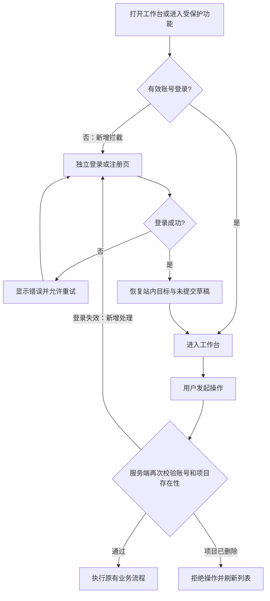
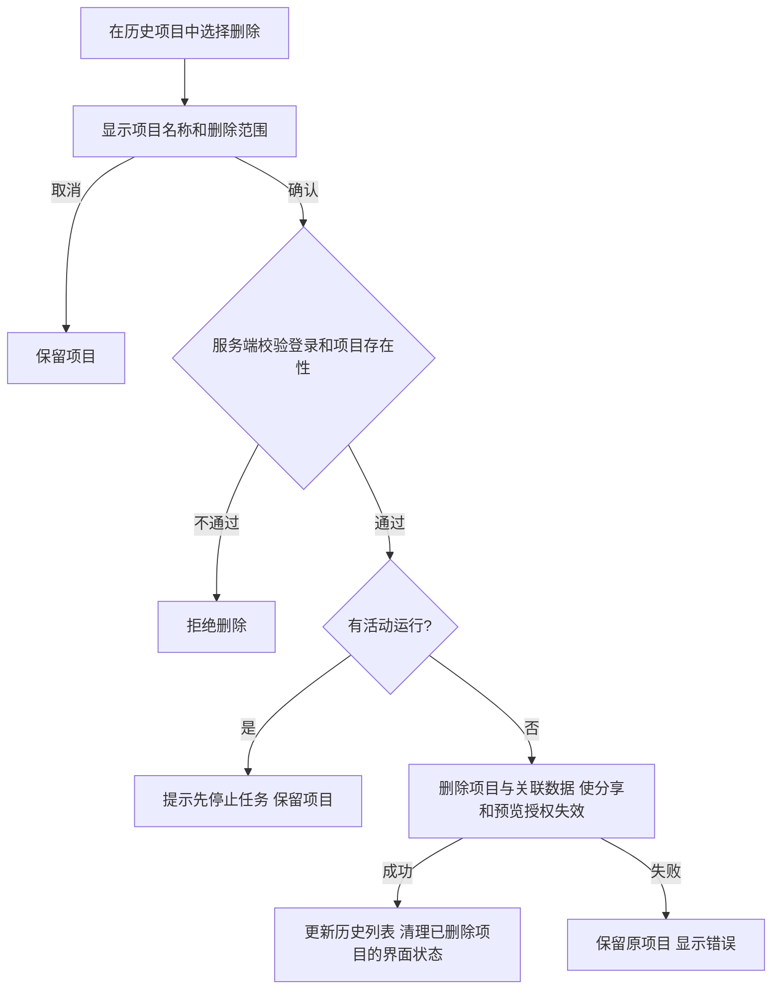

# 登录后全局共享与历史项目删除需求

日期：2026-11-13。状态：**需求与技术方案已确认，用户继续确认后已发布并完成公网验收。** 用户在需求稿交付后回复“继续”，确认按本文范围推进。

用户原始要求：未登录不能向 AI 发布指令，必须登录后才能使用正常功能；登录交互参考 Codex 内置浏览器中的 atoms.dev；增加删除历史任务的能力。用户已明确删除对象为“左侧整个项目/对话及其任务历史”，不是项目内某一次任务。用户随后明确：项目数据登录后全局可见，**所有账号均可查看、修改、发 AI 指令和删除**。

本文优先于[原需求](requirements.md)和[验收补齐需求](acceptance-completion-requirements.md)中允许游客创建项目、执行任务和保存示例副本，以及按账号隔离项目权限的约定。与本次变更无关的已确认能力继续保留。

## 1 变更前现状与问题

- 当前服务在初始化时自动创建游客会话；项目和 AI 操作只要求有效会话，未要求关联已登录账号。前端也只检查初始化是否完成，因此游客可以创建项目、发送需求和调用模型。
- 已有用户名与密码注册、登录、退出及跨设备恢复，登录入口是工作台中的弹窗；现有账号可继续使用。
- 左侧展示的是项目列表。一个项目包含多次任务、对话、执行记录、文件、检查点和交付版本，也可能具有应用业务数据及分享链接；当前没有删除项目的入口或接口。
- 实际查看的参考页为 [Atoms 登录页](https://atoms.dev/zh/login?redirect=/zh)：独立页面、左侧登录表单、右侧产品说明、突出主操作、未填写时禁用继续按钮。页面显示 Google 和邮箱入口；本次默认沿用本项目已有的用户名与密码方式，借鉴页面结构与反馈交互。

以上来自本轮代码和参考页面检查，不代表已经完成修改或线上验证。

## 2 登录后使用

### R01 功能访问边界

- 未登录打开工作台时展示独立登录/注册页面；检查登录状态期间显示加载状态，不能先闪出项目内容或可操作工作台。
- 创建和管理项目、发送或补充 AI 指令、批准计划、回答问题、停止/继续/重做任务、导入输入、查看项目文件、预览、导出、读写应用数据、管理分享、复制示例或分享为新项目，均要求有效账号登录。
- 服务端必须执行同样的限制。无 Cookie、有效游客 Cookie、过期/撤销的账号 Cookie 都不能绕过页面直接使用上述接口；拒绝请求不能创建项目、修改数据、触发模型或启动执行器。
- 产品介绍、预置示例介绍和已主动公开的分享页面仍可公开访问；分享中的试用不会修改原项目数据。创建副本时必须先登录，新副本同样进入共享列表。
- 注册、登录、登录状态检查以及服务健康检查保持可用，不因强制登录形成循环拦截。

### R01a 登录后全局共享（用户追加确认）

- 所有已登录账号看到相同的全局项目列表，能访问所有现有及新建项目，包括旧游客项目。
- 共享范围包含项目对话、任务和运行记录、输入文件、产物、检查点、历史版本、应用业务数据及项目内备份。所有登录账号都能编辑、发 AI 指令、停止/继续任务、导入导出、管理分享和删除项目。
- 页面明确显示“共享工作空间”，创建者不再构成访问或操作限制；不提供“仅本人可见”的虚假提示。
- 账号密码、会话凭据、模型密钥和其他服务端配置不属于项目共享内容。
- 单项目只能有一个活动运行，已有业务数据修订冲突检查继续有效，避免多个账号同时操作造成覆盖。删除确认明确提示会影响所有账号。

### R02 登录与注册交互

- 桌面采用参考页的左右分栏：一侧为账号表单，另一侧为本项目的产品说明；窄屏优先完整展示表单和主操作。
- 沿用现有用户名与密码注册/登录，提供清楚的模式切换、字段要求、错误提示及提交中状态，防止重复提交。
- 登录成功后进入工作台；从受保护入口或分享复制入口进入登录时，保留合法的站内目标，成功后返回相应页面。
- 因会话过期进入登录时保留尚未提交的指令草稿；重新登录后由用户确认发送，不自动执行会产生模型调用或数据写入的操作。
- 返回目标不能跳到任意外部网址。错误密码在表单中提示；网络错误提供重试，不能误报为账号密码错误。

### R03 登录失效、退出与原有数据

- 退出成功或确认会话失效后，清理当前页面的项目展示、预览及进度订阅，恢复登录页；旧页面的新操作仍由服务端拒绝。
- 切换账号后，上一账号尚未返回的请求不能重新填入旧项目内容。
- 退出不等于停止已由服务端接受的后台任务。已有运行和已保存产物继续遵守原有停止、保存和恢复规则。
- 原游客项目和业务数据保留并进入登录后的共享列表，不再要求先接收或认领才能使用。登录页不再提供没有权限意义的“接收游客项目”选项。
- 原账号、跨设备恢复、登录限流和已消耗额度继续有效；原账号间项目隔离改为登录后全局共享。当前标签页尚未发送的草稿不会自动共享。

### 使用流程变化

## 3 删除历史项目

### R04 删除对象与入口

- 删除单位是左侧列表中的一个完整项目/对话，包括其中所有任务历史。
- 每个项目提供可发现的删除入口，桌面、触屏和键盘操作均能使用。
- 删除前显示确认框，明确项目名称和影响范围：对话、任务记录、文件、检查点、历史版本、应用业务数据和项目内数据备份将被删除，分享链接失效。取消后保持原状。
- 默认不提供回收站或用户恢复入口，确认文案应说明无法在产品中恢复。
- 正在执行的项目不能删除，提示先停止任务。用户明确停止并结束活动运行后，才能再次发起删除；删除动作本身不自动停止任务。
- 没有活动运行的项目均可删除，包括成功、失败、已停止，以及等待回答或批准的项目。

### R05 删除结果与数据边界

- 任何已登录账号都可以删除共享列表中的项目；未登录、过期或撤销会话均不能删除。删除确认说明“此操作会对所有账号生效”。
- 服务端确认成功后才移除列表项。删除当前打开项目时回到新建页面，清理当前项目的预览、事件订阅和最近打开记录；删除其他项目不影响当前工作。
- 刷新、换设备、重启服务后，项目不再出现。旧页面或旧地址不能再读写、导出、恢复版本、继续任务或使用原预览授权；已建立的事件订阅也应结束。
- 原项目分享链接及从该链接创建新副本的能力失效。删除前已经独立创建的副本不受影响。
- 删除不得误删其他项目仍在使用的文件内容、版本或业务数据，也不能清空账号或重置已消耗的模型额度。删除的项目不再占用项目数量上限。
- 并发启动与删除必须得到一致结果：活动运行存在时拒绝删除；删除已成功时，启动或迟到写入不能把项目重新创建出来。
- 删除失败时保留原项目并明确提示。网络中断或重复点击不能导致其他项目被删，也不能出现只删一部分却报告成功的状态。
- 已下载文件、其他人的独立副本和部署系统按原策略保留的历史备份不属于此次在线删除范围；不能承诺召回已导出的内容或擦除备份介质。

### 删除流程（新增）

## 4 验收标准

| 编号 | 场景 | 通过条件 |
| --- | --- | --- |
| A01 | 无 Cookie 或只有游客 Cookie 打开工作台 | 展示登录页；不能创建项目或向 AI 发送需求 |
| A02 | 绕过页面直接请求项目、任务、复制、文件、应用数据和事件接口 | 服务端拒绝；没有新项目、数据写入、模型请求或执行器任务 |
| A03 | 注册、正确/错误密码登录、重复提交 | 成功后进入工作台；错误明确；提交过程中防止重复请求 |
| A04 | 两个不同账号分别登录 | 都能查看全部项目，并能对对方创建的项目修改、发 AI 指令、停止、继续和删除；同时操作遵守运行和数据冲突限制 |
| A05 | 退出、会话过期、旧页面操作和账号切换中的迟到响应 | 恢复登录入口；项目内容不会在未登录时被迟到响应重新展示；新请求被拒绝 |
| A06 | 从分享复制入口登录，或会话失效后重新登录 | 返回站内目标并保留未提交草稿；不自动发出 AI 指令 |
| A07 | 登录后查看旧游客项目，另一设备或账号再次打开 | 旧项目和保存数据完整，无需认领；未登录无法操作，原额度账本保留 |
| A08 | 打开公开介绍或分享页 | 可查看已公开内容；创建个人副本前要求登录 |
| D01 | 删除确认后取消，以及确认删除闲置项目 | 取消不变；确认成功后完整项目从历史列表移除 |
| D02 | 分别删除当前项目和其他项目 | 当前项目删除后回到新建页；删除其他项目不打断当前界面 |
| D03 | 删除运行中项目，或同时启动和删除 | 运行中拒绝；竞争结果一致；无迟到写入复活 |
| D04 | 未登录请求删除，以及另一个有效账号请求删除 | 未登录拒绝且没有变化；另一个账号可按确认流程删除，所有账号看到相同结果 |
| D05 | 删除后刷新、换设备、重启、使用旧地址及事件订阅 | 项目不再出现，旧读写与订阅不能继续工作 |
| D06 | 删除带业务数据、备份、版本和分享的项目 | 关联数据不可再使用；分享失效；其他项目和独立副本正常 |
| D07 | 模拟删除失败、响应丢失、重复请求 | 无部分删除的成功假象；界面可重试或刷新确认结果 |
| D08 | 删除达到数量上限的账号中的一个项目 | 释放一个项目名额；已消耗调用额度不减少 |
| U01 | 桌面和 390px 窄屏，含键盘操作 | 登录表单、错误提示、删除入口和确认框可见可操作，无遮挡 |

上述要求的执行结果见[验收记录](login-required-project-deletion-validation.md)。登录拦截及删除的数据验证应使用隔离测试账号和数据库，不删除用户现有项目。

## 5 本轮交付与下一阶段

需求已确认，对应[技术方案](login-required-project-deletion-design.md)说明账号校验范围、页面状态变化、删除的数据关系和并发处理，以及对应验证方式。用户已回复“继续”确认技术方案，现已按独立功能实现、验证并提交 commit，人工验收材料见[验证记录](login-required-project-deletion-validation.md)。

新增第三方登录、邮箱验证码、找回密码、项目内单次任务删除、批量删除和回收站不纳入本稿。生产发布按后续确认和项目发布约定执行，实际状态见[发布回执](login-required-project-deletion-release-20261113.json)。
