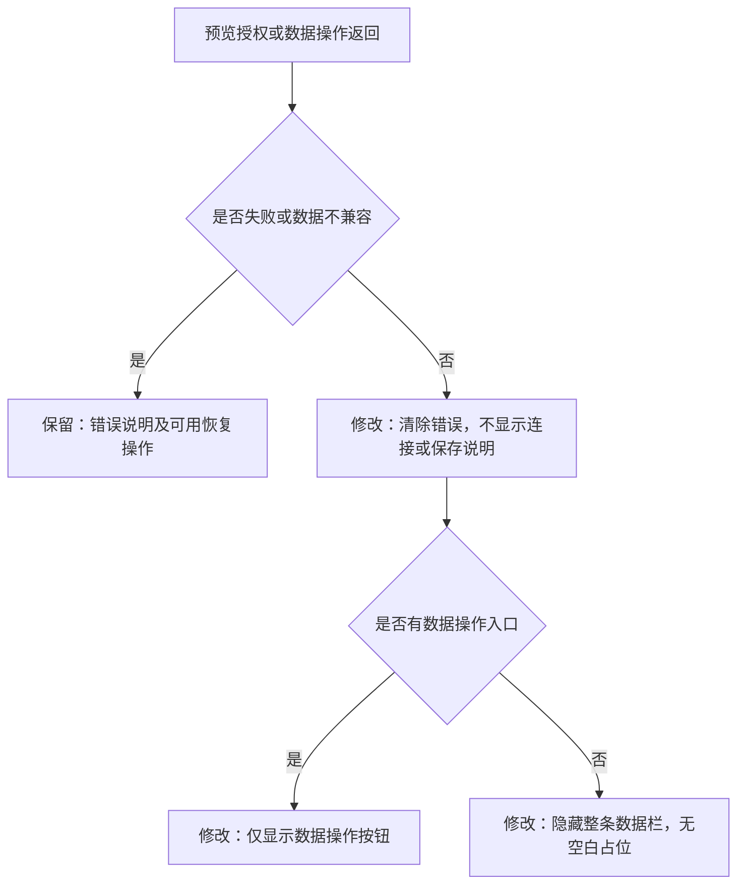

# 移除预览常驻说明

日期：2026-11-14（北京时间）。依据：用户要求去掉截图所示「旧版应用 · 尚未接入持久化，页面内的修改可能随刷新丢失」这一类提示。

## 需求与验收

- 工作台及分享页共用的预览组件不再展示连接、正式数据、试用数据、旧版应用、保存中和保存成功等平台说明。
- 没有数据操作入口、也没有错误时，不渲染顶部数据栏，不留空白占位。
- 导入、导出、下载备份入口继续可用；格式不兼容、请求失败等实际错误及恢复操作继续显示。
- 只调整平台预览栏；应用正文、离线导出说明、模型失败后的演示切换提示不属于本次截图范围。
- 数据读写、预览授权与演示就绪通知保持原行为。

## 实现方案

`AppPreview.tsx` 仅保存需要显示的错误，删除成功状态及其文案；有操作入口或错误才显示数据栏。常规操作栏使用中性色，发生错误时沿用错误样式。没有新增实体、接口或存储。

既有验收脚本改为等待应用实际显示保存后的记录，不再依赖被移除的平台成功文案。验证使用前端构建、既有浏览器验收，以及旧版预览和错误状态的定向页面检查。

## 验证记录

- `npm run build --prefix web`：TypeScript 检查与生产构建通过。
- 既有浏览器验收通过：`acceptance_completion.cjs` 11 项、`fallback_navigation_acceptance.cjs` 19 项、`login_shared_deletion_acceptance.cjs` 12 项。覆盖保存/刷新/后端重启、导入、分享、账号及演示自动跳转。
- 定向页面检查通过：正常预览只有数据按钮；模拟旧版预览在桌面和 390px 窄屏没有提示栏或顶部占位；模拟备份下载失败仍显示错误。桌面、窄屏及错误截图已检查。
- 所有检查使用本地独立数据目录、空模型配置，无付费模型调用。旧版与下载失败检查使用注入响应；未修改或验收线上部署。
- 证据：`artifacts/acceptance-completion-2026-11-13T19-35-13-808Z/`、`artifacts/fallback-navigation-2026-11-13T19-35-13-804Z/`、`artifacts/login-shared-deletion-2026-11-13T19-35-13-807Z/`、`artifacts/preview-notice-removal-20261114/`。
