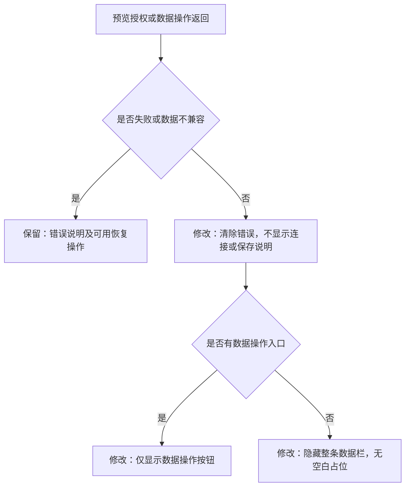
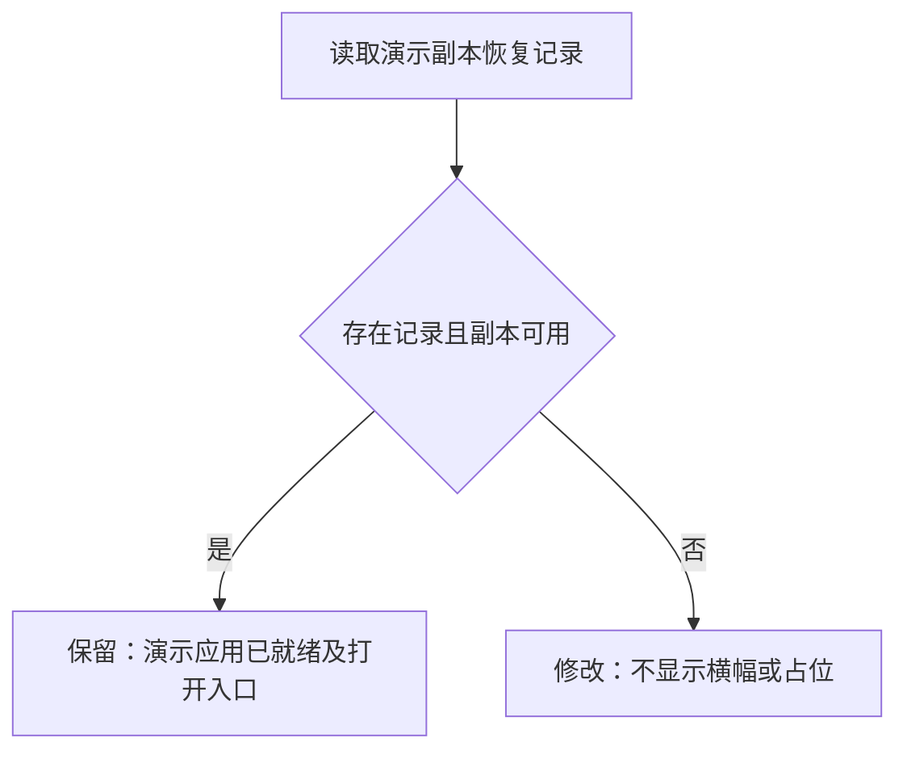

# 移除预览常驻说明

日期：2026-11-14（北京时间）。依据：用户要求去掉截图所示「旧版应用 · 尚未接入持久化，页面内的修改可能随刷新丢失」这一类提示。

## 需求与验收

- 工作台及分享页共用的预览组件不再展示连接、正式数据、试用数据、旧版应用、保存中和保存成功等平台说明。
- 没有数据操作入口、也没有错误时，不渲染顶部数据栏，不留空白占位。
- 导入、导出、下载备份入口继续可用；格式不兼容、请求失败等实际错误及恢复操作继续显示。
- 只调整平台预览栏；应用正文、离线导出说明、模型失败后的演示切换提示不属于本次截图范围。
- 数据读写、预览授权与演示就绪通知保持原行为。

## 实现方案

`AppPreview.tsx` 仅保存需要显示的错误，删除成功状态及其文案；有操作入口或错误才显示数据栏。常规操作栏使用中性色，发生错误时沿用错误样式。没有新增实体、接口或存储。

既有验收脚本改为等待应用实际显示保存后的记录，不再依赖被移除的平台成功文案。验证使用前端构建、既有浏览器验收，以及旧版预览和错误状态的定向页面检查。

## 验证记录

- `npm run build --prefix web`：TypeScript 检查与生产构建通过。
- 既有浏览器验收通过：`acceptance_completion.cjs` 11 项、`fallback_navigation_acceptance.cjs` 19 项、`login_shared_deletion_acceptance.cjs` 12 项。覆盖保存/刷新/后端重启、导入、分享、账号及演示自动跳转。
- 定向页面检查通过：正常预览只有数据按钮；模拟旧版预览在桌面和 390px 窄屏没有提示栏或顶部占位；模拟备份下载失败仍显示错误。桌面、窄屏及错误截图已检查。
- 上述检查使用本地独立数据目录、空模型配置，无付费模型调用。旧版与下载失败检查使用注入响应；后续已于 2026-11-14 03:50（北京时间）发布，线上验证见[发布记录](preview-budget-deployment-20261114.md)。
- 证据：`artifacts/acceptance-completion-2026-11-13T19-35-13-808Z/`、`artifacts/fallback-navigation-2026-11-13T19-35-13-804Z/`、`artifacts/login-shared-deletion-2026-11-13T19-35-13-807Z/`、`artifacts/preview-notice-removal-20261114/`。

## 补充：演示副本删除后的提示

2026-11-14 用户继续要求去掉「演示副本已删除，原任务与成果仍保留」及旁边的禁用按钮。演示副本不可用时不渲染这一整条横幅，不留占位；副本可用时继续提供「打开演示应用」。删除状态、原任务记录及继续操作保持原有行为。

实现只调整 `App.tsx` 的渲染条件，无新增实体或接口，并删除不再显示的文案及禁用分支。

验证通过：前端生产构建；既有演示跳转 19 项和当前任务错误展示 9 项；补充的桌面/390px 无横幅、无禁用按钮以及可用副本入口检查 3 项。原任务继续入口仍可使用，截图已检查。共 31 项浏览器检查，使用本地独立数据或明确模拟的接口快照，未调用付费模型。

证据位于本次独立工作树的 `artifacts/deleted-demo-notice-2026-11-13T19-59-11-130Z/` 和 `artifacts/fallback-navigation-2026-11-13T19-59-11-073Z/`。

2026-11-14 04:01（北京时间）已发布 `20261113T200035Z`，前端代码 `20e20f0`。本次仅切换前端静态文件，后端沿用 `8076c55` 对应程序，应用和执行器均未重启；模型配置、其他 10 个容器保持一致，旧静态资源及上一版本保留。

公网健康、登录保护和资源一致性等 6 项检查通过，13 个前端文件与发布清单一致。使用线上实际前端资源与模拟接口快照，额外确认桌面/390px 不显示删除横幅、原任务继续入口仍在、可用副本仍可打开，共 3 项通过；未创建生产账号或发起模型任务。

切换瞬间数据库内容一致。后续核验时，发布前已运行的一项任务继续写入产物及调用记录；原运行和服务进程保留，其余 10 个空闲项目保持一致。备份为 `/opt/atoms_lab/backups/20261113T200105244861Z.db`。最终凭据见本次独立工作树 `artifacts/deleted-demo-release-20261113T200035Z/release-final.json`，服务器凭据同步到 `/opt/atoms_lab/release-receipt.json`。
