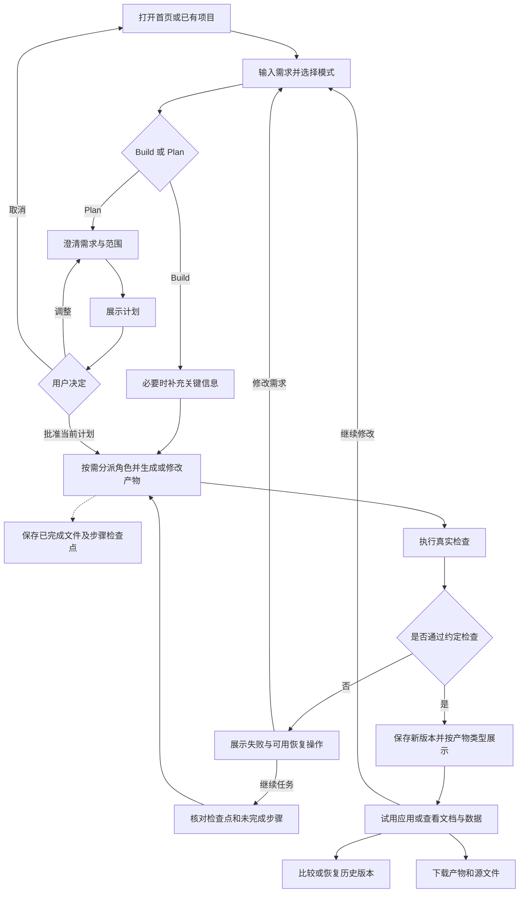
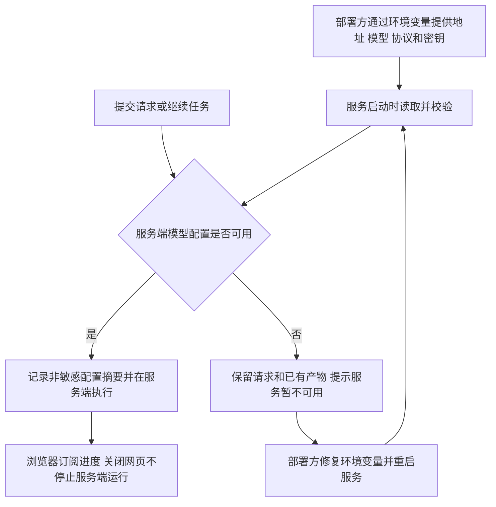
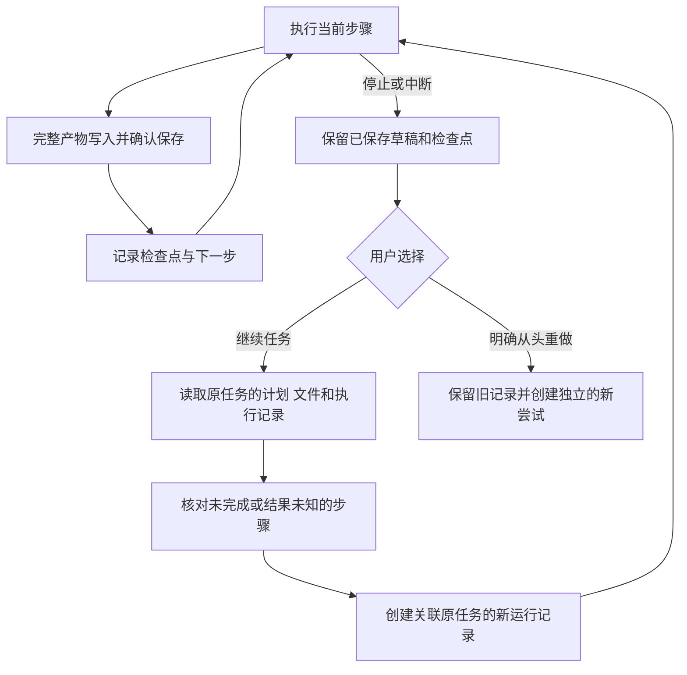

# Atoms Demo 需求规格 v0.6

日期：2026-11-11。

2026-11-13 最新补充：用户已确认[登录后全局共享与历史项目删除需求](login-required-project-deletion-requirements.md)，正常工作台功能改为登录后使用；所有登录账号均能查看、修改、发 AI 指令和删除全部项目。该需求优先于下文的游客创建、执行及项目权限隔离约定；当前处于技术方案阶段，不代表已经实现或上线。

2026-11-13 补充：用户已确认[验收缺口补齐需求](acceptance-completion-requirements.md)，纳入账号、跨设备恢复及生成应用业务数据持久化。该补充优先于本文对应的首版排除项；[新技术方案](acceptance-completion-design.md)待确认，不能据此视为功能已经实现。

状态：**已获用户批准，进入实施与验收**。用户明确批准受限云端执行方案；后续取消 Git 提交，并指定现有 LLM 网关与 `atoms.linhengyi.xyz`。

依据：[产品调研](product-research.md)、原始任务说明与共享 Plan 对话。下文保留需求基线；具体实现范围及验证结论见 [技术设计](technical-design.md) 与 [实施记录](implementation-status.md)。v0.5 纳入真实 Node 构建、脚本运行、浏览器交互测试及最多两轮运行修复，不以静态检查替代实际运行。首版运行代码使用固定依赖、禁外网、限时限资源的 gVisor 容器。

交付包含本地 Git 提交和部署构建摘要。模型密钥只由服务端环境变量提供，无配置 UI。

## 1. 目标

交付一个无需注册即可体验的网页工作台，让使用者以自然语言提出任务，由智能体协作完成任务并交付可查看、使用或下载的产物。工作台运行在浏览器中，任务产物不限定为网页；同一任务可以包含多个文件和多种类型的产物。

优先实现完整可用的任务循环、清晰的过程展示和可复现的交付。输入框接受自由描述，不能只按关键词返回固定示例。首版建议覆盖以下类别，具体文件格式和运行环境在技术方案阶段确定：

| 产物类别 | 例子 | 首版建议交付方式 |
| --- | --- | --- |
| 网页应用 | 咖啡馆菜单、待办工具 | 可交互预览、源文件、运行说明 |
| 非网页代码/脚本 | 文件整理脚本、数据转换程序 | 源文件查看与下载、运行说明；实际执行范围由受支持运行环境决定，未执行必须标注 |
| 文档/报告 | 需求说明、技术设计、基于用户材料的分析报告 | 富文本或 Markdown 预览及文件下载 |
| 数据与图表 | 销售汇总表、趋势图、分析结果 | 数据表和图表预览、数据文件及计算说明下载 |

初期数据分析可接受用户在对话中粘贴的小型表格/CSV。上传大型文件、完整 Office 格式转换、移动应用打包、音视频生成暂不自动纳入本期承诺。网页应用仍保留真实生成与交互验收，以覆盖原任务要求的应用生成能力；非网页产物另设验收，不能全部转成网页来替代。

## 2. 两种构建模式

| 模式 | 使用者预期 | 本 Demo 拟定行为 |
| --- | --- | --- |
| Build（默认） | 需求明确，尽快看到结果 | 直接执行生成与检查，不要求先批准计划；若缺少无法合理推断的关键条件，可补问后继续 |
| Plan | 先明确范围，再决定是否实施 | 先澄清必要问题，生成计划；允许提出调整，只有明确批准当前计划后才进入实施并修改目标产物 |

两种模式在首页及后续对话输入区均可选择。每次请求记录发送时的模式；运行中的请求不因切换输入区选项而改变，新的选择作用于下一次发送。正在等待批准的计划可以修改或取消；切换模式本身不等于批准。

**Team Mode 是原产品的另一维度。** 首版建议先实现 Build/Plan 两条实际流程，不增加没有实际作用的团队开关，也不通过角色头像数量声称具备原产品全部协作能力。是否需要完整 Team Mode 可在范围确认时增加。

### 本期智能体

上一版只描述了规划、开发、检查阶段，未明确智能体清单。本版建议实现以下五个角色的有效职责，不是只展示五个头像，也不要求每次任务依次调用全部角色。

| 智能体 | 定义与职责 | 典型输入 → 输出 | 调用条件 |
| --- | --- | --- | --- |
| Mike，协调者 | 管理任务范围、分派工作、跟踪状态、汇总交付与恢复 | 用户请求 → 子任务、交接说明、最终交付摘要 | Plan 由其组织；Build 可轻量路由，不强制审批 |
| Emma，产品经理 | 澄清目标、用户、范围与验收标准 | 模糊想法 → 问题、需求说明、验收清单 | 需求不清或显式要求产品文档时 |
| Bob，架构师 | 确定程序结构、模块边界、数据与接口约定 | 已明确需求 → 技术设计、模块/文件规划 | 需要结构设计的代码任务或显式架构请求；简单任务跳过 |
| Alex，工程师 | 编写和修改网页、程序、脚本，执行受支持检查并修复 | 需求/设计与已有文件 → 代码、测试记录、运行结果 | 代码与应用开发任务 |
| David，数据分析师 | 基于输入数据完成计算、统计和可视化 | 表格数据与问题 → 汇总数据、图表、分析报告 | 数据分析任务；结论需对应实际计算结果 |

通用文档根据用途交给对应角色，例如需求文档交给 Emma、技术设计交给 Bob、数据报告交给 David。角色可使用同一模型服务，但应有明确职责、可用工具、交接内容和可追溯的执行记录。检查由真实工具提供证据，Mike 汇总，首版不额外虚构一个原产品未出现的测试角色。

暂缓 Iris（联网深度调研）、Sarah（搜索优化）、Adrian（广告投放），因为分别需要额外的检索验证或外部业务集成。以上五个角色纳入本次实现，具体分派机制见技术设计。

## 3. 使用流程

以下是本项目拟新增的产品流程，不是对 Atoms 内部实现的推断：

项目、任务、请求、计划、中间产物、步骤检查点、运行结果与成功版本都需要保存。失败尝试单独记录，不能替换最后可用版本。相对 v0.1，新增了按类型展示与检查点保存；中断后继续不等于清空后重做。

v0.4 修改首次模型调用前的配置检查：从工作区配置改为服务端启动时读取的环境变量。适用于 Build、Plan、普通模型问答和中断后的继续执行。移除访客配置/测试步骤；配置缺失时保留请求，提示服务暂不可用，由部署方修复：

## 4. 首版功能

### F01 首页与项目管理

- 首页包含产品说明、需求输入、Build/Plan 选择和少量可编辑示例提示。
- 提交需求后创建项目并进入工作台；项目列表支持重新打开、重命名。
- 首次进入不要求注册；不同访客的可编辑工作区相互隔离。
- 示例提示仅辅助输入；示例项目如有预置，明确标注，不能伪装成即时生成结果。

### F02 对话与计划

- 消息区区分用户输入、协调/规划回复、开发活动、检查结果和系统错误。
- 用户 2026-11-11 补充：agent 中间执行过程默认折叠，用户点击后才展开。连续中间消息归为一段，展示记录条数；用户消息、最终交付、待批准计划、待回答问题及失败恢复操作保持可见。新进展不自动展开，已经展开的段落在实时更新时保持展开。
- Build 请求默认直接执行；Plan 请求通过问题卡与计划卡明确目标、范围和验收点。
- 澄清问题支持点击预设选项直接提交，也可在同一张问题卡中输入并发送自定义回答。执行过程可在对应运行旁展开查看角色进度和工具记录。
- Plan 支持批准、提出修改和取消。刷新后仍保留待确认计划及状态。
- 未批准的计划可以保存澄清和计划文档，但不得实施目标产物或生成新的交付版本；重复点击批准不能重复启动同一任务。
- 对已有项目的普通解释性问题可以直接回答，不应无故修改已有产物。

### F03 真实生成与执行反馈

- 调用真实模型服务，根据需求、已分派职责及当前产物生成或修改文件。
- 展示实际执行到的阶段、文件变化、检查摘要和明确的成功/失败状态。
- 角色身份应对应实际职责或执行阶段；不以虚构工具记录、虚构检查或模拟耗时充当执行证据。
- 请求失败、超时、额度不足时显示可理解原因及“继续任务”入口，保留对话、计划、已保存的中间文件、步骤结果和最后成功版本。
- 支持停止运行；停止后不接纳该次运行的迟到结果为当前产物，不覆盖已保存的中间状态。
- “继续任务”属于原任务：载入已保存工作状态，核对未完成步骤，再建立新的运行记录继续处理。新的模型调用和运行记录不意味着新项目，也不意味着删除或从头生成所有文件。
- “从头重做”是另一项显式操作：说明重新执行的范围，保留旧尝试及其中间产物，不能冒充继续操作或自动清空历史。
- 不承诺恢复模型尚未返回的生成过程、进程内存或未完成工具调用的内部状态；未完整保存的当前一步可能需要重做。结果未知的动作先核对实际产物，不能直接标记完成或盲目重复外部操作。
- 同一项目同时最多一个活动执行，重复提交不得造成并发覆盖。首版不做复杂任务队列。
- 执行任务运行于部署工作台的服务器。服务端确认接收后，关闭网页、断网或关闭客户端电脑不自动停止任务；重新打开后可查看已持久化的进度与结果。尚未确认接收的请求不能保证已启动。
- 等待用户回答或批准计划时保留等待状态；服务器进程停止时按中断恢复处理。网页产物的交互预览运行于用户浏览器，关闭网页会停止该预览，不等于停止后台生成。

### F04 工作台与产物展示

- 桌面采用左侧对话、右侧工作区；工作区包含产物列表、类型对应的查看器、源文件和历史入口。
- 网页运行在交互预览中，支持实际按钮、筛选、表单等操作，提供桌面/手机宽度切换及重新加载。
- 文档以阅读视图展示；数据以表格或图表展示；代码/脚本以源码及可用的运行记录展示。下载保留原文件类型，不能用网页截图替代文档、代码或数据文件。
- 区分已保存草稿和成功交付版本；草稿可查看下载，但未通过检查时不能标为可用或成功。
- 清楚区分首次生成中、更新中、成功、失败与空状态。
- 手机或窄窗口下能切换对话与产物，不让输入框和关键动作被遮挡。
- 生成内容运行区域与平台权限隔离，不能读取平台模型密钥、其他访客数据或直接操作宿主文件。

### F05 持续修改与数据保存

- 追加需求以当前选定的工作版本为基础，保留不相关功能和内容。
- 平台持续保存项目、任务、对话、模式、计划、运行记录、文件产物、步骤检查点与版本关联。
- 每个完整文件或有效文件变更在对用户标记“已保存”前持久化；每个可恢复步骤完成后保存检查点。不能等整个任务成功才保存所有产物。
- 检查点包含已确认计划、文件快照/引用、已完成步骤、检查结果和待办事项。它是应用自己的恢复记录，不是模型内部状态的备份。
- 刷新页面及服务重启后，仍能打开项目、查看消息、已确认保存的草稿、检查点和最后成功版本。
- 服务中断的运行在恢复后显示可理解的中断状态，不无限显示“生成中”，不悄悄重新扣费执行。
- 平台数据持久化属于首版硬要求。生成应用自己的数据库、跨设备数据同步不包含在首版承诺中；需要此能力时应明确提示范围限制。

### F06 扩展能力：版本对比与恢复

- 每次成功生成形成命名版本，记录时间、对应需求和改动摘要。
- 支持查看版本文件及差异；文本和代码可比较内容，数据可比较内容或结构，其他文件至少显示变更清单，不承诺任意二进制文件的语义比较。
- 预览历史版本不会自动修改当前工作版本。
- 恢复前展示目标，用户确认后切换工作版本；保留较新版本，允许再次查看或恢复。
- 恢复历史交付版本与继续中断任务是两个动作。前者选取已有版本，后者使用尚未交付的检查点和草稿。
- 恢复只承诺本 Demo 管理的文件及相关项目状态，不声称能恢复外部数据或第三方服务。
- 运行中禁止恢复，避免结果覆盖用户选择。

### F07 文件与交付

- 提供文件列表、源码/内容查看和当前版本下载；下载内容与所选版本一致，同一任务支持多个产物。
- 提供可从外部访问的 Demo 工作台、本地 Git 源码、启动配置说明和验收说明。
- 说明已实现能力、取舍、未验证事项及后续扩展顺序。
- 本期必须部署工作台；“让每个生成应用一键发布到独立公开地址”作为后续增强，不与工作台在线访问混为一谈。

### F08 服务端环境变量接入（替换原访客配置功能）

- 协议类型、服务地址（Base URL）、模型名称与 API Key 均从服务端环境变量读取。首页与工作台没有模型设置页面，不提供访客保存、替换、删除密钥或测试连接的接口。
- 所有访客及首版五个智能体共用部署方提供的模型配置；项目、对话和文件仍按访客工作区隔离。调用消耗部署方密钥对应账户的额度，保留全局、工作区和运行额度限制。
- 模型动作 JSON 格式不合法时，向模型反馈具体原因并要求重写当前动作，最多重试五次。动作格式通过后，下条动作重新获得五次机会。整个回复包含额外文本或多个对象时拒绝执行其中的动作。格式重试计入该轮的模型调用额度，触达限制时保留已保存进度。
- 按网关接收的 JSON 请求字节数加最大输出量预留每分钟 Token 额度。网关明确返回 `model_tpm` 时先等待，再重试同一次模型请求，最多两次。每次发送计入运行及每日调用额度。停止任务或运行超时可结束等待，已保存进度可继续。
- API Key 不写入数据库，不需要密钥密文表或应用加密主密钥；不得进入前端构建变量、聊天、提示词、日志、错误详情、检查点、生成文件、导出包或 Git 仓库。
- 服务启动时只校验环境变量是否齐全且格式有效，不自动发起收费探测。部署验收时由开发/部署人员显式执行最小工具调用测试；普通访客不承担配置步骤。
- 服务地址只能由部署方指定，访客输入与模型工具参数不能覆盖；请求不得通过重定向将密钥转发给其他地址。接口兼容情况需真实验证，不承诺任意厂商原生协议。
- 首版不做配置热更新；修改环境变量后重启生效。每次运行保存非敏感的协议、地址、模型与部署配置标识；重启后继续任务使用当前配置并记录变化，已保存工作不丢失。
- 配置缺失、鉴权失败、模型不可用或限流时展示脱敏错误，保留原任务及产物；不返回配置秘密，也不自动切换到其他收费账户。

### F09 多语言运行与修复次数（2026-11-12）

- 执行器支持根目录 Go 模块的真实编译和测试、Python 标准库脚本及 TypeScript 脚本。脚本须成功退出且输出匹配断言。Go Redis 项目用沙箱内的本地 TCP 测试验证。
- 当前草稿的 Go、Python 和独立 TypeScript 脚本须分别取得对应执行报告。报告须匹配交付的文件版本。
- 单次运行首次产物检查失败后允许五次自动修复。第六次失败后保留草稿和失败记录，阻止本轮的下一次执行。编译、运行或浏览器断言失败计入修复次数。执行环境故障保存原因并结束本轮，不消耗修复次数。复用现有 gVisor 隔离、离线依赖、单作业和资源限制。
- 执行节点忙时使用原作业标识分别等待 2、5、10 秒后重试。响应丢失或结果未知时，只查询原作业的执行记录。仍无法确认时保留当前草稿和检查点，用户继续时先核对原作业，再决定是否需要提交。停止或超时可取消等待。

## 5. 核心概念

这些是产品概念，不限定数据库表或技术结构，具体方案在需求确认后制定。

| 概念 | 定义 | 例子 | 用途 |
| --- | --- | --- | --- |
| 访客工作区 | 无需注册的访客所拥有的项目集合 | 同一浏览器再次打开后找到自己的项目 | 隔离不同访客的编辑权限 |
| 项目 | 持续进行的一组相关工作及其上下文 | 咖啡馆网站及菜单维护说明，或销售分析 | 聚合任务、对话、文件、状态和历史 |
| 任务 | 一个需要完成的用户目标，可包含多次执行尝试 | 完成月度销售分析 | 中断继续时保持同一目标及已有工作 |
| 请求 | 一次用户输入及其发送时模式 | Plan：搭建咖啡馆网站 | 明确本次目标，避免模式含义漂移 |
| 计划 | 等待确认或已经确认的实施范围 | 包含菜单、营业时间、地址；不含预约 | 在 Plan 路径控制实施边界 |
| 运行 | 某任务的一次实际执行尝试 | 销售分析中断后，基于检查点再次执行 | 分清任务身份与执行次数，记录状态和错误 |
| 智能体 | 承担特定职责、使用对应工具并交付结果的执行角色 | David 计算并生成销售报表 | 分配工作、交接上下文并追溯产物来源 |
| 部署模型配置 | 服务启动时读取的协议、地址、模型和密钥；密钥只留在服务端运行环境 | 部署方设置模型网关及已开通模型 | 为所有角色提供调用能力；运行记录只保存非敏感摘要，不建立访客配置实体 |
| 消息/步骤 | 对话内容或某次实际活动的记录 | 用户修改意见、代码检查失败摘要 | 解释发生了什么，支持刷新后继续查看 |
| 文件产物 | 任务产生的可保存文件，带类型与草稿/交付状态 | 页面、脚本、需求文档、汇总 CSV | 支撑按类型展示、检查、下载和版本关联 |
| 检查点 | 已保存工作状态及继续所需信息的记录 | 两个文件已保存、第三个待写、检查未运行 | 让后续运行从有效进度继续，不依赖模型内存 |
| 版本 | 一次成功交付的不可随意覆盖的产物快照 | v2：菜单增加分类筛选 | 支撑历史查看、比较与恢复 |

## 6. 验收用例

| 编号 | 操作 | 通过条件 |
| --- | --- | --- |
| A01 Build 首次生成 | 输入包含栏目和样式的自由需求，选择 Build | 不强制审批计划；真实生成可预览代码；主要要求可观察到 |
| A02 Plan 首次生成 | 选择 Plan，回答必要问题，调整并批准计划 | 批准前只允许澄清与计划产物；批准后按最新计划实施；问题、计划与结果可追溯 |
| A03 模式边界 | 等待批准时切换输入模式；重复点击批准 | 切换不隐式批准原计划；重复批准最多产生一次执行 |
| A04 自由需求 | 分别输入咖啡馆网站、待办工具，以及非预置内容 | 输出对应不同需求；不是同一固定模板更换标题 |
| A05 真实交互 | 在生成页操作菜单筛选或新增/完成待办 | 操作实际改变页面状态；无假按钮 |
| A06 多轮修改 | 在已有菜单上调整指定价格或增加分类 | 生成新版本；目标改动生效；无关页面内容仍保留 |
| A07 持久化 | 刷新页面、重开项目、服务重启 | 项目、任务、消息、模式、计划、已确认保存草稿、检查点及成功版本仍在 |
| A08 异常恢复 | 制造模型错误、超时或生成检查失败，再重试 | 错误可见；旧版本仍可用；无假成功、无无限自动重试 |
| A09 停止与续做 | 两个文件已标记保存，第三步中断，刷新或重启后选择继续 | 前两个文件及检查点仍在；新运行关联原任务，从未完成步骤继续；无关已完成内容不被重新生成；迟到结果不覆盖草稿或成功版本 |
| A10 版本能力 | 对比 v1/v2，预览 v1，恢复 v1，再查看 v2 | 差异准确；历史预览不自动恢复；恢复后可继续迭代；v2 保留 |
| A11 预览与导出 | 切换桌面/手机预览，查看并下载当前代码 | 预览与版本一致；下载文件能按交付说明运行 |
| A12 访客隔离 | 两个独立浏览器会话创建不同项目 | 不能读取或修改对方未分享的工作区 |
| A13 线上交付 | 外部浏览器打开已部署地址，完整执行 A01/A02 主流程 | 无需注册；在线模型可用；数据可保存；源码链接与交付版本对应 |
| A14 非网页产物 | 分别请求需求文档、非网页脚本、已知小样本数据的分析报告 | 返回对应格式的实际文件；能预览/查看和下载；数据计算匹配已知结果；未执行的脚本不声称已验证 |
| A15 角色分派 | 分别发起模糊产品需求、架构请求、开发请求、数据分析任务 | 对应角色有真实执行及产物记录；简单任务不机械调用全部五个角色；交接保留已确认范围 |
| A16 未完成写入 | 在当前文件尚未确认保存时中断 | 先前文件保持完整；当前部分结果不冒充完整文件或检查点；继续时核对并补做当前一步 |
| A17 继续与重做 | 对同一中断任务分别测试继续和显式从头重做 | 继续复用检查点；重做保留旧尝试且记录起点；两种操作均不悄悄删除旧文件 |
| A18 环境变量接入 | 部署方设置协议、地址、模型和密钥后启动服务并执行任务 | 五个角色读取服务端配置；访客无需配置；无配置页面或密钥修改接口；密钥不入库或前端 |
| A19 接入与错误 | 部署验收显式测试有效配置，并模拟缺少配置、错误密钥、不可用模型及网络失败 | 启动校验不发起收费请求；工具调用能力真实验证；错误脱敏并保留任务，不自动转用其他账户 |
| A20 密钥保护 | 检查客户端、接口、存储、日志、工具上下文与导出；尝试从请求覆盖模型地址 | 密钥仅服务端使用；访客和模型不能更改服务目标；不向重定向目标发送密钥；项目归属隔离不变 |
| A21 部署配置变更 | 先停止或结束活动运行，修改环境变量并重启，再继续原任务 | 新运行使用当前环境配置，保留非敏感关联；之前的文件和检查点保留；无配置热切换或隐式收费续跑 |
| A22 关闭网页 | 服务端确认接收任务后关闭所有客户端页面，后台检查完成后重新打开 | 已启动任务持续执行且进度持久化；重新打开展示实际结果；需要回答或批准时保持等待，不自行批准 |

自动检查、浏览器实测和人工验收分别记录，不把源码推断写成真实设备验证，不预设成功率或性能数字。

## 7. 暂不纳入首版的范围

- Iris 联网深度调研、Sarah 搜索优化、Adrian 广告投放；独立 Team Mode 开关及任意角色提及暂缓。
- 通用后端项目生成、任意依赖安装与任意终端命令执行。
- 支付、用户注册系统、营销投放、搜索优化、外部连接器。
- 视频、完整演示文稿/Office 原生格式生成、图片生成、移动应用打包、多模型竞赛、文件上传、语音输入。
- 可视化选中元素编辑、手工代码编辑、多人实时协作。
- 每个生成应用的独立托管、域名绑定及外部数据库恢复。
- 访客 API Key 配置页面与接口、按工作区保存模型密钥、配置热更新。

这些是为按时交付提出的范围建议，不是原任务禁止实现的内容。

## 8. 需求基线与后续步骤

已将 **Build + Plan 双模式、多类型产物、五个按需协作的智能体、环境变量接入模型、真实执行、平台持久化、中间产物续做、持续修改、版本对比与恢复** 作为技术方案基线。具体实现边界、格式与验证方法由技术方案说明；技术方案确认后开始编码。

[技术方案](technical-design.md) 已同步环境变量接入、后台执行、角色交接、受限云端执行、首版工具清单及替代选型取舍。用户已批准实施与部署，指定现有 LLM 网关和 atoms.linhengyi.xyz；实际验证范围见实施记录。

按用户提供的 AGENTS.md，需求确认后进入技术方案，方案确认后编码；完成匹配的验证后提交 Git，最终等待人工验收。
