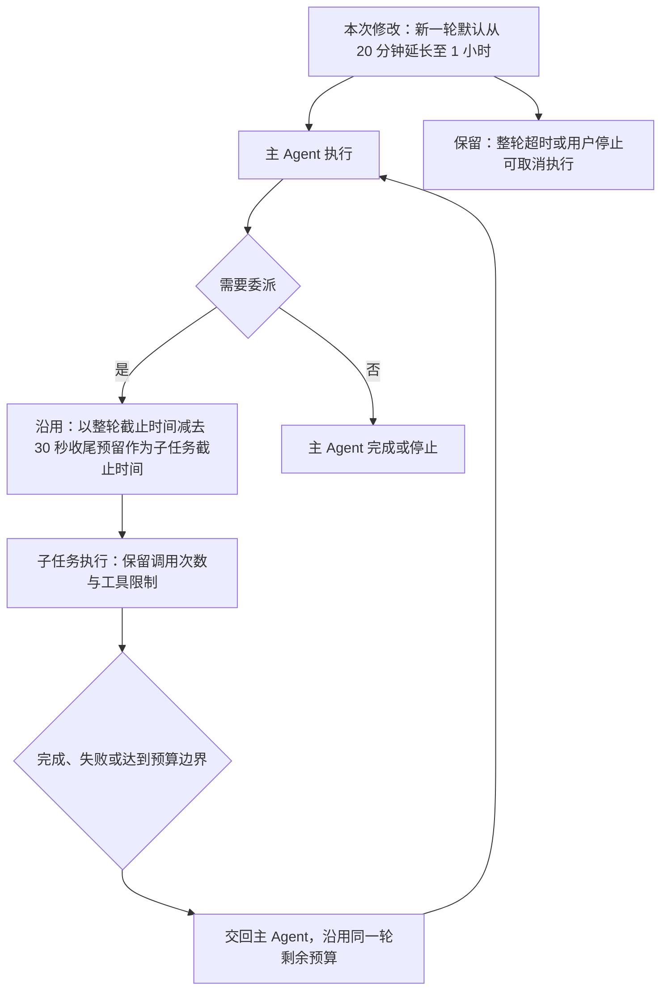

# 整轮 1 小时与委派共用时限

日期：2026-11-14（北京时间）。依据：用户先要求取消委派单独超时、整轮使用 20 分钟；确认计算器触发整轮上限后，明确要求“把整轮超时改为1小时”。

## 需求与验收

- 程序默认整轮时限由 1200 秒改为 3600 秒，与环境变量示例、部署模板一致；仍由 `ATOMS_RUN_SECONDS` 设置。
- 取消 `ATOMS_DELEGATE_SECONDS` 和每次委派固定 180 秒的上限。委派使用整轮剩余时间，给主 Agent 保留既有的 30 秒收尾时间。
- 一轮中的多次委派共用相同截止时间，不从每次委派开始重新计时。
- 旧委派恢复时按当前运行截止时间计算，不继续使用旧版保存的 180 秒截止时间，也不清空已消耗的模型调用次数、产物或执行记录。
- 整轮取消、用户停止、模型/工具各自超时及调用次数预算继续有效。延长时间不代表必然运行满 1 小时。
- 已有线上配置同步改为 3600 秒；配置由服务启动时读取，当前运行结束后重启应用，新一轮使用新时限。

## 实现方案

本次将现有配置默认值与部署配置改为 3600 秒，沿用已有委派时间计算，不新增实体、接口或数据表。现有 `Delegation.Deadline`（委派记录中的截止时间）记录「本轮开始时间 + 本轮时限 - 主 Agent 收尾预留」。例如整轮从 10:00 开始，10:05 分派的子任务截止时间为 10:59:30，整轮截止时间为 11:00。

旧委派再次进入执行前同步现有截止时间字段，保留调用计数与中间产物。角色指令明确旧交接消息的截止时间不适用于新的继续运行，避免模型据此提前放弃。单次模型请求仍受 HTTP 客户端超时及当前运行剩余时间的共同限制。

## 验证计划

- 配置读取：缺省和无效值回落到 3600 秒，有效环境变量仍可覆盖。
- 委派：重复分派使用同一个整轮截止时间；运行超过原来的 20 分钟后仍可委派，子任务在整轮第 59 分 30 秒交回。
- 恢复：旧截止时间被更新，调用计数与材料保留。
- 保留主 Agent 收尾时间、次数限制和停止行为的回归；使用短时限及模拟模型验证，不等待真实 1 小时或调用付费模型。
- 线上：重启前确认没有活动任务及执行器作业；仅变更时限配置，核对启动进程环境、`/api/bootstrap` 的 `limits.run_seconds` 与服务健康。

## 历史验证记录：20 分钟版本

- 配置及委派定向测试通过：默认 1200 秒、无效配置回落、有效覆盖；整轮已过 4 分钟后仍可分派，子任务可用时间超过旧 180 秒；重复分派共用相同截止时间；保留主 Agent 收尾时间。
- 旧记录续跑回归通过：保存两份文件后停止，将旧委派截止时间设为过去，再继续完成第三份文件；旧文件未重写，委派累计 6 次调用未被清零，截止时间更新到当前整轮。
- 四个专家角色的调用上限、格式失败、时间边界和主动交回回归通过。时间边界使用 4 秒整轮、2 秒收尾预留验证真实取消与交回。
- `go test ./... -count=1 -timeout 120s`、`go vet ./...` 通过；补充角色时间规则说明后，`go test ./internal/agent -count=1 -timeout 120s` 再次通过。
- 测试使用本地模拟模型与独立数据库；未等待真实 20 分钟，未发起付费模型调用，未部署或修改服务器环境。

## 本次验证记录：1 小时版本

- 配置测试通过：默认、无效值和非正值均回落到 3600 秒，显式环境变量仍可覆盖。
- 委派测试通过：将运行开始时间设为 25 分钟前，重复分派仍共享「开始后 59 分 30 秒」的截止时间；进入最后 30 秒后停止委派并交回主 Agent。
- `go test ./... -count=1 -timeout 120s`、`go vet ./...`、`git diff --check` 通过。测试使用模拟模型和独立数据库，未执行真实 1 小时的模型任务。
- 线上应用待当前活动运行结束后执行，配置生效结果另行记录。
