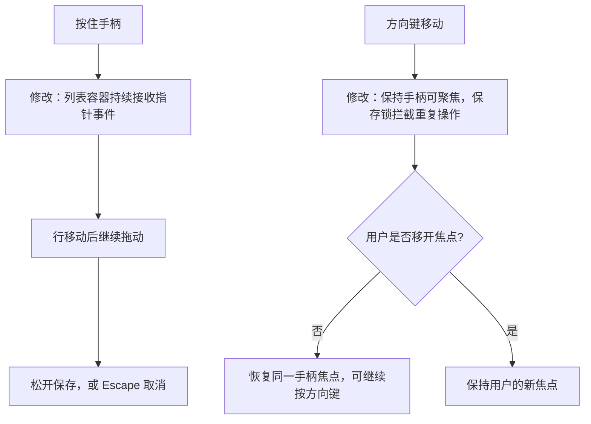

# 共享排序交互修复

日期：2026-11-14（北京时间）。用户反馈拖动左侧六点手柄无效，且方向键只能移动一次。本次修复已确认排序功能的缺陷，不改变共享范围、保存方式或后端接口。

## 问题与方案

- 向下拖动：在用户 Chrome 页面复现。预览顺序时 React 移动了正在捕获鼠标/触屏事件的行，浏览器随后丢失捕获，触发取消。将事件捕获与移动、松开、取消监听移到不随排序移动的列表容器。
- 连续方向键：保存期间禁用按钮，以及行在 DOM 中移动，均可能让焦点回到页面。保存期间保留可聚焦手柄，通过既有保存锁拒绝重复操作；布局更新后恢复同一个手柄的焦点。若用户已点击其他位置，则不再恢复焦点。
- Escape 取消拖动也由稳定的窗口监听处理，释放捕获并恢复原顺序。

## 验证

扩充的回归在修复前因向下拖动失败而超时，修复后通过。前端 TypeScript 与生产构建通过；排序浏览器检查由 8 项扩充为 13 项，包括鼠标跨多行上下拖动、原生触屏双向拖动、连续 4 次方向键且不重新聚焦、Escape 取消、保存期间拒绝第二次移动和不抢回用户焦点。原有跨账号、冲突、失败恢复、新建/删除和重启检查保留。

证据：`artifacts/project-order-2026-11-13T19-02-32-502Z/`。登录/共享/删除 12 项回归也通过（`artifacts/login-shared-deletion-2026-11-13T19-02-32-501Z/`）。本次共 25 项浏览器检查；使用独立数据、无模型调用。后台代码与数据库结构没有修改。

## 发布与线上复验

2026-11-14 03:05（北京时间）部署 `20261113T190456Z`，前端代码 `e0eea940e5e278ef4935acb11ac892fff6668bb3`，后台沿用 `cff1612751008d0c3ce7d2097bb03167df184bb5`。只切换静态资源，未重启后端或执行器；11 个项目、业务数据及环境配置保持不变。备份 `/opt/atoms_lab/backups/20261113T190505104964Z.db`，发布凭据 `artifacts/order-interaction-fix-20261113T190456Z/release-final.json`。

公网健康、资源哈希与登录边界等 6 项检查通过。随后在已登录的用户 Chrome 页面使用真实拖动，将首项下移两行并拖回；保持同一手柄焦点连续执行 Down、Down、Up、Up，位置分别为 2、3、2、1，每次都显示保存成功。全部验证后恢复操作前的共享顺序。该复验只改变排序修订号，没有提交模型任务或修改项目内容。
