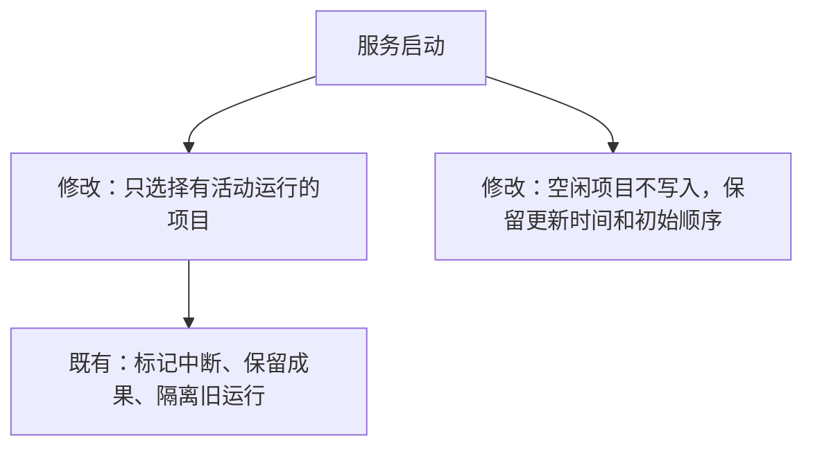

# 共享项目排序验证记录

日期：2026-11-14（北京时间）。用户已确认全账号共享及完整技术方案。实现与自动化验证完成，尚待用户人工体验验收。

## 实现结果

- 左侧每项增加拖动手柄；鼠标、触屏上下拖动并松开保存，手柄聚焦后可用方向键移动。
- 新增 SQLite 全局顺序记录和 `GET/PUT /api/project-order`，沿用登录与 CSRF 防护；旧项目列表接口也输出共享顺序。
- 记录修订号并校验完整项目集合。并发保存或项目增删导致冲突时返回 409，前端提示并恢复最新列表；同一已保存顺序的重试不会重复递增修订号。
- 初次排序前沿用原列表，排序后固定已有项目相对顺序；新建项目置顶，内容更新不挪位，删除过滤失效 ID。
- 刷新、换账号、换设备和服务重启后持久保留；页面重新获得焦点时读取最新顺序。排序期间保持当前项目及未发送草稿。

## 验证与证据

`go test ./... -count=1 -timeout=120s`、`go vet ./...`、`npm.cmd run build --prefix web` 均通过。

新增 Go 用例验证两个账号共享、数据库重开、内容更新、新建与删除、实际并发写入、响应丢失后重试、重复/无效 ID、撤销登录后的访问拒绝。HTTP 用例验证修订号、409、CSRF；现有未登录/游客/已撤销会话的路由检查加入排序接口。

`node scripts/project_order_acceptance.cjs`：8 项通过。证据 `artifacts/project-order-2026-11-13T18-39-38-856Z/`，包含结果、服务日志、桌面和触屏截图：

1. 鼠标拖动保存，不误打开或删除项目，保留当前选择与草稿。
2. 刷新及第二个账号读取相同顺序。
3. 更新内容不改变顺序，键盘移动后另一页面获得焦点读取新顺序。
4. 两个账号并发修改，旧修订被拒绝并恢复最新顺序。
5. 注入保存失败时恢复服务器顺序并提示原因。
6. 新增项目置顶，删除后其余相对位置不变。
7. 后端硬重启后顺序保留。
8. Chromium 原生触屏事件在 390px 页面完成拖动并保存。

与自动演示跳转及已有持久化、登录/删除功能的回归联测通过，详见[演示跳转验证记录](fallback-auto-preview-validation.md)。桌面和移动截图已检查。

## 验证边界

发布预检补充：Linux 隔离运行发现原有启动恢复会对所有项目调用写入，即使项目未运行也会更新 `updated`，影响首次手动排序前的列表。现改为仅选取仍有 `active_run` 的项目进行恢复；新增检查确保空闲项目的原始状态、更新时间及初始顺序完全不变，已有中断恢复和旧运行隔离测试继续保留。

修正后重新执行全量 Go 测试、`go vet` 和全部 50 项浏览器检查，均通过。本轮证据：`artifacts/project-order-2026-11-13T18-50-58-633Z/`、`artifacts/fallback-navigation-2026-11-13T18-50-58-634Z/`、`artifacts/acceptance-completion-2026-11-13T18-50-58-634Z/`、`artifacts/login-shared-deletion-2026-11-13T18-51-01-644Z/`。

全部操作发生在独立本地数据库，模型调用为零；仅保存失败场景注入 503。手机使用 Chromium 模拟触屏，未验证实体设备。其他已打开页面在重新读取或获得焦点时更新顺序，不做持续推送。
