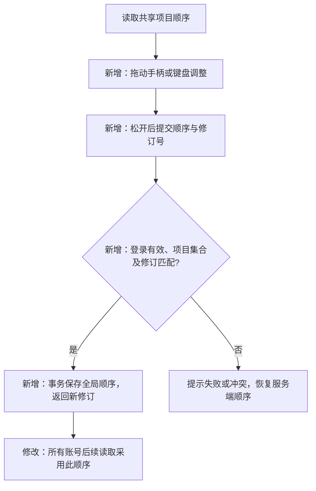

# 左侧项目拖动排序

日期：2026-11-14。用户已明确所有账号共用一套顺序，确认方案、认可结果并批准发布。实现已部署。结果见[验证记录](shared-project-order-validation.md)与[发布记录](shared-order-fallback-deployment-20261114.md)。

## 需求与验收

- 每行增加拖动手柄，鼠标和触屏均可上下移动；松开后保存。拖动不打开项目、不触发删除。
- 全局顺序保存在服务器，刷新、换账号、换设备和服务重启后保持。
- 新建项目排在顶部，已有项目更新内容不改变手动顺序；删除项目后其余相对位置保持。
- 保存失败显示原因并恢复服务端顺序；多人同时排序时拒绝覆盖已更新的顺序，加载最新结果。
- 保留当前选中的项目与未发送输入。提供键盘上移/下移操作。
- 初始顺序沿用当前列表，首次拖动后固定；各账号在读取列表、返回页面或窗口重新获得焦点时获取最新共享顺序。

## 实现方案

新增实体 `ProjectOrder` 是全局列表顺序记录，例：`revision=3, ids=[项目C, 项目A, 项目B]`；其中修订号用于识别过期保存。它只控制展示顺序，不修改任务调度、项目归属、内容或调用额度。

SQLite 增加一张保存全局顺序的表；事务保存有序项目 ID 和修订号。新增 `GET/PUT /api/project-order`，沿用账号登录和 CSRF 校验。PUT 提交当前修订号与完整 ID 列表，检查重复、未知项目、列表成员变化及并发更新；冲突返回 409。现有项目列表接口也按此顺序输出。

读取时移除已删除 ID、将新增项目放在顶部；首次保存前沿用原列表顺序。前端用独立排序组件处理拖动和键盘操作，拖动时预览顺序，松开后调用接口；提交期间不接受第二次排序。检查窗口重新获得焦点时的列表刷新，不用后台高频轮询。

验证包括：两个账号共享排序、服务重启恢复、新建/删除后的顺序、内容更新不改变位置、并发冲突与无效请求、拖动不误点击、鼠标/触屏/键盘操作、排序失败恢复，以及自动演示跳转的联动回归。数据库变更、相关验证与代码提交独立记录。
