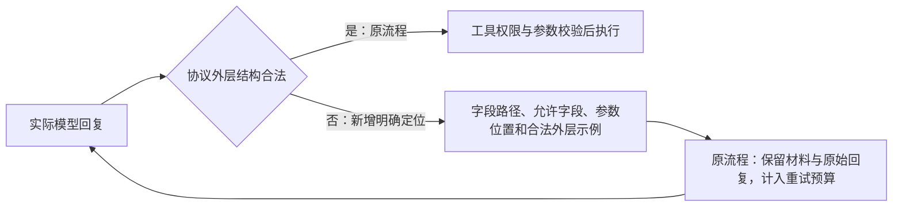
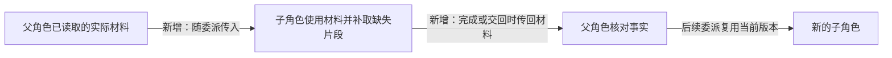

# 任务续跑修复实施与验证

日期：2026-11-13（北京时间）。用户已明确要求按 `task-progress-repair.md` 实施。

当前结论：通用机制与统一校验反馈已实现，测试通过。隔离真实续跑最终完成，原七项任务验收条件未削减，保存了真实 PPTX 和交付版本；PowerPoint 原生打开仍未覆盖。生产代码、配置和原项目未变，下文保留各轮实际失败及补验过程。

## 阶段 1：统一上下文与参数反馈

- 当前工作材料随 Frame 持久保存，记录来源、资源版本和恢复方式；文件写入更新材料，旧检查点可恢复真实读取结果。
- 普通请求、格式重试、一级历史压缩和二级对话摘要共用材料选择；JSON 编码器不再按工具名称和消息位置省略正文。
- 用户回答、更正、审批及运行中指令从原始消息独立保留；摘要的覆盖编号不能删除这些约束。无法容纳必需输入时本地拒绝超限请求。
- 文件读取支持明确行范围；完整替换说明禁止用片段覆盖。参数校验反馈包含未知字段、缺失字段、类型与允许字段，并校验数组中的对象。
- 本地验证：实际捕获 JSON、Chat Completions、Responses 三条序列化路径的请求，覆盖连续格式重试、多资源、两级摘要、遗漏约束的摘要、过大材料和旧版本替换。协议验证使用本地受控端点，不代表真实上游协议验收。

## 阶段 2：动作事实与委派交接

- 工具注册声明控制语义；主循环不再列举控制工具名称或解释文件参数。步骤保存执行/拒绝、输入输出版本、错误类别和报告引用。
- 委派默认最多 8 次模型请求、180 秒；给主 Agent 预留 3 次请求、30 秒（短整轮按四分之一预留）。可用 `ATOMS_DELEGATE_CALLS/SECONDS`、`ATOMS_PARENT_RESERVE_CALLS/SECONDS` 调整。摘要和格式重试都计入委派与整轮额度。
- 增加 completed / needs_replan / blocked 返回，明确子目标完成不等于任务交付；未知作业继续核对原标识。普通停止续跑仅使用原委派剩余额度。
- 本地 `go test ./... -timeout 60s` 通过。四个专家角色分别覆盖调用额度、格式错误、时间边界及主动 blocked；断言主 Agent 仍能发起下一次请求，调用记录闭合。原有停止、迟到结果、新指令、执行器恢复测试通过。

## 阶段 3：有限恢复与持久执行观察

- 确定性失败按工具、无损规范化参数、相关输入版本、执行条件及错误类别记录。缺少确定性证据的历史/外部失败不会触发此规则。
- `ATOMS_REPEAT_FAILURES` 默认 3；`ATOMS_REPLAN_BUDGET` 默认 2。以任务拥有的稳定目标及用户指令版本关联，换角色、改子目标描述、重新分派或普通继续不重置。原样重试耗尽后仍可读取、诊断或提交改变条件的动作。
- 移除执行器中不区分输入及环境的“五次失败”累计拦截。文件变化不计验收进展，相同版本、同一验收项重复通过只保存一个观察基线。
- 页面在失败后展示结构化交接原因、保留文件数、实际记录数与待办；格式错误的最终无效回复也保存，不只保存可重试的回复。
- `go test ./... -timeout 60s` 与前端生产构建通过。受控轨迹验证重命名非文件工具、临时/未知结果、20 次正常资源变化、重复报告、换角色后相同失败及普通继续。阈值是保守机制默认值，尚不是大规模真实任务成功率调优结论。

## 阶段 4：产物回收与交付证据

- 脚本通过 `outputs` 声明相对工作目录的文本或二进制输出；执行器返回原始字节的 Base64、大小及 SHA-256。服务端核对声明、输入、作业、运行及指令版本后，原子保存文件、报告、动作事实和检查点，不改写原输入摘要。
- 延用项目限制：单文件 256 KiB、项目合计 2 MiB；每次最多 20 个输出。拒绝缺失、重复、额外输出、损坏编码/哈希、符号链接、硬链接及越界路径；失败不回收部分输出，不覆盖旧文件。
- `propose_plan.delivery` 明确目标、输入、需保留能力及验收对应关系。所有计划验收项、目标及需保留能力必须被覆盖；旧 HTML 或闲置脚本不自动成为本次运行目标。报告绑定真实输入、输出、任务指令和计划版本；相关版本变化后失效。
- 支持非空、文本包含、JSON 相等、ZIP 成员数量、成员原文及 XML 元素文字断言。类型条件缺项在执行前反馈；JSON 数字比较保留大整数精度。浏览器只有实际断言步骤提供验收条件与文件对应关系，点击操作本身不证明验收通过。
- 单文件下载与 ZIP 导出直接使用已保存的字节；二进制文件不作为 UTF-8 正文展示。生成器输入目录 `/workspace/project` 只读，工作目录 `/workspace/scratch` 可写，工具说明及报告中明确这一事实。

## 验收中补齐的边界

- 同一文件的多个读取片段同时保留；替换资源会更新各相关角色的材料，删除会移除全部片段并记录删除事实。超长单行可用 `read_file(offset, limit)` 分段读取，按 UTF-8 字符边界返回，不要求缩短源文件。
- 委派等待模型额度、格式重试及摘要调用均计入时间/调用预算；每个待执行工具启动前复查预算。暂时性执行故障交回 blocked，保留主 Agent 的接管机会。
- 未知作业在同一运行内避免反复查询，普通继续仍核对原作业标识；缺少回执不虚构“未执行”，也不重新提交。后来得到实际报告时，将未知处置记录关联到最终步骤。
- 新增 `cmd/repair-replay`，从明确选定的历史项目创建隔离副本，记录实际请求和结果；可指定原额度数据库，副本调用仍消耗原用户/全局额度。程序只记录请求正文，不记录鉴权头。
- 验收工具首次复制历史时，发现存储只接收当前草稿引用的 blob，遗漏副本历史版本；已修复为保留检查点、任务基线和交付版本所引用的字节。原生产数据没有缺失。修复后补齐验收副本的 52 个历史 blob，并增加关闭/重新打开数据库后的历史读取测试。

## 本地验证结果

| 验证 | 结果与范围 |
| --- | --- |
| `go test ./... -count=1 -timeout 60s` | 通过；执行时设置历史快照与真实二进制夹具环境变量，包含可选历史回归 |
| `go vet ./...` | 通过 |
| `npm run build`（web） | 通过 TypeScript 检查与生产构建 |
| `node --test runner/outputs.test.cjs` | 通过文件回收及拒绝异常输出测试 |
| `ATOMS_RUNNER_IMAGE=atoms-runner:progress-repair node scripts/runner_acceptance.cjs` | 真实本地 runc 容器的 19 项验收通过；预期失败场景被正确拒绝，覆盖 JS/TS/Python/Go、网页交互、二进制往返、权限/网络隔离及运行期限 |
| 实际历史正文回放 | 原任务读取的 3,123 字符正文，SHA-256 `319f9d464febb9f24f9839fca5f3b41ebd6ffaef91b4c9d56e6457af19ad3192`；无压缩/一级/二级压缩共捕获 15 个重试请求，正文及版本均保留 |
| 回收事务与迟到结果 | 缺文件、额外文件、坏哈希、内容断言失败、新指令、停止均不会提交旧输出；证据不伪造最终摘要 |
| 已保存二进制重启与继续 | 关闭/重新打开数据库，再通过真实 Engine 的 continue 路径进入等待；HTTP 下载及 ZIP 中的字节与已保存内容一致 |

本地多协议序列化验证不代表原生 Chat/Responses 真实上游验收；没有运行 Go race 检查。通用预算阈值仅经上述正常/失败轨迹验证，不能据此宣称真实任务成功率或生产容量。

## 历史任务的真实模型回放

使用生产应用自己的模型环境配置，`chat` / JSON 工具模式。在独立数据库、独立受限执行器中运行，原用户额度账本计费与限额正常生效。

| 回放 | 实际结果 |
| --- | --- |
| 首轮（上限 24 次） | 24 次模型调用、17 次工具动作、6 次格式修复。实际读取了三个页面数据文件，委派达到预算后主 Agent 得到交接并继续规划。一次小规模脚本运行因写入只读源码目录失败；未回收到 PPTX。整轮达到调用上限后结束 |
| 反馈修正后的短回归（上限 12 次） | 10 次模型调用、3 次读取动作、6 次格式修复。最终因 `json: unknown field "role"` 耗尽格式修复次数；未形成新产物，完整真实模型交付未通过 |
| 补充参数层级提示后（上限 24 次） | 24 次模型调用、13 次工具动作、11 次格式修复。正确委派并读取原材料，但仍有多段 JSON、空白回复消耗额度；调用上限结束，没有二进制产物 |
| 补齐委派材料交接后的普通继续（上限 24 次） | 保留协调者、任务及预算历史，未追加用户指令；24 次模型调用、22 次工具动作、2 次格式修复。真实脚本先后生成 2 页和 10 页候选，均因模型声明的内容/归档断言失败而没有提交产物；调用上限结束，完整交付仍未通过 |
| 一次未启动成功的复制尝试 | 因上述验收副本历史 blob 缺失退出，没有模型调用；修复后才执行短回归 |

以上四轮共发起 82 次真实模型调用。首轮仅收到 23/24 次用量报告（累计已知 771,919 token），短回归收到 10/10 次（238,815 token），后两轮分别收到 24/24 次（569,440、1,389,952 token）；首轮用量不完整，总计不作为完整消耗或费用结论。各轮使用当时构建的候选二进制，不将后续修复追记为此前已经验收。

首轮运行 `e6d6bf49fea9dee99f90e758d7751052`；短回归 `c125d39175031ea1b3cf5aae3793bbd8`。首轮、短回归分别确认所复制的源项目 JSON 未变。

后两轮运行分别为 `6ad32710ff05def584182fbf7c86fc42`、`6c3906581a4382263cffe0da35fbca39`，均确认副本来源状态未变。普通继续中，2 页候选因为把“不含 HTML”写成正向包含断言而失败；10 页候选因一项归档成员数量断言返回 0、期望 1 而失败。退出码、标准输出和字节回收通过均没有绕过失败的内容验收。

## 受控 PPTX 产物验证（不计作模型自主完成）

复用首轮模型保存的生成器，只在独立夹具中将输出目录从源码目录改为当前工作目录。云端真实 runsc 作业先生成 2 页、再生成 10 页；未调用模型，也未修改生产项目。

- 2 页文件：9,502 字节，SHA-256 `fed2be42ac9746b4dcf83cfd30ccde141ca3327852305f497d46e167a2464d80`。
- 10 页文件：24,643 字节，SHA-256 `fff1a90b2aa80c056388800c692cedb119d1a79bbf6f51699ef856a88171bde0`。
- 10 个幻灯片及 10 条页引用、34 个 XML/关系文件可解析，关系目标存在。该真实文件通过保存、重启、普通继续、单文件下载及 ZIP 字节一致性回归。
- 按原页面数据逐页核对，9/10 个原始标题存在，第 2 页标题不一致；原文片段 150/170 匹配，20 段存在文字差异（包括网页翻页提示，不能全部解释为语义缺失）。服务端真实内容断言拒绝了原第二页标题缺失的候选，未把“能生成 10 页”当作完整内容交付。
- 本机未发现可用 PowerPoint 可执行文件或 App Paths 注册，未执行 PowerPoint 打开及版面验证。此产物仅是回归夹具，不作为已验收演示文稿交付。

## 环境、记录与交付状态

- 修复代码尚未部署到生产；线上仍为 `/opt/atoms_lab/releases/20261112T161808Z`，`atoms-web`、`atoms-runner` 均保持 active。
- 验收后核对原项目状态 SHA-256、生产环境文件摘要、current 指向均未变化；独立回放和执行器服务均已停止，保留回放资料。原项目状态 SHA-256：`06ce31ff958ba04a99a35a3f7b8ee45dbdf034c1c766e4e4e6c4f34f5777e4c7`。
- 本地私有验收资料在 `artifacts/progress-repair-20261113/`（被 Git 忽略）；容器总报告在 `artifacts/runner-acceptance.json`。云端隔离资料在 `/opt/atoms_lab/acceptance/progress-repair-20261113/`，含实际模型请求、数据库及产物报告；鉴权环境文件没有下载或提交。
- 首轮验收二进制 SHA-256：`93b2d6e055a7da8778bb889f882aad89e85bd6dacb5638e81d1dcfe56daec009`；短回归：`b75247a53d637602863c5aa501882939863c62ec0494666869a21e9656179144`。
- 参数层级反馈回放二进制：`d5887fb8af2c5a107e7dd7cdbb7f296a205a47c208640855ebaa7d0c4c277cf3`；保留状态普通继续：`594ba232bcf6b12edff856f4c3d4c000b8568025ffed33ad26d03fcbc392236f`。后续用量、失败断言和环境复核保存在私有 `followup-receipts.json`。
- 四阶段代码实现及机制验证可供评审；真实模型完整交付和 PowerPoint 打开验收仍未通过/未覆盖，不能宣布整体验收完成。

## 继续修复：JSON 参数层级反馈

用户要求继续处理未通过验收。目标：对模型实际产生的“工具参数与 name 并列、遗漏 arguments 对象”给出能直接定位的反馈，保留原始证据与执行限制；不放宽协议，不自动执行或改写无效意图。

复查真实回复后确认，`role` 是 `calls[0]` 内错层的工具参数，并非服务端不支持角色字段。此前只反馈 `unknown field role`，连续重试未说明应放进 `arguments`；最后还出现未填写工具名的无效回复。另有回复夹带 `<system_warning>` 尾文，仍按多余内容拒绝，不能当作应用指令。

- JSON 适配器明确区分顶层 `content/calls`、调用层 `name/arguments` 与工具参数层。校验反馈根据实际工具参数定义指出 `$.calls[0].role` 应位于 `$.calls[0].arguments.role`；改名的测试工具使用同样规则。
- 结构示例只作格式反馈，参数仍须由模型按实际任务和工具 Schema 填写；工具业务参数校验仍归工具适配，不搬进主循环。
- 本地端点回归捕获实际重试请求：原始读取正文、hash、正确位置反馈均在；无效回复持久保留，但没有执行委派。修正后的调用正常执行，5 次请求、1 次格式修复、4 次工具动作完成受控任务。
- `go test ./... -timeout 60s`、`go vet ./...` 通过。独立真实回放上限 24 次，使用同一原额度账本；实际结果另行记录。

## 继续修复：委派材料交接与普通续跑

真实回放还暴露了材料只留在读取角色中：父角色已读正文没有进入子角色，新委派重新读取会消耗有限调用预算。现已在分派时复制父角色工作材料，在交回时把子角色的实际读取材料交给父角色；保持材料来源、资源版本和片段范围，后续修改仍按原有规则更新所有相关角色。

- 受控模型验证：父角色读取 A，Alex 直接看到 A、读取 B 后 needs_replan 交回，父角色及后续 Bob 均能看到 A/B；无须重复读取，7 次请求完成检查。
- 隔离验收工具增加 `--keep-root`，可不追加新指令，保留原协调者、子角色、工作材料、审批状态及已用委派/重规划预算，通过 Engine 的普通 continue 路径执行。此前新建协调者的方式仍可显式用于重新规划回放。
- 复制测试确认源状态不变；`go test ./... -timeout 60s` 与 `go vet ./...` 通过。后续真实验收使用保留原状态的副本，上限 24 次。

## 根本修复：统一校验问题与反馈传递

用户指出应从报错机制修复，并确认继续实施。此前的参数层级提示解决了一类现象，但协议仍有直接透传 Go 解码错误的路径，参数校验又使用另一套文案；嵌套数组只返回最先遇到的问题，原生协议的无效参数 JSON 会在工具边界前直接终止。

- 新增 `internal/validation`，协议和工具适配共用问题结构：`path`、`code`、`actual`、`expected`、`hint`。错误由实际字段定义产生，包含必填项、允许字段/值、嵌套数组下标与修正提示，不按具体工具名分支。
- 协议层只校验动作外层、角色可用工具及单动作限制；工具边界校验同一份参数定义。原生工具的参数语法错误也在工具边界形成已闭合的拒绝记录，供下一次调用修正。
- 关联错误一次反馈，最多 16 项；不复制参数长正文，不推测或自动修正业务值。可读错误与结构化 `validation` 同时进入持久记录及下一次请求，二者均应用密钥脱敏。
- 清理旧的两套字段/类型校验及重复解析拒绝分支；保留既有权限、业务检查、重试和总预算限制。

本地验证：字段错层、缺失 name/arguments、null/类型/枚举错误、数组多处嵌套错误、非法 JSON、追加对象/尾文、反馈上限及脱敏通过。真实 HTTP 测试端点验证 JSON、原生 Chat、Responses 的下一次请求均收到五项嵌套错误和原证据；失败计划没有保存，合法修正可以保存。原生参数语法错误在两种协议中均被拒绝并闭合，修正后完成受控任务。三协议、三个压缩层级、每级三次重试共 27 个请求保留真实结构化反馈和两份工作材料。

`go test ./... -count=1 -timeout 60s`（含原历史/二进制夹具）与 `go vet ./...` 通过。

### 两次真实模型纠错验证

使用服务器原应用的 JSON 模型配置、原用户额度账本，每个案例只请求一次，上限合计 2 次、单次输出上限 2,048 token。历史同类无效回复先在本地固定端点或参数校验器中生成反馈，再将任务依据和同一反馈发送给真实模型；这些是纠错能力的小样本，不是完整历史任务续跑。

| 案例 | 结果 | 用量回执 |
| --- | --- | --- |
| `assign_step` 中 `role/goal` 与 `name` 并列、缺失 `arguments` | 一次回复把参数放回 `arguments`，保留 Alex、只读核对及证据内容；外层和参数校验通过 | 1,942 输入 + 115 输出 = 2,057 token |
| `run_project` 的执行类型错误、入口为数字、输出格式错误且缺少 `old_hash` | 一次回复改为 `kind=script`、字符串入口、`format=binary`、空旧哈希，并保留预期标准输出；校验通过 | 2,466 输入 + 92 输出 = 2,558 token |

2/2 次取得完整用量回执，合计 4,615 token；与四轮长回放合计发起 84 次真实模型调用，长回放仍有一份用量缺失。纠错验证只解析和校验模型返回，没有执行工具、写入项目或启动脚本执行器。

验收入口 `TestLiveValidationFeedback` 默认跳过，必须显式提供原额度数据库、所有者和新的输出目录才会调用真实模型。测试二进制 SHA-256 为 `1dc91484c92acc5748e8804edc9b9b16cea890e43a16b0d410c80ac6d9693d5b`；完整回执保存于隔离目录 `feedback-live/`。结束后服务自动退出；原项目、生产配置及 current 指向复核未变，生产服务保持 active。该修复尚未部署，PPTX 完整交付与 PowerPoint 打开验证仍未完成。

## 继续修复：归档选择与反向内容断言

复查上一轮实际参数及执行器留存的字节，确认完整候选的 `[Content_Types].xml` 确实存在；旧实现统一用 glob 解释 `member`，方括号被当作字符集合，所以返回匹配数 0。2 页候选的失败来自把“不能出现翻页提示”写成正向 `contains` 检查。

- 扩展断言的 `member_match`，明确选择 `exact` 字面名称或 `glob` 通配模式；省略仍为 glob，保留已有声明含义。未找到成员时反馈实际选择器与匹配方式；若同名字面成员存在，提示使用 exact。
- 增加 `text_not_contains`、`archive_text_not_contains`、`archive_xml_not_contains`。归档反向检查要求至少选中一个成员，且所有选中内容均不包含指定文字；读取错误、无效 UTF-8/XML、零匹配、超限均失败。
- 断言的条件参数错误使用统一的结构化反馈，定位到 `$.arguments.assertions[i]` 下的具体字段；未通过验收仍不提交部分候选输出。
- 保持已有通配模式语义，测试明确区分同存的 `[a].xml` 与 `a.xml`；覆盖全体排除、一个成员含禁止文字、实体转义文字、空/损坏 XML、多个根元素、零匹配以及真实候选字节。

取回的上一轮完整候选为 24,791 字节，SHA-256 `b44d2fbc6e04b636ac86bec55a7eca75b5bb29da18123b449e1073634e038b8b`，没有重写生成器或重新生成文件。10 个标题、10 个副标题与源数据匹配，正文片段仅省略网页的翻页操作提示。该文件通过新增的明确成员匹配及反向内容检查；旧的模糊声明仍被拒绝，并给出正确修改建议。

`go test ./... -count=1 -timeout 60s`（含三组历史夹具）与 `go vet ./...` 通过。随后在新隔离副本中保留协调者和历史，补充工具能力及真实失败原因，最多 16 次模型请求，结果另行记录。尚不把此候选或工具修复记作完整交付通过。

## 真实产物入库与独立文件验证

归档断言修复后的隔离续跑（v6）使用 16 次模型调用、12 次工具动作、4 次格式修复；16/16 次取得用量回执，共 1,282,363 token。两次真实脚本执行分别回收了 2 页与 10 页 PPTX，当前文件的内容断言和静态检查通过，子任务携带实际证据交回主协调者。

| 保存产物 | 大小 | SHA-256 |
| --- | --- | --- |
| `smoke.pptx` | 9,524 字节 | `86d5819de7f3a804f42f4dd73f2a59f09e944263faceb8cc2e96e0ad81f27e4d` |
| `鬃毛邮报BOSS机制讲解.pptx` | 24,791 字节 | `b44d2fbc6e04b636ac86bec55a7eca75b5bb29da18123b449e1073634e038b8b` |

该轮仍以调用上限结束，未形成最终交付版本：完成检查发现 preserve 中网页缺少当前版本的真实运行与浏览器报告。模型随后尝试删减计划验收范围，被拒绝；核对保存状态，原计划及七项验收条件完全未变。六个原网页文件与原线上快照逐一比较，哈希、大小和类型均一致；生成器也未改写。此失败不能记作完整交付通过。

对已经保存的完整文件另做独立验证：

- 逐页核对三个原始 JS 数据文件：10 个标题与 10 个副标题一致，正文片段仅省略网页翻页操作提示；占位符与待核对标记保留。
- 使用 presentations 工具链导入同一字节并渲染 10 页 PNG，逐页检查未见文字裁切或重叠。包结构检查覆盖 10 页、14 个关系文件，零发现；画布尺寸及布局几何检查零发现、零警告。
- 把本轮实际保存的 PPTX 作为夹具运行 `TestCollectedArtifactDownloadAfterContinue`，通过真实存储关闭/重开及 Engine continue 路径后，HTTP 单文件下载与 ZIP 内文件均与保存字节一致。此项使用受控模型，没有追加付费模型请求。
- 当前环境未找到 PowerPoint，未执行原生 PowerPoint 打开验证；工具渲染不能代替该项验收。

证据位于隔离记录 `real-replay-v6/{result,project,audit}.json`、`v5-candidate/{content-verification,package-integrity,layout-geometry,visual-review}.json` 及逐页渲染图。补验另起保留全部状态的新副本，上限 12 次调用，维持原计划与七项条件；补充网页交互检查，并按新指令版本重新登记实际报告。

## 最终补验与环境复核

2026-11-13 11:28～11:30（北京时间），保留主协调者和全部状态的隔离副本（v7）在 12 次上限内实际使用 7 次模型调用、7 次工具动作、0 次格式修复。7/7 次取得用量回执：430,531 输入 + 11,183 输出 = 441,714 token。子任务正常交回，主协调者通过 `finish_task`，任务及运行均为 completed，形成第 2 个交付版本。

| 实际报告 | 验证结果 |
| --- | --- |
| 网页运行 | 真实构建、Chromium 加载、脚本错误与横向溢出检查共 4 项通过 |
| 浏览器交互 | 1440 与 390 两种视口，核对 10 页总数、首页标题、下一页后的页码与标题、返回首页页码；连同构建和页面检查共 23 项通过 |
| Python 生成 | 实际执行原生成器，stdout 精确匹配；回收同一哈希的 10 页 PPTX，连同内容断言共 24 项通过 |
| 静态验收 | 37 项声明的内容断言全部通过，覆盖原七项条件及其全部目标路径；加上 6 项通用检查，共 43 项 passed |

静态报告另有 2 项 `not_run`：通用文件检查器不负责 Python 运行和二进制内容。它们没有补记为通过，分别由独立的实际脚本运行报告及声明的二进制内容断言覆盖。

独立审计确认四份报告均绑定当前任务、指令版本 5、未修改的计划版本及当前输入/输出哈希；七项验收对应的所有文件均有通过证据。最终交付版本清单与当前文件完全一致，所有文件与 v6 相同，原网页六个文件仍与最初线上快照一致。PPTX 十页渲染、下载及 ZIP 的独立验证使用上述同一哈希，未把模型自述当作验证结果。

本次累计发起 107 次真实模型调用，取得 106 份用量回执；首轮缺失的 1 份仍记为未知。最后两轮分别消耗 16 与 7 次；小样本纠错和多轮人工诊断后的成功，不等于未经干预的成功率或生产容量结论。

11:32 完成环境复核：隔离 runner 与全部回放服务均 inactive，产物与原始记录保留；生产 `atoms-web`、`atoms-runner` 均 active。原项目状态 SHA-256 仍为 `06ce31ff958ba04a99a35a3f7b8ee45dbdf034c1c766e4e4e6c4f34f5777e4c7`，生产两个环境文件哈希和 current 发布目录均未改变。没有部署或推送修复。

最终证据保存在本地 `artifacts/progress-repair-20261113/real-replay-v7/` 的 `result.json`、`project.json`、`audit.json`、`outputs/`，以及 `artifacts/progress-repair-20261113/after-final.json`；云端原始记录位于独立验收目录 `/opt/atoms_lab/acceptance/progress-repair-20261113/`。剩余未覆盖项是 PowerPoint 原生打开，附录完整交付验收不能记作全部通过。
