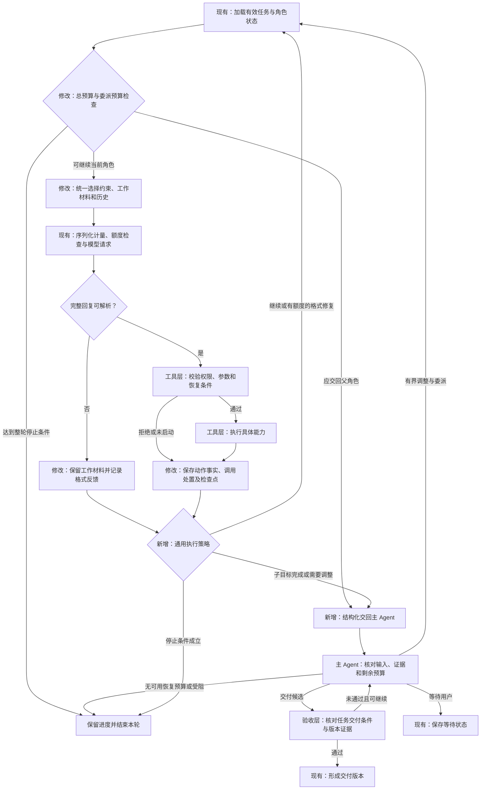

# Atoms 任务续跑与重复执行修复方案

更新：2026-11-13（北京时间）。状态：方案修订，尚未实施；本次仅调整本文，不改代码。方案确认后再进入编码与验证。

## 1. 目标与范围

本方案解决三类通用问题：格式重试或上下文裁剪丢失下一步所需材料；工具调用成功与任务进展混淆；子 Agent 长时间执行而主 Agent 缺少接管机会。脚本产物回收与交付验证作为独立配套能力设计，不能用主循环修复通过代替真实产物交付通过。

- 格式重试、常规历史裁剪、两级压缩和续跑使用一致的上下文保留规则。
- 工具提供实际执行事实，执行策略识别确定的重复失败和预算边界，主 Agent 根据证据判断是否调整任务路线。
- 已保存产物、检查点及有效用户约束保留；停止、新指令和迟到结果继续遵守现有版本校验。
- 主循环不增加按具体工具名、文件路径、文件格式或某个案例分支处理的逻辑。将同样的特例移到另一个公共辅助函数，也不算完成职责分离。

具体格式转换任务只用于附录中的回归，不作为通用架构或默认阈值的依据。本次不引入新的 Agent 框架、任意工具插件平台或独立数据库，不全面重写现有执行器。

## 2. 各层职责

主 Agent 是承担目标管理和规划的模型角色；主循环是驱动各个角色运行的程序。前者判断下一步做什么，后者执行统一的运行协议。

| 层次 | 应负责的内容 | 不应承担的内容 |
| --- | --- | --- |
| 主 Agent / 规划与委派 | 理解用户目标和有效更正，识别已有输入与能力缺口，给出子目标、验收条件；收到交接后决定继续、验证或换路线 | 把模型选择的实现方式伪装成用户要求；仅凭子 Agent 自述判定交付成功 |
| 主循环 | 加载状态，调用上下文构建、模型适配和工具执行入口，处理继续、交回、等待、完成或停止；检查运行有效性与总预算 | 理解某个工具的参数字段；判断某种格式应如何生成；按文件覆盖次数修复某个案例 |
| 上下文管理 | 从任务状态、当前工作材料与历史构建输入，统一决定保留、更新、摘要和按需读取；校验必保材料及请求预算 | 根据消息离末尾的距离淘汰仍在使用的结果；把摘要覆盖范围当作约束已完整保留的证明 |
| 模型协议适配 | 编解码协议，校验完整模型回复，返回结构化格式错误及用量；对最终请求测量字节数 | 按具体工具名称自行删减参数或结果；在编码阶段再次丢弃上下文层要求保留的材料 |
| 工具定义与适配 | 声明能力、参数、权限和控制语义，执行具体业务；提供参数反馈、结果摘要、资源版本及执行事实；核对本工具的未知外部作业 | 自行决定整个任务已完成；让公共循环理解本工具的内部字段、错误字符串或文件格式 |
| 通用执行策略 | 根据结构化执行事实、委派预算和历史判断继续、交回或停止；给出原因与证据引用 | 将同名调用、文件变短、哈希改变或没有成功报告单独判为停滞；解析特定格式或模型自然语言来确认业务完成 |
| 委派与恢复管理 | 分配子任务预算和主 Agent 预留预算，保存交接结果与停滞历史，保证续跑及调用记录闭合 | 将正常的重新规划请求作为异常直接终止整轮；重新分派后清空已发生的重复记录 |
| 执行器与持久化 | 隔离运行、回收声明的产物、核对字节及版本；原子保存事实、文件、报告和检查点；按原动作标识恢复 | 因模型声称成功而生成通过记录；接纳失效运行覆盖当前状态 |
| 验收与交付 | 按本任务的交付对象、约束及对应输入/输出版本检查真实证据；决定能否形成交付版本 | 把项目内所有历史文件都当成本次交付对象；用退出码或输出文字代替产物内容验收 |

工具注册信息描述“普通执行、委派、等待、结束”等控制语义，主循环消费这些语义和统一结果。资源内容如何摘要、错误是否可重试、外部作业如何恢复，由对应工具适配负责。通用策略可以记录工具标识，但不按具体名称编写分支。

依赖方向为：工具产生事实，上下文管理与执行策略消费事实，主循环执行控制决定，主 Agent 处理需要重新规划的交接。实现时先复用现有结构和明确的函数边界，不预设需要复杂的中间件体系。

## 3. 数据定义与复用

以下是拟新增或扩展的状态，不等同于新增数据库表。优先扩展现有 `Task`、`Frame`、`Step` 和 `Report`。历史记录缺少字段时按未知处理，不能补成已验证或已完成。

| 数据 | 定义与保存位置 | 具体例子与用途 |
| --- | --- | --- |
| 当前工作材料 | 当前角色帧仍需使用的证据集合；记录来源消息/步骤、资源标识与版本、内容或可恢复引用、保留原因。按 `Frame` 关联，不只按角色名区分 | `src/main.go` 的 H1 版本第 20～60 行和最近错误；也可以是查询返回的字段定义。用于跨格式重试及压缩保留下一步依据 |
| 动作事实 | 由服务端记录在步骤或调用处置记录中的结果：是否实际执行、输入版本、资源变化、错误类别、报告引用和恢复状态 | 某资源由 H1 变为 H2，但尚无验证报告；或参数校验拒绝且资源未改变。用于区分写入成功、验证成功、失败与未启动 |
| 委派约定 | 关联 `Frame` 的子目标标识、任务目标版本、输入引用、有效约束、完成条件及调用/时间预算 | 使用已有数据生成汇总，先核对合计；预算内未完成时返回已有结果。用于让子 Agent 获得明确边界 |
| 委派结果 | `Frame` 的结构化返回：子目标完成 `completed`、需要重规划 `needs_replan`、受阻 `blocked`；附原因、事实引用、已有产物和待办 | `needs_replan`：已有脚本和两条失败记录，尚无有效运行报告。用于正常交回主 Agent；子目标完成不等于整个任务交付完成 |
| 执行观察记录 | 保存在 `Task`，关联稳定子目标和目标版本，记录最近事实、重复失败依据、已用恢复预算和交接/停止原因 | 同一输入版本和参数连续产生同一确定性错误，已交回检查一次。用于跨运行、重新分派和普通继续保留判断依据 |
| 产物证据关系 | 扩展执行及验收报告，记录实际输入快照、输出清单及哈希、验收项和对应任务目标/计划版本 | 某输入快照生成一个结果文件，并通过内容断言。用于判断报告能否证明当前交付物，属于独立的产物回收阶段 |

模型可以提出计划、待办和策略调整，但这些内容与执行事实分别保存。材料是否仍有效由资源版本和任务状态核对；报告是否通过以真实工具结果为准。

## 4. 统一保留当前工作材料

### 4.1 构建与更新

- 每次组装请求时分别处理：任务目标与有效约束、当前工作材料、可压缩的旧历史。原始用户目标、确认/更正、审批状态和验收条件从任务状态及其来源消息恢复，不依赖模型摘要兜底。
- 工具适配提供结果的资源标识、版本、可保留内容和摘要方式。上下文层保留近期完整动作及仍有效的工作材料，允许同一子目标依赖多个资源；不能退化为只保留“最后读取的一个文件”。
- 格式错误可能无法解析出有效工具意图。此时沿用该次请求的工作材料并增加具体校验反馈，不依据无效回复猜测新目标，也不把新增反馈当成已推进的动作。原始无效回复保留在执行记录。
- 参数校验失败不改变资源，保留原材料及版本。资源成功变更后，由工具事实和存储中的真实内容更新材料；不能继续把旧片段当成当前版本。
- 一次编辑成功不代表该资源已处理完毕。只有子目标结束、明确切换依赖或材料已被新版本替代后，才可释放相应保留要求。续跑时从持久引用恢复，不能依赖进程内缓存。

### 4.2 裁剪与预算

- 常规请求、格式修复请求及两级压缩共用保留决策。协议适配器仅编码已选材料，不另设按工具名称或“最后两条消息”裁剪正文的规则。
- 大材料由工具提供范围读取或结果分段能力；具体行号、片段或分页语义属于工具层。超过预算时先压缩旧历史、缩小可重取范围，明确保留版本和重新获取方式；必需材料仍装不下则保存进度并返回原因，不静默丢弃。
- 已有的近期完整动作保留规则继续作为基础，工作材料可跨越该历史窗口。工具请求与结果成对处理，原始记录和检查点不被摘要替换。
- 二级摘要只能替代允许压缩的历史。有效约束单独保留来源；无法确定某条约束是否已被更正时，保留有序原文，不由摘要自行裁定失效。发送前检查必保材料实际进入最终请求，不能只检查摘要 JSON 格式和来源编号合法。
- 最终序列化字节数用于请求上限校验、额度预留和实际发送。不同协议共用材料选择，编码仍遵守各自协议；本方案不声称此前未验证的协议路径已通过。

当前入口：[请求准备](../internal/agent/context.go#L26)、[对话摘要](../internal/agent/dialogue.go#L73)、[JSON 编码与现有裁剪](../internal/model/json_tools.go#L49)、[格式重试记录](../internal/agent/model_action.go#L55)。

## 5. 工具层提供语义和执行事实

- 参数错误反馈根据该工具的参数定义生成，说明未知字段、缺少字段、类型错误及允许字段。主循环不针对某个工具拼接纠错提示，也不把错误调用自动转换成另一个工具动作。
- 文件工具明确完整替换与局部修改的区别。局部任务优先局部编辑是文件能力的使用建议，合理的完整替换仍允许；已有版本比较和历史保留继续提供保护。版本匹配不能证明内容没有退步，内容正确性仍需相应验收。
- 工具说明应明确完整替换必须提供完整内容，较大文件可以分次局部修改。公共提示中“单次内容尽量简短”的建议不能导致把局部片段当成完整文件保存；这一潜在冲突需要在工具说明中消除，不能直接认定为已证实的现场原因。
- 每次结果记录是否执行、相关输入/输出版本和真实错误类别。参数拒绝、确定性失败、暂时性故障、外部结果未知分别表达，不由公共策略匹配工具专属错误文本。
- 工具声明并实际核对其重试和恢复条件。外部状态会变化或版本未知时，即使参数相同也不能据此判定重复无效；结果未知的外部操作先查询原作业，不能换标识重新执行。
- 事实、工具结果和检查点使用现有原子保存边界。未启动或被拒绝的动作有明确处置记录，不能计为成功执行；恢复时不得重放已处置的调用。

当前入口：[定义与参数校验](../internal/agent/tools.go#L31)、[文件版本校验](../internal/agent/tools.go#L166)、[工具结果与检查点](../internal/agent/engine.go#L518)、[外部作业恢复](../internal/agent/runner.go#L177)。

## 6. 通用执行策略与委派交接

### 6.1 何时交回

| 依据 | 处理方式 |
| --- | --- |
| 相同动作、规范化参数、相关输入版本和执行条件下，反复出现同一确定性失败 | 在配置的恢复预算内提供反馈；耗尽后阻止继续盲重试并交回。规范化只消除无意义的表示差异，不能抹掉有效参数变化 |
| 委派调用数或时间预算达到边界 | 在可安全交接的位置返回已有成果与待办，由主 Agent 决定下一段工作；预算交接本身不等于任务停滞 |
| 持续发生资源变更，但尚无法确认接近子目标；或工作长期未形成新的有效证据 | 作为检查方向的信号，携带事实交回主 Agent；通用策略不直接宣判业务失败 |
| 暂时性故障或外部结果未知 | 按工具声明的有限恢复方式处理；无法确认时返回受阻原因和可恢复引用 |
| 达到整轮预算、用户停止或运行已失效 | 按既有规则停止接纳新动作，保留已提交状态及需要后续核对的记录 |

文件哈希改变、文件数增加、重复调用同名工具、反复整体替换、文件缩短，以及没有新的通过报告，都不能单独证明进展或停滞。正常多文件实现、调研和排错允许暂时没有成功验收；新的失败诊断也可能提供有用信息。同一验收项对相同版本重复通过不应反复算作新进展。

重复失败阈值和委派预算应作为可配置的通用策略，通过失败轨迹与正常任务共同校准；本文不将某个案例的覆盖次数固化为默认阈值。模糊的重复形态由主 Agent 结合子目标评估，确定性拦截必须有可核对的工具事实。

### 6.2 委派预算与结构化交接

- 主 Agent 分派时提供已有输入引用、有效用户约束和最小可验证目标。模型选择的技术路线与用户硬性要求分别标注；能力缺口在分派前说明，不让子 Agent 无限尝试不存在的能力。
- 委派管理从整轮剩余预算中分配子任务调用数和时间，预留主 Agent 读取交接、重规划及收尾的预算。不足以保留这些预算时，不再启动新的委派。
- 子任务预算覆盖其模型请求，包括格式重试和摘要调用；耗时包括等待与工具执行。它们仍计入原有整轮及每日额度，不能另开预算绕过限制。预算数值在受控回放中校准并记录，实施验收必须证明主 Agent 的预留可用。
- 子任务预算将尽或需要重规划时，不再启动新的工作。在运行仍有效且总时限允许时，已启动工具完成后先保存结果再交回。停止或超时优先，不无限等待收尾；未知外部结果保留原作业引用，下次继续先核对。
- `needs_replan` 和可恢复的 `blocked` 作为正常委派结果交回，不通过普通错误一路上抛并直接使整轮失败。主循环只消费控制状态，不读取专属工具参数来决定后续动作。
- 交回前闭合已发出的工具调用：实际完成、校验拒绝和未启动分别记录。外部结果未知则保留恢复引用并禁止重放；不得伪造成功或留下续跑时会再次启动的旧待执行动作。
- 所有子 Agent 使用同样的规则。主 Agent 自身也受整轮预算和执行观察约束；它不能通过不断创建新委派来消除同一问题的历史。

### 6.3 重新规划与普通继续

- 主 Agent 根据交接事实提出有边界的下一次尝试，说明改变了哪些条件、下一步动作和完成条件。Plan 模式下如改变已批准范围或验收条件，沿用现有修订审批流程。
- 执行观察按 `Task`、稳定子目标及目标版本关联。更换运行、角色帧或委派标识不清零；改写子目标文字也不能当成用户改变目标。
- 重新规划和恢复尝试有独立的有限预算，仍受整轮上限约束。再次进入相同失败循环且预算耗尽时，保存已有成果并带原因结束本轮，页面展示卡住的子目标、实际证据和可恢复工作。
- 普通“继续任务”保留历史，先核对上次停止原因。允许有限的诊断、验证、环境复核或改变策略的尝试，但不重新开放已耗尽的原样盲重试路径。不能要求先通过新验证才允许执行验证。
- 新的相关验证证据、经核实的执行条件变化或用户明确改变目标，可更新观察基线；原记录仍保留。模型自述、无关文件变化和同一报告重复出现不能重置判断。

当前入口：[执行循环](../internal/agent/engine.go#L250)、[委派执行与返回](../internal/agent/tools.go#L208)、[现有新指令交接](../internal/agent/steering.go#L55)。本次新增的交接与现有停止、新指令版本校验共用有效性边界，不覆盖它们。

## 7. 调整后的执行流程

图中标明本次新增或修改的位置。主循环调用各层的统一入口，具体工具和任务场景不进入流程分支。

图中保存动作事实不代表每个动作都改变文件。工具调用与结果成对、原子提交、旧运行拒绝写回、未知作业先核对等规则贯穿整个流程。格式重试及预算交接也更新执行观察，不能因尚无工具结果而绕过委派边界。现有格式重试次数限制继续有效；子角色耗尽恢复预算时可交回，主 Agent 无上级可交回时按整轮策略收尾。

## 8. 独立配套能力：脚本产物回收与交付验证

### 8.1 能力边界

当前脚本模式主要返回标准输出、标准错误、退出码和检查报告；下载接口可以读取已入库文件的字节。缺口是把隔离作业生成的文件带回项目，以及建立输入、输出与验收之间的可靠关系。

该能力在执行器、存储及验收层实现，适用于不同产物类型。某种文件格式的内容检查属于对应验收器或任务声明的检查，不在主循环增加格式分支。

### 8.2 回收与证据

- 执行请求声明输出路径及必要的验收断言。执行器只回收允许范围内的声明产物，返回原始字节、大小和哈希；文本与二进制传输明确区分，不用有损字符串转换传递二进制。
- 服务端核对作业、运行及指令版本、输入快照、路径和大小限制、输出哈希。缺文件、校验失败、超限或失效结果给出明确原因，保留原有产物。
- 生成成功且本次回收检查通过后，产物、工具事实、报告与检查点原子保存。失败记录可单独保存，不能将部分回收标为完整交付。
- 报告分别绑定实际执行输入与输出，不将生成前的项目摘要直接当成生成后的摘要，也不为适配新摘要而改写旧报告。新增输出会改变项目文件集合，必须凭完整输入/输出关系判断证据有效性。
- 验收范围来自用户目标及有效计划，明确本次交付对象、所依赖的输入、需要保留的既有能力及验收项。保留历史文件不自动增加无关验收；模型也不能通过缩小清单排除用户要求。
- 程序退出成功或输出预期文字仅证明对应运行断言；内容结构、业务条件、实际下载字节及必要的打开验证分别记录。依赖或目标产物变化后，相应报告失效。

当前完成检查会根据整个文件清单的后缀选择检查类型。配套能力需在验收层明确上述范围与证据关系；不得通过主循环为某种新格式绕过原检查。旧报告保持其原有证明范围，证据不足时补验。

当前入口：[脚本执行](../runner/job.cjs#L273)、[执行结果入库](../internal/agent/runner.go#L296)、[完成检查](../internal/agent/artifacts.go#L119)、[下载与 ZIP 导出](../internal/httpapi/server.go#L324)。

## 9. 实施顺序与验收

方案确认后按以下顺序实施，每阶段分别记录实际验证结果：

1. 统一上下文保留，修复格式重试丢失当前材料；完善工具参数反馈与完整替换说明。
2. 补齐动作事实、委派预算和结构化返回，验证任何角色均能在整轮预算耗尽前交回主 Agent。
3. 引入通用执行观察与有限恢复，使用失败轨迹及正常任务校准策略；不先加入案例覆盖次数拦截。
4. 独立实现脚本产物回收和交付证据，再开展需要该能力的完整产物回归。

| 场景 | 通过条件 |
| --- | --- |
| 较长工具结果后连续发生格式错误 | 捕获每次实际请求，正文或必要片段、资源版本和错误仍在；同时覆盖未触发压缩、一级压缩和二级摘要路径 |
| 一个子目标依赖多个资源 | 材料不会仅因另一工具被调用或追加反馈而消失；资源更新后不继续使用旧版本依据 |
| 参数包含未知字段或缺少必填字段 | 无资源变更；反馈来自工具定义并包含可修正信息；修正后可沿原工作继续 |
| 摘要格式正确但省略有效用户约束 | 约束仍由独立来源进入实际请求；模型建议不变成用户要求，过期检查不冒充当前证据 |
| 必保材料超过请求预算 | 不发送超限请求、不静默删掉关键材料；保存进度并说明需要缩小或重新获取的材料 |
| 非文件工具与更换名称的测试工具 | 同样的动作事实得到同样的策略结果，不修改主循环或增加工具名分支 |
| 相同条件下重复确定性失败 | 在有限预算内交回；被拒绝或未启动的调用有明确记录，续跑不重放 |
| 相同参数但外部状态变化、临时故障或结果未知 | 不误用确定性重复失败规则；先按原作业或对应能力核对状态 |
| 正常多文件开发、调研、合理整体重写 | 即使暂时没有通过报告，也不因调用同名工具、三次覆盖或文件缩短被认定停滞；预算交接允许正常续作 |
| 多次写入或反复产生相同验证结果 | 不把文件数量、哈希变化、模型自述或重复通过同一检查算作新的验收进展 |
| 委派达到预算或返回需要重规划 | 已提交成果保留，主 Agent 仍有调用和时间预算；交接不作为普通异常直接导致整轮失败 |
| 重规划后同一循环复发，再普通继续 | 历史及已用恢复预算保留；不恢复原样盲重试，允许有限诊断、新策略或验证，不形成“先验证才能运行”的死锁 |
| 改换角色、委派标识或子目标描述 | 同一任务目标下的重复记录不会被清零；用户真实更正仍按指令版本生效 |
| 停止、超时、新指令或服务重启 | 保留已提交产物及检查点，未知作业按原标识核对，失效运行不能覆盖新状态；所有角色规则一致 |
| 新输出改变项目摘要 | 报告仍可按真实输入/输出关系核对；不伪造最终摘要，依赖或输出变化后对应证据失效 |
| 下载、历史文件与交付范围 | 单文件及 ZIP 字节匹配已保存产物；保留历史文件不引入无关检查，用户要求和既有需保留能力不被漏验 |

先用可控模型和执行器验证上述机制，再用历史任务的只读副本回放。记录实际请求、工具事实、材料版本、预算和任务状态，分别报告机制回归、真实模型续跑及完整交付结果。本文未执行这些新增验收，不将历史测试结果作为本方案通过的证明。

## 附录 A：PPTX 回归案例与原始问题记录

本节仅保存「鬃毛邮报 4.1『神话的遗闻』从 HTML 改交付为 PPTX」的历史证据和回归要求。以下现场数据沿用此前排查记录，本次文档修订未重新回放线上任务。

| 历史现场证据 | 对应的通用问题 |
| --- | --- |
| `v1` 的 10 页内容已保存在 `slides-a.js`、`slides-b.js`、`slides-c.js`，三个文件的哈希与原交付一致。Mike 最初两次包含读取意图的回复均未通过 JSON 校验；正式分派改为根据需求文档手写 PowerPoint XML、主题、母版和打包关系。整个 PPTX 改造任务没有读取三个页面数据文件。 | 未执行的模型意图不等于已有输入被读取；分派遗漏输入，并把自主技术选择变成了硬性要求 |
| 2026-11-13 01:01:06，`read_file` 返回 `scripts/build_pptx.py` 的完整 3,123 字符。下一条续写回复 JSON 无效；新增的无效回复与反馈使正文在重试序列化时被省略。本轮没有一级工具摘要或二级对话摘要记录。 | 常规请求裁剪与重试未共同保护当前工作材料；不能仅修复大上下文压缩路径 |
| 一次 `replace_text` 把脚本补到约 7 KB，下一步模型携带正确旧哈希，用 `write_file` 替换成约 1.1 KB 的开头。另一轮局部修改因未知参数 `content` 失败，模型随后整文件重写。 | 版本校验不保证内容正确；参数反馈、工作材料和工具使用语义需要协同 |
| 最近一次续跑有 32 次模型调用、5 次格式修复、26 次工具动作。24 次写入成功，其中 6 次覆盖同一入口、18 次写入不同路径。整个 PPTX 改造任务没有调用 `run_project`；本轮在 1,200 秒总时限到达时退出。 | 成功写入次数不能证明交付条件完成；需要有预算的委派交接与证据检查 |

时间采用北京时间。项目 ID：`01275ce9f54ada3a10249f0259410b2f`；续跑 ID：`4d20df845911e9f1ab7d92e31c766d4a`。回放区分模型声明、校验通过的动作和实际保存结果。

回归分为两个层次：

1. **通用机制回归。** 在只读副本中重现 3,123 字符正文后格式失败、参数错误后继续修改、反复写入及续跑。确认材料不丢失、工具记录闭合，并能在整轮超时前携带事实交回主 Agent。反复覆盖只作为本案的诊断信号；删除原方案“同一入口第三次覆盖即拦截”的通用规则。
2. **真实交付回归。** 配套产物能力可用后，由主 Agent 在该任务的委派中明确复用三个 `slides-*.js` 的标题和要点，先验证小规模生成再扩展到 10 页。核对真实 `.pptx` 的页数、标题和要点，下载单文件及 ZIP 校验字节一致，用 PowerPoint 打开，并确认续跑后仍可访问。缺少打开验证环境或其他能力时记录未覆盖项，不声称完整通过。

本案的文件名、页数、格式知识和阶段性生成策略只出现在任务输入、对应工具/验收能力及回归夹具中，不进入主循环、通用执行策略或所有任务共用的提示。
