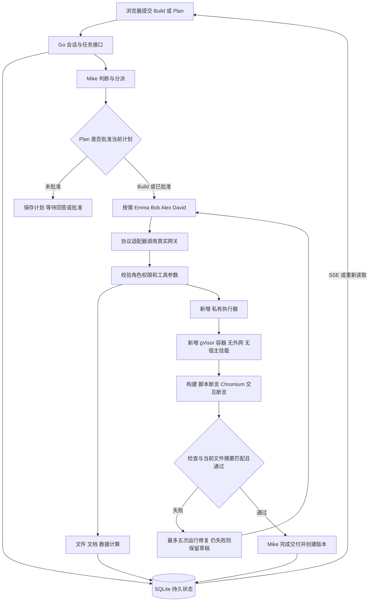
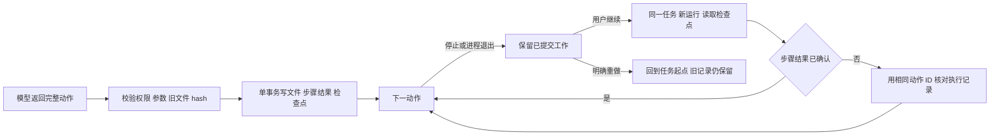
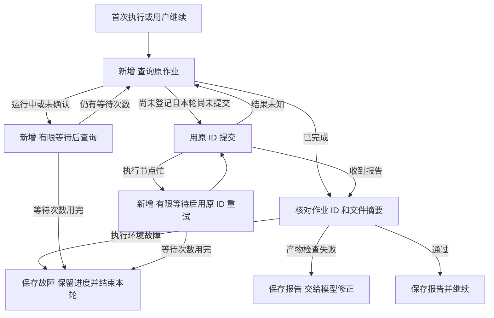
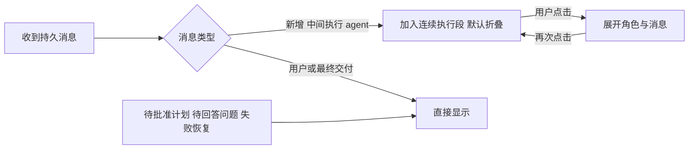
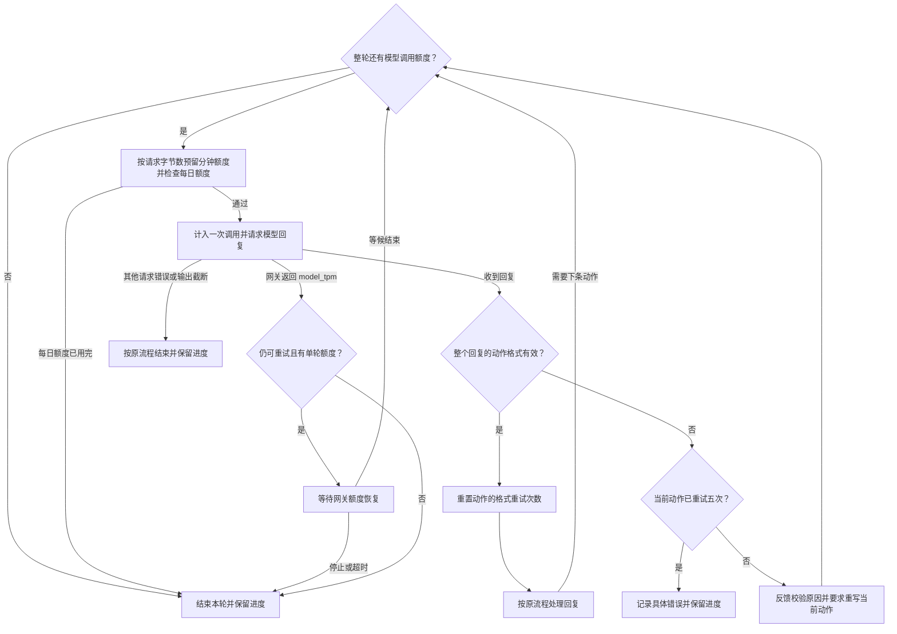

# Atoms Lab 技术设计 v0.5

本文记录实现方案，验收状态见 implementation-status.md。先前备选讨论保存在 archive/technical-design-v0.3-review.md。[交互架构图](../.archify/architecture-atoms-demo-20261111-173155/atoms-demo.html)记录 2026-11-11 确认的设计，已通过图表自动检查。

## 1. 实现与取舍

Go 服务提供接口、网页和后台任务；React/TypeScript 提供工作台；SQLite 持久保存工作区、项目状态和文件内容。五个角色按需顺序协作。Eino 的 ToolsNode 执行工具，角色循环、审批、恢复和版本由应用管理，未使用 Eino ADK Runner。模型协议支持 Chat Completions 和 Responses；实际网关使用 Chat Completions 的 JSON 动作适配。

| 部分 | 当前选择 | 可替代方案与取舍 |
|---|---|---|
| 后端 | Go net/http | Python/FastAPI 的智能体生态更丰富；Go 符合维护者经验且便于单文件部署 |
| 前端 | React/TypeScript/Vite | Vue 同样适合；Next.js 提供服务端渲染，但本工作台不依赖搜索收录，无需另一个应用服务器 |
| 调度 | 单进程后台循环，Eino ToolsNode | Eino ADK 或 LangGraph 提供更多编排能力；自管状态更容易明确本项目的原子保存和迟到结果规则，但要自行维护恢复逻辑 |
| 状态 | SQLite WAL，文件内容同库事务 | PostgreSQL + 对象存储适合多实例和大文件；本期小文件单实例用 SQLite 更简单，不能据此承诺高可用 |
| 进度 | SSE + 持久事件序号 | WebSocket 适合双向实时协作；本期控制请求用 HTTP，进度单向推送足够 |
| 工具协议 | 网关 JSON 对象输出，严格解析后执行 | JSON 模式校验整个回复。单条模型动作格式错误时最多重新生成五次 |
| 代码执行 | 独立私有执行器 + gVisor Docker 容器 | 只有静态检查无法验证行为；普通 runc 隔离较弱仅本机调试；微虚拟机隔离更强但资源与运维成本较高 |
| 依赖 | 固定 Node、esbuild、React、Playwright、Go、Python | 作业离线运行，第三方依赖随项目提供 |
| 部署 | 现有阿里云单节点，独立目录与服务 | 独立执行机能减少资源争抢；先以单作业、资源上限做真实容量测试，不购买新资源 |

## 2. 端到端流程

相对旧静态基线，新增私有执行服务、真实运行、浏览器断言和有限修复；移除访客 API Key 设置。

任务的 context 来自服务器，和浏览器请求断开无关；关闭网页不会取消已接收的执行。关闭网页会终止该浏览器中的产物预览。服务器停止后不自动重发收费调用，而是标记中断并等待用户继续。

运行使用 epoch（递增的有效代号）防止停止后的旧结果覆盖新工作。步骤 ID、文件快照和检查点一起保存；未完整提交的当前动作不称为成功。执行器以任务/角色/动作导出的 ID 去重；服务重启时未知作业返回中断报告，不盲目重跑。继续不承诺模型内部推理、尚未返回的文本或进程内存恢复。

执行工具增加先查询再提交的步骤。私有接口 `GET /jobs/{id}` 复用执行器鉴权与作业文件，返回已完成报告、`job_running`（原作业正在运行）或 `job_not_found`（尚未登记）。只有查到尚未登记时，才用原 ID 提交。执行器在读取作业文件前先占用执行名额，保证同时到达的提交不能重复启动同一作业。相同 ID 对应的提交内容发生变化时返回 `job_conflict`。

明确返回 `job_busy` 时按 2、5、10 秒等待后重试。提交结果未知后只查状态，有限等待沿用同一组时长。原作业结果未确认时不记为已完成的步骤，用户继续后仍按相同 ID 查询。报告的 `failure_code` 标识执行环境故障，例如 `container_failed` 表示容器未返回可信报告，`runner_interrupted` 表示执行器重启中断作业。此类报告保留在历史中并结束本轮，从修复次数中排除。编译和断言失败按原流程交给模型。

## 3. 实体定义

2026-11-11 新增展示规则：中间执行消息仍完整保存，前端按连续 `kind=agent` 消息分组，使用原生 details/summary 默认折叠。分组以首条消息 ID 为稳定标识，实时追加消息不会重置用户的展开选择；最终 `delivery` 消息、用户输入和待处理卡片独立显示。无需新增数据库实体。

| 实体 | 定义、例子与用途 |
|---|---|
| Workspace | 匿名会话所有者，例如浏览器 A 的项目集合；持有 HttpOnly Cookie，数据库保存令牌 hash，用于隔离项目和 blob |
| Project | 可长期迭代的工作，例如阅读清单；聚合文件、任务、消息、版本和事件 |
| Request | 带 request_id 的用户动作；相同 ID 重试不会重复启动 |
| Task | 用户的一项目标，例如增加已读筛选；包含起点快照、模式、计划、角色帧和检查点 |
| Plan | 带 revision 的计划和验收条件；批准旧 revision 无效，反馈产生新 revision |
| Run | 某任务的一次执行；记录配置摘要、次数、已报告用量、错误、起止时间和有效代号 |
| Frame | 一个角色的目标和私有模型消息；例如 Alex 接到实现表单的工作，结束后只向父角色返回结果摘要 |
| Step | 一个已确认工具动作；例如写入 app.js，记录调用 ID、参数摘要及结果，避免重复执行 |
| Checkpoint | 已提交的文件快照和步骤状态；例如两个文件已存、第三个未完成，用于续做 |
| File / Blob | 路径、类型、内容 hash 和字节数；内容按工作区保存，inputs/ 文件只读 |
| Report | 与文件集合摘要绑定的结构、运行或浏览器检查；例如 390px 下点击添加后数量为 3 |
| Version | 成功交付时的不可变文件快照和检查引用；例如 v2 新增筛选，恢复不会删除 v3 |
| Runner job | 私有执行请求和结果；同 ID 相同输入返回原结果，不同输入拒绝 |
| Model quota | 持久每日调用计数及分钟预留；失败或用量未知的调用不假定零消耗 |

## 4. 角色与信息交接

Mike 管理目标、批准和交付；Emma 处理产品需求；Bob 处理架构设计；Alex 编程与测试；David 计算数据和图表。不是固定依次调用五个角色，也不提供无作用的 Team Mode 开关。

父角色传递子任务目标、最新计划、验收约束、当前文件清单。子角色通过受控工具读取所需文件，产生文件、真实检查结果和完成摘要。模型私有协议消息保留在检查点，不作为公开思维链展示；子角色不再递归派生其他角色。所有角色使用同一部署模型，但权限不同。

## 5. 工具清单

| 工具 | 用途 / 角色 |
|---|---|
| list_files / read_file / search_files | 查询当前项目文件；所有角色 |
| check_artifacts | HTML 引用、JS/TS/CSS 语法、文档和数据结构检查；所有角色 |
| ask_user | 提出确实缺少的信息；Mike、Emma；回答回到发问帧 |
| propose_plan | 保存带 revision 的计划并暂停；Mike |
| assign_step | 分派专家，持久保存交接与返回；Mike |
| finish_task | 检查交付条件并形成版本，或只回答问题；Mike |
| write_document | 写 Markdown/文本；Emma、Bob、David |
| write_file / replace_text / delete_file | 受限路径写入、旧 hash 比较修改、删除；Alex |
| run_project | 实际构建网页、运行 JavaScript/TypeScript/Python 脚本或编译测试 Go 模块；Alex |
| test_preview | 桌面和手机 Chromium 声明式交互断言；Alex |
| analyze_table | 筛选、选列、排序、分组 count/sum/mean/min/max；David |
| create_chart | 从实际计算结果生成柱图/折线图配置；David |

没有任意宿主 Shell、联网搜索、外部数据库、任意包安装、广告投放或外部发布工具。数据结果记录输入/输出 hash 和计算参数；无效数字报错，不能悄悄按零计算。Plan 未批准时不能运行目标代码，只可写 planning/ 下的计划文档。

## 6. 运行边界与验收含义

执行器私有 HTTP 绑定回环并校验随机令牌。Go 服务和生成代码都没有 Docker socket；只有可信执行器可创建容器。生产要求 runsc，无此运行时拒绝启动。runc 必须显式开启 LOCAL_DEV 且绑定回环。

每作业独立容器：禁外网、无宿主目录和凭据、只读根文件系统、临时工作目录、进程数量和内存/CPU 上限、最长 120 秒。容器内可用回环地址做测试。可信驱动保留降权和终止子进程所需能力，生成脚本以非 root 用户运行，脚本最长 15 秒。Chromium 在外层 gVisor 内运行，未宣称浏览器内建沙箱开启。固定依赖之外的工程不能直接运行。

Go 模块使用 `run_project(kind=go, entry=go.mod)`，由执行器以固定参数顺序编译和测试。编译产物写入临时目录。镜像预编译常用标准库，每个作业复制一份缓存使用。Python 和 TypeScript 使用 `kind=script`，例如 `tools/check.py` 或 `tools/check.ts`，仍要求退出码为 0 且输出匹配断言。网页中的 TypeScript 继续随网页构建与验收。

`run` 报告附带实际执行类型，例如 Go 的 `execution=go`。交付检查按当前文件摘要匹配对应类型，Go 需要编译和测试两项成功。旧网页和 JavaScript 报告可继续用于已有产物。首次失败后可再试五次，当前运行累计六次失败后拒绝下一次执行。

网页构建成功后实际启动 Chromium；交互工具支持 click/fill/select/check/expect_text/expect_count/expect_visible，至少一个断言，桌面 1440 和手机 390 两种宽度。记录浏览器报错和横向溢出。脚本要求调用者给出预期 stdout，比较真实退出码和输出。检查通过只证明所列用例，不保证任意输入都正确。

脚本工作目录是 `/workspace/scratch`，项目文件位于 `/workspace/project`，读取相邻文件需以脚本位置解析路径（ESM 可使用 `new URL(相对路径, import.meta.url)`）。此约束已纳入工具说明，不能假设当前工作目录就是项目目录。

历史写入正文只在发送给模型时缩减为独立的只读调用记录；不把摘要说明字段塞入工具 arguments，以免模型误复制为新参数。数据库中的原始调用、正文和检查点保持不变。统计工具使用固定输出格式；模型不得自行增加用户未要求的列名约束。静态格式检查和工具来源校验不能替代对任意手写、改写文件的业务审查。

浏览器端 iframe 使用 sandbox allow-scripts allow-forms 和 CSP，形成无同源权限的预览；允许 JavaScript 拦截表单事件；由 form-action none 禁止实际表单提交，并禁止外部网络和本地持久存储。生成网页的状态仅在当前预览内存中。平台自己的项目和版本则持久保存。

文件上限 100 个、单文件 256 KiB、当前集合 2 MiB。CSV/JSON 上限为 2000 行、32 列。程序默认每轮最多调用模型 24 次、执行工具 64 次、运行 600 秒。云端每轮最多调用模型 96 次、运行 1200 秒。每日调用额度默认每个工作区 1,000 次、全站 2,000 次，已有部署以服务端环境变量 `ATOMS_WORKSPACE_DAILY_CALLS` 和 `ATOMS_DAILY_CALLS` 为准。格式重试计入同一轮的模型调用次数。触达限额时保留工作并说明原因。

## 7. 模型适配与恢复

当前网关 https://api.linhengyi.xyz/v1，模型别名 chat。实际部署设置 ATOMS_LLM_TOOL_MODE=json。模型返回一个包含 content 和 calls 的 JSON 对象；必须通过完整解析、工具白名单及参数校验，才交给 Eino 执行。不执行部分 JSON、越权工具或多动作回复。

格式重试从按整轮计数改为按当前动作计数。同一角色的回复通过格式校验后，下条动作获得五次新的重试机会。顶层 JSON 对象后出现额外说明或第二个对象时，反馈具体原因并要求模型重新输出完整对象。原有的整轮修正次数继续用于运行记录。

每次请求先按发送给网关的 JSON 字节数加上输出上限预留 Token。例如，90,000 字节的请求加 12,288 的输出上限，预留 102,288。共享网关仍可能因其他流量而拒绝请求。模型客户端把带 `insufficient_quota` 和 `model_tpm` 的 HTTP 429 识别为 `TPMThrottleError`，其中 `RetryAfter` 记录网关要求等待的时长，例如 1 秒。引擎取该时长与预计补足本次预留量的时间中的较大值，再尝试最多两次。每次重新发送经过本地分钟额度、单轮额度和每日额度检查，旧预留自然过期，未知用量不按零计。

验证覆盖格式重试重置、拒绝带多余内容的回复、五次格式重试后停止、按实际发送的字节数预留、仅对明确的 TPM 限流等待重试、两次限流重试后停止、重试计入单轮和每日额度，以及停止任务时取消等待。

原始输出保存在私有执行记录；无效动作不重复作为下一次提示正文。已保存写文件动作的历史正文用内容 hash 代替，完整文件仍由 read_file 获取，避免上下文不断膨胀。原生工具模式及 Responses 协议保留各自协议项，不冒充本次网关已验收的路径。

API Key 只从服务端环境读取，不进入前端、SQLite、提示词、产物或仓库。禁止跟随模型/执行器 HTTP 重定向。HTTP 错误中仅明确的网关 `model_tpm` 会进入上述等待重试流程。已知 usage 累加，未知用量明确显示。

## 8. 部署和验证

候选节点 47.113.231.252；域名 atoms.linhengyi.xyz。应用、执行器、数据和服务独立于既有网关。生产单执行作业，先验证 runsc 兼容、实际资源占用与既有服务可用性，再配置 Caddy HTTPS 入口。部署不修改网关模型配置或重启既有服务。

验证分四层：Go 行为测试覆盖事务/恢复/权限/批准/协议；Docker 实测覆盖构建、交互、失败断言、超时和隔离；真实模型端到端验收覆盖自由需求和角色工作；线上浏览器验证域名、持久化和完整流程。不能用模型替身测试代替真实模型验收，不能用本机 runc 通过代替云端 runsc 通过。

当前网关 JSON 模式的特殊情况：供应商可能把非 JSON 输出替换为空格，即使 finish_reason 为 stop。因此空白返回也进入单条动作的格式重试流程，已报告用量计入本轮。[供应商说明](https://api-docs.deepseek.com/guides/json_mode/)
